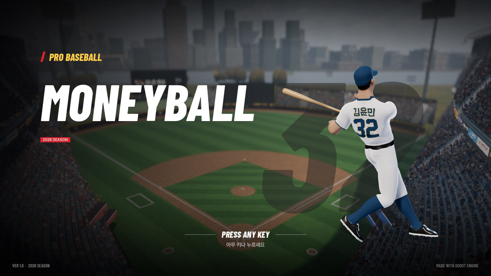
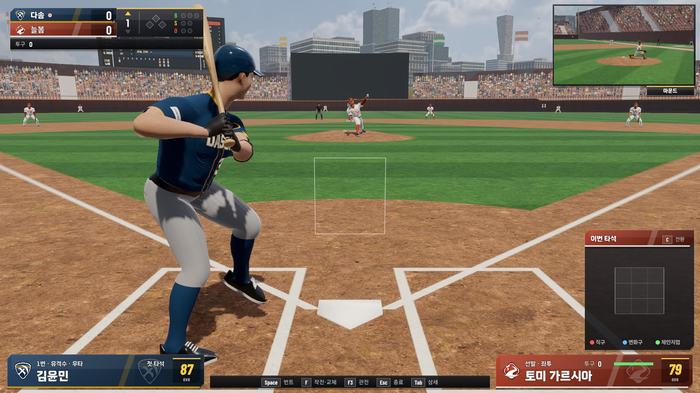

<div align="center">



# ⚾ MONEYBALL ⚾

**리얼 3D 프로야구, 당신의 야구 인생이 시작됩니다**

🏟️ KBO를 닮은 리그에서 펼쳐지는 진짜 야구 🏟️


</div>

---



## ⚾ 주요 특징

**🎓 고교 유망주에서 명예의 전당까지**<br>
고교 주말리그에서 이름을 알리고 드래프트 지명을 받으세요. 퓨처스리그에서 실력을 쌓아 1군에 오르고, 연봉 협상과 FA를 거쳐 은퇴식의 주인공이 되어 보세요. 데뷔 첫 안타부터 통산 2000안타까지, 기록을 세울 때마다 기념구가 진열장에 쌓입니다.

**📋 KBO식 신인 드래프트**<br>
10개 구단, 11라운드. 지난 시즌 순위의 역순으로 지명합니다. 스카우트의 평가가 빗나갈 수도 있습니다.

**🌱 선수마다 다른 성장**<br>
모든 선수에게는 숨은 잠재력이 있습니다. 나이와 출전 기회에 따라 성장 속도가 달라지고, 경기 중에 새 구종을 익히기도 합니다.

**🧢 1군과 2군을 오가는 시즌**<br>
좋은 성적은 콜업으로, 부진은 말소로 이어집니다. 2군 유망주를 키워 올리고, 트레이드 마감 전에 승부수를 던지세요.

**🧤 승부처에서는 직접**<br>
감독으로 작전을 지시하다가, 경기가 걸린 순간에는 직접 타석과 마운드에 오르세요.

**📜 다시 쓰는 KBO 역사**<br>
역사에 남은 시즌을 그해의 구단과 규칙 그대로 다시 플레이할 수 있습니다.

---

## 🎮 모드

| | |
|---|---|
| ⚾ **친선 경기** | 원하는 구단과 구장을 골라 바로 한 경기 |
| 🏆 **리그 모드** | 구단을 맡아 우승에 도전하세요. 트레이드, 올스타전, 포스트시즌, 그리고 마운드 위의 헹가래까지 |
| 🌟 **전설의 시작** | 나만의 선수를 만들어 프로 무대에 도전하세요 |
| 📜 **역사적 시즌** | 그 시절 그 구단으로 다시 펼치는 명승부 |
| 🎯 **연습 모드** | 타격과 투구를 원하는 만큼 연습하세요 |

---

## 📦 다운로드

[Releases](../../releases/latest)에서 `Moneyball-1.0.0-windows.zip`을 받아 압축을 풀고 `Moneyball.exe`를 실행하세요.

- Windows 10/11 64비트, Vulkan을 지원하는 그래픽 카드 (GTX 1060급이면 1080p 60fps)
- 긴 연출은 스페이스바로 건너뛸 수 있습니다.
- 저장 데이터는 `%APPDATA%\Godot\app_userdata\Moneyball\`에 남습니다.

## ▶️ 소스로 실행

```bash
./dev play      # 게임 실행
./dev release   # 배포판 만들기 (build/release/)
```

[게임 구성](docs/01-game-design.md) · [기술 문서](docs/) · [개발 기록](docs/10-history.md)

<sub>넥슨에서 서비스했던 온라인 야구 게임 「프로야구 2K14」(서비스 종료)를 참고해 만든 개인 비상업 프로젝트입니다. 참고작의 이름·화면·에셋은 사용하지 않았습니다. 게임 속 선수·구단은 가상이며, 실제 시즌 팩의 구단·선수 이름도 실제와 다르게 바꾼 이름입니다. 외부 자료의 출처와 이용 조건은 배포판의 `CREDITS.txt`, 각 폴더의 LICENSE와 `game/assets/CREDITS.md`에 있습니다. 비상업 조건(CC BY-NC-SA 4.0)의 자료가 들어 있어 판매할 수 없습니다.</sub>
