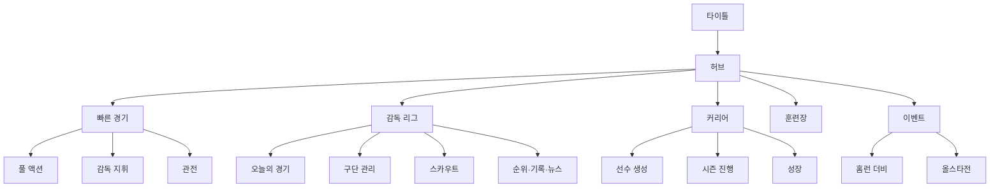
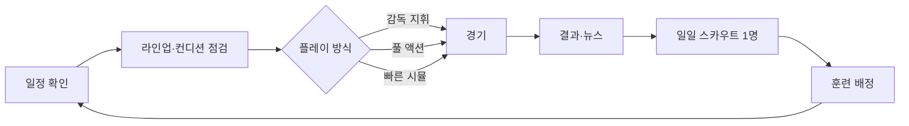

# 02. 게임 구성

모드, 리그, 구단 운영, 커리어, 연출의 설계. 수치는 모두 초기값이며 데이터 파일(`game/data/*.json`)에 두어 코드 수정 없이 조정한다.

## 1. 설계 기둥

1. **한 경기 10~15분.** 참고작이 40분에서 시작해 세 번 줄인 끝에 도달한 길이다. 모든 모드의 기본 설정이 이 예산 안에 들어와야 한다.
2. **지켜보다가 뛰어든다.** 경기는 시뮬레이션으로 흐르고, 플레이어는 승부처에서 직접 치고 던진다. 전환에 로딩이나 화면 단절이 없다.
3. **한 선수의 야구 인생.** 커리어 모드는 선수 한 명의 타석과 수비만 플레이한다.
4. **설명할 수 있는 능력치.** 능력치는 공개된 산식으로 기록에서 계산한다. 누가 왜 그 등급인지 답할 수 있다.
5. **야구장에 있는 느낌.** 중계 카메라, 관중의 반응, 장내 아나운스. 소리와 카메라에 투자한다.

## 2. 모드 구성

| 모드 | 한 줄 설명 | 참고작의 대응 요소 |
|---|---|---|
| 빠른 경기 | 팀 둘을 골라 한 경기. 플레이 방식 3종 | 싱글플레이, 친선 경기 |
| 감독 리그 | 구단을 운영하며 승강 리그를 치른다 | 페넌트레이스 + 슈퍼심 |
| 커리어 | 선수 한 명을 만들어 키운다 | 마이플레이어 |
| 훈련장 | 튜토리얼과 자유 연습 | 튜토리얼 |
| 이벤트 | 홈런 더비, 올스타전 | 홈런레이스, 올스타전 |

1차 범위는 **싱글플레이 전용**이다. 온라인 대전, 과금, 서버는 범위 밖이다.

## 3. 경기 플레이 방식과 시간 예산

| 방식 | 플레이어가 하는 일 | 9이닝 예상 시간 |
|---|---|---|
| 풀 액션 | 모든 투구와 타격, 수비, 주루를 직접 | 25~35분 (3이닝 약 10분, 6이닝 약 20분) |
| 감독 지휘 | 시뮬레이션을 관전하며 작전 지시. 경기당 3회 직접 개입 | 10~15분 |
| 관전 | 지켜보기만. 속도 조절 가능 | 4~12분 |
| 빠른 시뮬 | 결과만 받는다 (리그 전용) | 즉시 |
| 커리어 경기 | 내 선수의 장면만 | 5~10분 |

이닝 수는 3·6·9 중 선택한다. 감독 리그 공식 경기는 9이닝 고정이다.

**시간을 지키는 장치**

- 감독 지휘의 관전 구간은 "타석 요약 재생"이 기본이다. 결과가 나는 투구만 보여 주고 나머지 투구는 볼카운트 표시로 넘긴다. 한 타석 평균 8~10초
- 승부처(레버리지 지수 2.0 이상)에서만 전체 투구를 보여 준다
- 이닝 교대, 타석 진입 연출은 2초 이내. 버튼 하나로 건너뛴다
- 작전과 개입은 "예약"할 수 있다. 예: "주자 득점권에 나가면 알려 줘", "7회 이후 동점이면 개입"

## 4. 감독 리그

### 4.1 구조

- 디비전 3개 × 10팀 = 가상 구단 30개. 플레이어는 3부에서 시작한다
- 시즌 길이는 시작할 때 고른다: 짧게 36경기 / 표준 72경기 / 풀 144경기. 같은 디비전의 9팀과 각각 4·8·16번 만난다
- 포스트시즌은 계단식이다(아래 순위끼리 먼저 붙고 승자가 한 칸씩 올라간다). **1부는 실제 KBO 방식의 5팀**: 와일드카드 결정전(5위 대 4위, 4위가 1승을 안고 시작. 최대 2경기) → 준플레이오프(5전 3선승) → 플레이오프(5전 3선승) → 한국시리즈(7전 4선승). 2부 이하는 상위 4팀이 3전 2선승·5전 3선승·7전 4선승. 역사적 시즌은 그해 방식을 따른다
- 우승팀과 준우승팀이 승격, 하위 2팀이 강등. 1부 우승이 최종 목표다
- 다른 팀의 경기는 통계 해석기로 즉시 계산한다. 다른 디비전도 같이 돌아간다
- 시즌 종료 시 시상: MVP, 투수상, 신인상, 포지션별 베스트, 타이틀 홀더

### 4.2 하루의 흐름

허브에서 "오늘의 경기"까지 클릭 2번, 경기 종료 후 다음 날까지 클릭 3번 이내로 만든다.

### 4.3 직접 개입

- 감독 지휘 중 **경기당 3회** 개입할 수 있다. 개입하면 그 타석(공격) 또는 그 타자 상대(수비)를 풀 액션으로 플레이한다
- 작전 지시는 횟수 제한이 없다
- 개입 버튼은 항상 화면에 있고, 승부처가 오면 강조된다
- 포스트시즌은 5회로 늘린다
- 빠른 경기의 감독 지휘는 횟수를 설정할 수 있다(0, 3, 5, 무제한)

### 4.4 작전 지시

| 공격 | 수비 |
|---|---|
| 강공 / 기다리기 / 번트 / 스퀴즈 | 투수 교체 / 불펜 준비 |
| 도루 / 더블 스틸 | 고의사구 |
| 히트 앤드 런 / 런 앤드 히트 | 전진 수비 / 병살 수비 / 깊은 수비 |
| 대타 / 대주자 | 외야·내야 시프트 |
| 주루 성향(적극·보통·안전) | 견제 지시 / 피치아웃 |
| | 승부·유인구 위주·정면 승부 |

경기 전에 팀 전략(공격 성향, 투수 교체 기준, 주루 성향)을 정해 두면 AI 감독이 그 기준으로 움직인다.

## 5. 구단 운영

### 5.1 로스터

| 항목 | 규칙 |
|---|---|
| 1군 | 26명. 투수 11~14명, 야수 12~15명 |
| 2군 | 최대 34명. 총 보유 60명 |
| 타순 | 9명 + 지명타자 사용. 상대 선발이 좌완일 때와 우완일 때의 타순을 따로 저장 |
| 투수 보직 | 선발 5, 롱릴리프, 미들릴리프, 셋업, 마무리. 보직별 인원은 자유 |
| 자동 구성 | 버튼 하나로 코스트 상한 안에서 추천 로스터 |

### 5.2 등급과 코스트

종합 능력치(OVR)로 등급이 정해지고, 등급이 코스트를 정한다. 디비전마다 1군 코스트 합계 상한이 있다.

| 등급 | OVR | 코스트 |
|---|---|---|
| S | 85 이상 | 7 |
| A | 75~84 | 5 |
| B | 65~74 | 3 |
| C | 55~64 | 2 |
| D | 54 이하 | 1 |

| 디비전 | 1군 코스트 상한 |
|---|---|
| 3부 | 60 |
| 2부 | 75 |
| 1부 | 90 |
| 빠른 경기 | 제한 없음 |

상한 60이면 C급 26명(52)에 B급 몇 명을 더하는 수준이다. 승격할수록 스타를 더 넣을 수 있다.

### 5.3 선수 수급

| 방식 | 내용 |
|---|---|
| 일일 스카우트 | 매일 후보 5명이 제시되고 1명을 영입한다. 후보의 등급 분포는 디비전과 스카우트 레벨에 따른다 |
| 스카우트 리포트 | 경기 보상으로 얻는 무작위 영입권. 포지션·유형을 지정하는 상위 리포트도 있다 |
| 트레이드 인 | 보유 선수 2~5명을 내고 새 선수 1명을 받는다. 낸 선수의 코스트 합이 결과 등급의 확률을 정한다 |
| 방출 | 소량의 포인트로 환급 |
| 커리어 졸업 | 커리어 모드에서 키운 선수를 등록 |

현금 결제는 없다. 재화는 경기로 버는 포인트 하나다.

### 5.4 육성

| 시스템 | 설계 |
|---|---|
| 훈련 | 매일 3명까지 배정. 타자는 타격·주루·수비, 투수는 구위·제구·변화. 잠재력 한도까지 오른다 |
| 잠재력 | 선수마다 능력치별 상한. 나이에 따라 성장 속도가 다르다(젊을수록 빠름) |
| 특성 | 선수당 1개 장착. 같은 특성 2개를 합쳐 상위 단계로. 3단계까지 |
| 컨디션 | 5단계(최상·좋음·보통·나쁨·최악). 능력치에 +6·+3·0·−3·−6% |
| 체력 | 투수는 등판 후 회복 일수 필요. 야수는 연속 출장 시 컨디션 하락 확률 증가 |

**특성 목록 (초기안)**

| 타자 | 효과 | 투수 | 효과 |
|---|---|---|---|
| 정교함 | 컨택 상승, 삼진 감소 | 탈삼진 | 2스트라이크 후 구위 상승 |
| 장타 | 파워 상승 | 땅볼 유도 | 낮은 코스 무브먼트 상승 |
| 테이블세터 | 출루 시 주루 상승 | 뜬공 유도 | 높은 코스 구위 상승 |
| 준족 | 주력·도루 상승 | 정밀 제구 | 제구 상승 |
| 만능 | 모든 수비 위치 적성 상승 | 뒷문 | 8회 이후 리드 상황 능력 상승 |
| 철벽 | 수비 범위·포구 상승 | 이닝 소화 | 체력 상승, 피로 누적 감소 |
| 균형 | 전 능력치 소폭 상승 | 균형 | 전 능력치 소폭 상승 |
| 해결사 | 득점권 컨택·파워 상승 | 위기 탈출 | 득점권 제구·구위 상승 |

부상은 넣지 않는다. 참고작과 같은 판단이다. 컨디션과 체력이 로테이션을 강제하는 역할을 한다.

### 5.5 팀 컬러

로스터 구성이 조건을 채우면 팀 전체가 보너스를 받는다. 참고작의 팀 시너지가 특정 조합으로 메타를 고정시킨 문제를 피하려고 세 가지 제한을 둔다.

- 보너스 합계는 능력치 +5를 넘지 않는다
- 동시에 적용되는 팀 컬러는 2개까지
- 조건이 서로 다른 방향을 가리키게 한다

| 팀 컬러 | 조건 (1군 기준) | 보너스 |
|---|---|---|
| 발야구 | 주력 70 이상 야수 6명 | 도루 성공률, 추가 진루 |
| 대포 군단 | 파워 75 이상 4명 | 파워 +2~3 |
| 그물망 수비 | 수비 범위 70 이상 6명 | 수비 범위·포구 +2~3 |
| 선발 왕국 | B급 이상 선발 4명 | 선발 체력 |
| 철벽 불펜 | B급 이상 불펜 5명 | 불펜 제구 |
| 프랜차이즈 | 같은 출신 구단 선수 10 / 15 / 20명 | 전 능력치 +1 / +2 / +3 |
| 육성 구단 | 직접 키워 등급이 오른 선수 8명 | 성장 속도 |

## 6. 커리어 모드

### 6.1 선수 생성

1. 이름, 등번호, 투타 방향, 외형(체형·피부·헤어·수염·장비)
2. 포지션: 선발, 구원, 마무리, 포수, 1루수, 2루수, 3루수, 유격수, 좌익수, 중견수, 우익수
3. 유형: 시작 능력치 배분과 성장 비용 할인을 정한다

| 타자 유형 | 강점 | 투수 유형 | 강점 |
|---|---|---|---|
| 정교형 | 컨택, 선구안 | 강속구형 | 구속, 구위 |
| 거포형 | 파워 | 제구형 | 제구 |
| 쌕쌕이형 | 주력, 주루 | 기교형 | 변화, 구종 수 |
| 수비형 | 수비 범위, 포구, 송구 | 땅볼형 | 낮은 코스, 싱커 계열 |
| 만능형 | 고른 배분 | 뜬공형 | 높은 코스 직구 |

4. 팀 선택. 로스터 팩을 넣었다면 기존 선수를 골라 포지션을 바꿔 시작할 수도 있다

### 6.2 한 경기의 흐름

- 내 타석, 내가 주자로 있는 상황, 내 쪽으로 온 타구만 플레이한다
- 그 사이는 **상황판**으로 지나간다. 점수표와 양 팀 타순이 보이고, 내가 관여하지 않는 타석의 결과가 한 줄씩 쌓인다([05](05-controls-camera-ui.md#35-상황판))
- 내 장면이 오면 **장면 카드**가 뜬다. 현재 점수와 상황, 그리고 이번 장면의 목표 하나("유리한 볼카운트 만들기", "주자를 진루시키기", "이 타자를 삼진으로")가 적혀 있다. 버튼을 누르면 3D 장면으로 들어간다
- 야수: 타석 4~5회 + 수비 기회 3~6회. 약 6~8분
- 선발 투수: 모든 타자를 상대하면 길다. 기본은 "주요 타자만"(득점권, 중심 타선, 이닝 첫 타자), 나머지는 내 능력치로 시뮬레이션. 설정에서 "전부 직접"으로 바꿀 수 있다
- 구원·마무리: 등판한 이닝만. 약 3~5분
- 수비는 **내 포지션에서 보는 카메라**로 한다. 투수는 던진 뒤 수비 책임(1루 커버, 번트 처리)도 진다
- 출루하면 직접 주루한다. 리드, 도루, 진루 판단
- 감독의 사인(번트, 도루, 히트 앤드 런)이 내려오고, 따르면 보너스가 있다

### 6.3 성장

- 목표는 두 겹이다. 장면마다 장면 목표 1개, 경기 전체에 경기 목표 1개(안타 2개, 6이닝 2실점 이하 등). 달성하면 성장 포인트(GP)
- 성적 자체에도 GP가 붙는다(안타, 타점, 호수비, 탈삼진)
- **GP는 분야별로 따로 쌓인다**: 타격, 수비, 주루, 투구. 그 분야의 플레이로만 얻고 그 분야의 능력치에만 쓴다. 타격만 잘해서는 수비가 오르지 않는다
- 승부처에서 성공하면 추가 GP와 인기도
- 경기가 끝나면 **경기 평점**(0~10)이 매겨지고 평점에 따라 메달 등급(동·은·금)이 정해진다. 메달 등급의 보상 상자에서 포인트, GP 부스트, 장비를 하나 뽑는다
- GP를 능력치에 쓴다. 높을수록 비싸다: 다음 1포인트의 비용 = `기본 × (1 + (현재값 − 40)/20)²`. 유형의 강점 능력치는 20% 할인
- 성장 화면에는 선수의 상반신이 3D로 보이고, 능력치마다 현재 값, 조절 버튼, 다음 단계 비용, 목표 값이 한 줄로 나온다
- 투수는 구종별로 구속·제구·변화를 따로 키운다
- **구종 진화**: 구종의 숙련도(사용 횟수와 결과)와 관련 능력치가 조건을 넘으면 상위 구종으로 바뀐다. 예: 체인지업 → 서클 체인지업, 슬라이더 → 스위퍼 또는 고속 슬라이더, 커브 → 파워 커브, 포심 → 라이징 패스트볼
- **신규 구종**: GP와 시즌 중 훈련 기간을 써서 배운다. 최대 6개
- **선구안 효과**: 선구안이 오르면 투구 직후 구종 힌트와 예상 도달 지점이 더 일찍, 더 정확하게 표시된다. 능력치 성장이 화면에서 체감되는 장치다
- **기회 타석 표시**: 투수가 흔들릴 때(연속 볼, 피로) 타석에 표시가 뜨고 타격 판정이 넓어진다

### 6.4 시즌과 경력

- 시즌 길이는 36 / 72 / 144경기 중 선택
- 2군에서 시작한다. 성적과 능력치가 기준을 넘으면 1군에 올라간다
- 인기도는 성적과 승부처 활약으로 오른다. 시즌 중반에 인기도와 성적 상위 22명이 올스타전에 뽑힌다
- 시즌 종료 후 계약 갱신. 이적 제안을 받을 수 있다
- 은퇴하거나 원하는 시점에 "졸업"시키면 감독 리그의 선수로 등록된다

## 7. 이벤트

| 이벤트 | 규칙 |
|---|---|
| 홈런 더비 | 8명, 3라운드 토너먼트. 라운드당 아웃 10개(홈런이 아닌 스윙이 아웃). 동점이면 최장 비거리. 홈런 수와 비거리에 따라 보상 |
| 올스타전 | 두 팀 각 11명. 풀 액션 또는 감독 지휘. MVP에게 특별 보상 |
| 명장면 도전 | 미리 짜인 상황(9회말 2사 만루 등)을 해결. 훈련장 졸업 과제 겸 일일 과제 |

## 8. 훈련장

타격(컨택 → 파워 → 번트 → 코스 예측), 투구(기본 → 견제 → 고급 조작), 수비(내야 → 외야 → 병살·다이빙·펜스 플레이), 주루(전체 → 선택 → 도루). 기본을 끝내야 심화가 열린다. 설명은 화면 하단에 한 번에 한 가지씩, 설명 후 3~5회 연습. 완료 보상은 처음 한 번만.

자유 연습: 구종·구속·코스를 지정한 타격 연습, 불펜 투구, 타구 유형을 지정한 수비 연습.

## 9. 재화와 보상

| 재화 | 얻는 곳 | 쓰는 곳 |
|---|---|---|
| 포인트 | 경기 결과, 일일 과제, 도전 과제, 시즌 순위 | 스카우트 리포트, 훈련 추가, 특성 합성 |
| 성장 포인트(GP) | 커리어 경기 | 커리어 선수 능력치 |

보상 수령은 경기 결과 화면에서 한 번에 끝낸다. 별도 수령함을 거치지 않는다.

## 10. 연출

| 요소 | 설계 |
|---|---|
| 카메라 | 중계 구도가 기본. 상세는 [05](05-controls-camera-ui.md#4-카메라) |
| 중계 | 1차는 텍스트 중계(화면 하단 한 줄). 문구는 상황별 템플릿을 새로 쓴다. 음성은 후순위 |
| 장내 아나운스 | 타자 소개, 투수 교체. 합성 음성 또는 텍스트 |
| 관중 | 흥분도 값(점수 차, 이닝, 주자, 볼카운트로 계산)에 따라 소리와 움직임이 변한다 |
| 응원 | 본체에는 북·호루라기 리듬과 구호를 새로 만들어 넣는다. 로컬 콘텐츠 팩에 팀별·선수별 음원 슬롯이 있어 가지고 있는 음원을 넣으면 재생된다 |
| 승부처 연출 | 레버리지 지수가 높으면 카메라가 좁아지고 관중 소리가 올라가며 심장 박동 효과음 |
| 리플레이 | 홈런, 호수비, 삼진, 득점 직후 다른 각도로 다시 보여 준다 |
| 전광판 | 이닝별 점수, 타자 기록, 구속을 경기 중 실제로 표시 |
| 기록 화면 | 박스 스코어, 타구 분포도, 투구 분포도 |

## 11. 난이도와 보조 옵션

| 난이도 | 타격 타이밍 창 | 투구 정확도 영역 | AI 수준 |
|---|---|---|---|
| 쉬움 | ±90ms | 넓음 | 실투 많음, 유인구에 잘 속음 |
| 보통 | ±65ms | 보통 | 능력치대로 |
| 어려움 | ±45ms | 좁음 | 볼배합 학습, 약점 공략 |
| 리얼 | ±30ms | 매우 좁음 | 능력치 보정 없음 |

보조 옵션은 난이도와 별개로 켜고 끈다.

| 옵션 | 켜면 | 기본 |
|---|---|---|
| 포수 리드 | 포수가 구종과 코스를 제시 | 켬 |
| 코스 예측 | 타격 전 코스를 찍는다. 맞으면 판정 확대와 비거리 증가, 틀리면 축소 | 끔 |
| 타격 조준 | 타이밍만 / 타이밍 + 상하 조준 / 타이밍 + 전 방향 조준 | 타이밍만 |
| 투구 조작 | 간편(게이지) / 고급(제스처) | 간편 |
| 수비 이동 | 자동 / 보조 / 수동 | 자동 |
| 송구 | 자동 / 수동 | 수동 |
| 주루 | 자동 / 수동 | 자동 |
| 궤적 표시 | 투구 궤적 잔상, 타구 낙하 지점 표시 | 켬 |

고급 조작은 어렵지만 보상이 있다. 고급 투구는 완벽 판정 시 구위 보너스가 더 크고, 전 방향 조준 타격은 정타 시 타구 속도 보너스가 있다.

## 12. 1차 범위 밖

온라인 대전과 랭킹, 현금 결제, 부상, 벤치 클리어링, 비디오 판독, 음성 해설, 모바일.

실명 선수·구단·구장은 게임 본체에 넣지 않고 로컬 콘텐츠 팩으로 넣는다([09](09-content-acquisition.md)). 이 문서의 모든 시스템은 가상 리그와 실제 리그 팩 양쪽에서 똑같이 동작한다.
