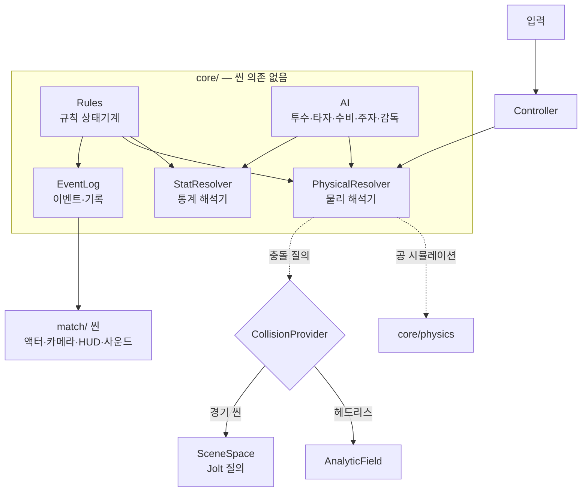
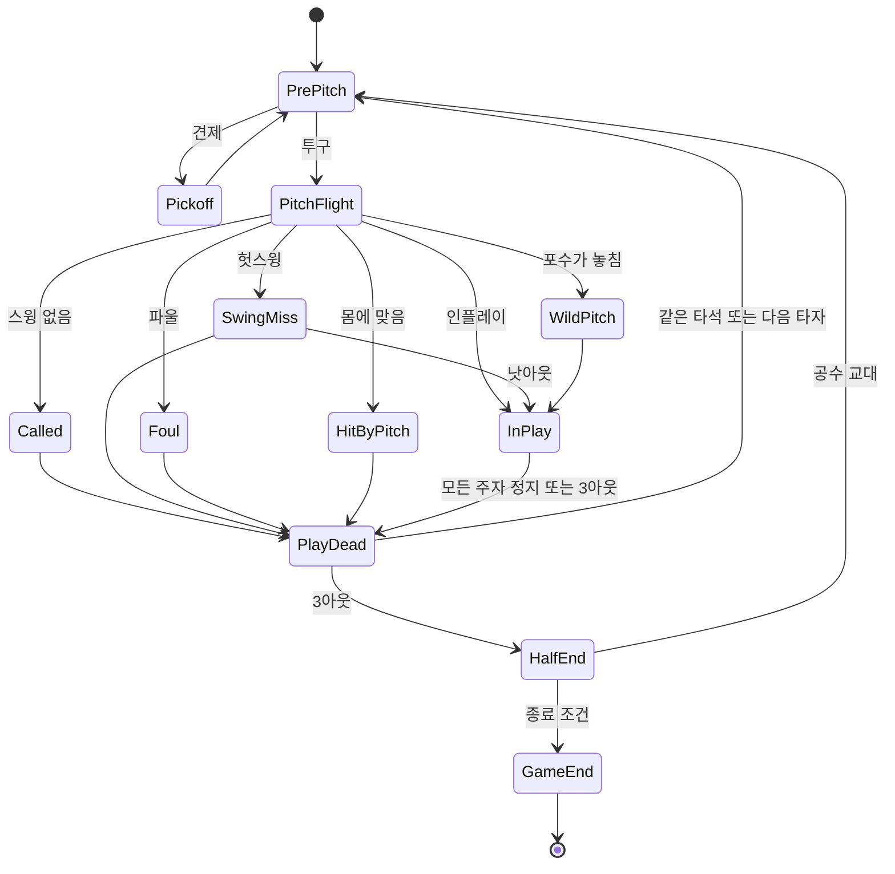
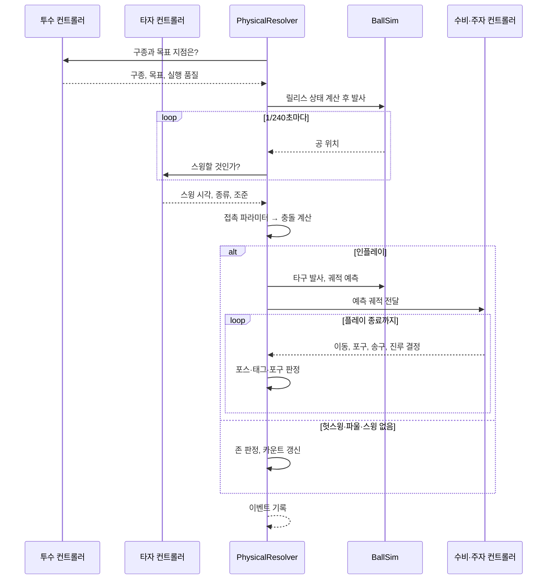

# 03. 경기 엔진

야구 규칙, 타석 결과 계산, AI, 작전·개입, 기록을 담당하는 `core/` 영역의 설계. 이 영역의 클래스는 `RefCounted`만 상속하고 노드·씬·렌더링에 의존하지 않는다. 그래서 헤드리스로 수천 경기를 돌릴 수 있다.

## 1. 구조



- **Rules**는 "지금 몇 회, 몇 아웃, 누가 어디 있나"와 "이 사건 뒤에 상태가 어떻게 바뀌나"만 안다
- **해석기**는 "이 타석(또는 이 투구)에서 무슨 일이 일어났나"를 결정한다. 통계 해석기와 물리 해석기가 같은 인터페이스를 구현한다
- **Controller**는 선수의 의사결정 주체다. 사람 입력 또는 AI가 같은 인터페이스를 구현한다. 개입은 컨트롤러를 AI에서 사람으로 바꾸는 것이다
- **EventLog**가 유일한 출력이다. 씬은 이벤트를 받아 그린다. 씬이 경기 상태를 바꾸는 일은 없다

## 2. 경기 상태

```gdscript
class_name GameState
extends RefCounted

var inning: int = 1
var half: int = Half.TOP            # TOP / BOTTOM
var outs: int = 0
var balls: int = 0
var strikes: int = 0
var bases: Array[int] = [-1, -1, -1]   # 각 루의 주자 선수 ID, 없으면 -1
var score: Array[int] = [0, 0]         # 원정, 홈
var lineup_pos: Array[int] = [0, 0]    # 팀별 현재 타순 인덱스
var teams: Array[TeamInGame]           # 타순, 수비 위치, 투수, 벤치, 불펜, 교체 이력
var pitch_counts: Dictionary           # 투수 ID -> 투구 수
var fatigue: Dictionary                # 투수 ID -> 0.0 ~ 1.0
var responsible_pitcher: Dictionary    # 주자 ID -> 책임 투수 ID (자책점 계산)
var rules: RuleSet                     # 이닝 수, 연장 한도, DH, 스트라이크 존 설정
var rng: Rng                           # 시드 고정 난수
```

`GameState`는 `duplicate_state()`로 통째로 복사할 수 있어야 한다. AI가 "이 작전을 쓰면 어떻게 될까"를 미리 돌려 볼 때 쓴다.

## 3. 진행 상태기계



도루는 `PitchFlight`와 겹쳐 진행된다. 주자는 독립된 작은 상태기계(리드 → 스타트 → 주행 → 슬라이딩 → 세이프·아웃)를 가진다.

## 4. 규칙 구현 범위

| 분류 | 포함 | 1차 제외 |
|---|---|---|
| 카운트 | 볼넷, 삼진, 2스트라이크 파울, 2스트라이크 번트 파울 삼진, 낫아웃 | |
| 스트라이크 존 | 타자 신장 비례 자동 판정(ABS 방식). [04](04-physics.md#6-스트라이크-존) | 심판별 존 차이 |
| 아웃 | 포스, 태그, 플라이, 병살·삼중살, 인필드 플라이, 주루사, 견제사 | 수비 방해, 주루 방해, 어필 플레이 |
| 진루 | 태그업, 희생 플라이·번트, 도루, 폭투·포일, 실책 진루, 인정 2루타, 홈런 | 보크 |
| 투수 | 승·패·세이브·홀드 판정, 자책점, 고의사구(자동), 견제 | 투구 시간 제한(옵션으로 추후) |
| 교체 | 대타, 대주자, 대수비, 투수 교체, 재출장 금지, 지명타자 소멸 | 더블 스위치의 타순 선택 UI |
| 종료 | 9회(3·6 선택), 말 공격 생략, 끝내기, 연장 한도(기본 11회, 설정 가능), 무승부 | 서스펜디드, 콜드 게임 |
| 판정 | 세이프·아웃, 페어·파울, 홈런 여부 | 비디오 판독 |

기록 규칙(타점, 자책점, 실책, 승리 투수 등)은 사례별 테스트로 고정한다. 참고작에 병살타에 타점이 붙는 버그가 있었다. 이런 사례를 테스트 목록에 넣는다.

## 5. 해석기 두 개

```gdscript
class_name Resolver
extends RefCounted

## 다음 한 단위를 진행하고 이벤트를 반환한다.
func step(state: GameState) -> Array[GameEvent]:
    return []
```

| | 통계 해석기 | 물리 해석기 |
|---|---|---|
| 단위 | 타석 | 투구 → 타구 → 수비 → 주루 (연속 시간) |
| 입력 | 타자·투수의 결과 확률 | 능력치 + 컨트롤러의 결정(사람 또는 AI) |
| 계산 | 확률 추첨 | 공 물리 시뮬레이션 + 선수 운동 모델 |
| 속도 | 경기당 1ms 수준 | 실시간. 헤드리스 가속 시 경기당 몇 초 |
| 쓰는 곳 | 다른 팀의 리그 경기, 빠른 시뮬, 커리어의 건너뛰는 구간 | 화면에 보이는 모든 경기 |

둘은 같은 리그 평균 분포에 맞춘다. 같은 두 팀이 붙으면 어느 해석기로 돌려도 장기적으로 비슷한 기록이 나와야 한다. 이것이 [13절](#13-보정과-검증)의 검증 대상이다.

한 경기 안에서 해석기를 바꿀 수 있다. 감독 지휘의 "타석 요약" 구간도 화면에 결과 투구가 보이므로 물리 해석기를 쓴다. 통계 해석기는 화면에 전혀 보이지 않는 구간에만 쓴다.

## 6. 통계 해석기

### 6.1 타석 결과

결과 9종: 삼진, 볼넷, 사구, 홈런, 3루타, 2루타, 단타, 땅볼 아웃, 뜬공 아웃.

타자의 결과별 비율 `b`, 투수의 허용 비율 `p`, 리그 평균 `l`을 오즈 비 방식으로 결합한다.

```
x[o] = b[o] × p[o] / l[o]
P(o) = x[o] / Σ x
```

타자와 투수가 모두 평균이면 리그 평균이 나오고, 삼진 많은 타자와 삼진 잡는 투수가 만나면 둘의 효과가 곱해진다.

### 6.2 리그 평균 (표준 환경, 타석당)

| 결과 | 비율 | 결과 | 비율 |
|---|---|---|---|
| 삼진 | 18.5% | 2루타 | 4.3% |
| 볼넷 | 9.0% | 3루타 | 0.4% |
| 사구 | 1.2% | 홈런 | 2.3% |
| 단타 | 16.7% | 인플레이 아웃 | 47.6% |

위 표는 처음 추정값이다. 구현(S4)에서는 KBO 기록실의 2025 정규시즌 합계로 바꿨다(삼진 19.8%, 볼넷 9.2%, 사구 1.45%, 안타 23.0%, 홈런 2.14%. [12의 8.1](12-baseball-reference.md#81-타석-결과-타석당)). 값은 `data/league_env.json`의 `kbo_2025`에 있다.

| 환경 프리셋 | 타율 | OPS | 팀당 경기당 득점 | 평균자책점 | 근거 |
|---|---|---|---|---|---|
| 타고투저 | .277 | .772 | 5.38 | 4.91 | 2024 시즌 |
| 표준 (기본) | .268 | .746 | 약 5.0 | 약 4.55 | 두 값의 중간 |
| 투고타저 | .259 | .717 | 4.59 | 4.20 | 2025 시즌 전반기 |

출처: [스포츠경향 2025-07-16](https://sports.khan.co.kr/article/202507161349003).

### 6.3 능력치 → 비율

능력치는 1~99, 리그 평균 50, 표준편차 15다. 비율은 로그 선형으로 바꾼다.

```
rate = league_rate × exp(k × (rating − 50) / 15)
```

| 비율 | 능력치 | k | 평균보다 1σ 높을 때 |
|---|---|---|---|
| 타자 삼진 | 컨택 | −0.28 | 삼진 24% 감소 |
| 타자 볼넷 | 선구안 | +0.30 | 볼넷 35% 증가 |
| 타자 홈런 | 파워 | +0.45 | 홈런 57% 증가 |
| 타자 2·3루타 | 파워, 주력 | +0.18, +0.10 | |
| 타자 인플레이 안타 | 컨택, 주력 | +0.06, +0.03 | BABIP 약 .320 → .340 |
| 투수 삼진 | 구위 | +0.28 | |
| 투수 볼넷 | 제구 | −0.32 | |
| 투수 홈런 | 구위, 땅볼 성향 | −0.20, −0.15 | |

보정: 좌우 상성(같은 손 대결은 투수 유리), 컨디션, 투수 피로, 특성, 팀 컬러, 구장 보정, 수비진의 범위 합(인플레이 안타 확률).

### 6.4 타구 후 처리

- 땅볼 아웃: 1루 주자가 있고 2아웃 미만이면 병살 확률(기본 11%, 타자 주력과 내야 수비로 보정). 그 외 주자는 진루표에 따라
- 뜬공 아웃: 3루 주자 태그업 득점 확률(외야 깊이 분포 × 주력 × 외야수 송구)
- 안타: 주자별 추가 진루 확률표(1루 주자의 단타 시 3루 진루 약 28%, 2루 주자의 단타 시 득점 약 60%). 주력과 외야수 송구로 보정
- 실책: 인플레이 타구당 약 1.5%, 수비수 포구 능력으로 보정
- 도루: 시도 확률은 감독 성향·주력·상황, 성공률은 주력 대 투수 견제·포수 송구
- 투구 수: 타석당 결과별 평균(삼진 4.8, 볼넷 5.6, 인플레이 3.3)에서 추첨해 피로에 반영

## 7. 물리 해석기

한 투구의 처리 순서.



세부 수치와 수식은 [04 물리](04-physics.md)에 있다. 여기서는 판정 로직만 적는다.

| 판정 | 방법 |
|---|---|
| 스트라이크·볼 | 공 중심이 홈플레이트 중간면(좌우·상하)과 끝면(상하)을 지날 때의 위치를 존과 비교 |
| 헛스윙 | 스윙 구간 동안 공과 배트 축의 최소 거리가 두 반지름의 합보다 크면 |
| 파울 | 타구가 1·3루 베이스를 지나기 전 파울 지역에서 멈추거나 닿으면, 또는 베이스를 지난 뒤 첫 바운드가 파울 지역이면 |
| 포구 | 공이 야수의 포구 가능 영역(글러브 도달 구) 안에 들어온 시점의 여유 시간으로 성공 확률 계산 |
| 포스 아웃 | 공을 가진 야수가 베이스에 닿은 시각 < 주자 도착 시각 |
| 태그 아웃 | 공을 가진 야수의 태그 범위 안에 베이스에서 떨어진 주자가 있으면 |
| 동시 | 주자 세이프 |
| 홈런 | 타구가 페어 지역의 펜스 윗면을 넘으면. 펜스 위를 맞고 넘어가도 홈런 |
| 인정 2루타 | 바운드 후 펜스를 넘으면 |

## 8. AI

### 8.1 투수·포수

- 볼배합: 카운트별 기본 구종 비율(투수의 구종 구성에서 계산) × 타자 약점 보정(구종별·코스별 성적) × 직전 투구와의 연계(같은 터널에서 갈라지는 구종 선호)
- 목표 지점: 유리한 카운트에서는 존 가장자리와 바깥, 불리한 카운트에서는 존 안쪽. 제구가 낮은 투수는 가장자리 대신 덜 위험한 넓은 영역을 겨냥
- 실행 오차: 제구 능력치와 피로로 정해지는 분포에서 추첨. [04](04-physics.md#52-실행-오차)
- 견제: 주자의 리드 크기와 도루 위협도에 따라

### 8.2 타자

- **인식 모델**: 투구 후 시간이 지날수록 구종과 도달 지점 추정이 정확해진다. 정확도 곡선은 선구안으로 정해진다
- 스윙 결정: 인식된 도달 지점이 존 안일 확률 × 카운트별 적극성 × 노리는 구종 일치 여부. 2스트라이크에서는 존을 넓힌다
- 타이밍 오차: 평균은 예상 구속과 실제 구속의 차이에 비례(직구를 노리다 체인지업이 오면 빠른 스윙), 표준편차는 컨택으로 결정
- 상하 오차: 인식된 도달 지점과 실제의 차이 + 컨택 기반 잡음
- 스윙 종류: 상황과 유형에 따라 컨택·파워·번트

### 8.3 수비

1. 타구가 맞는 순간 `BallSim.predict()`로 궤적 전체를 계산한다(한 프레임 안에 끝난다)
2. 야수별로 "궤적 위의 각 지점에 공보다 먼저 도착할 수 있는 가장 이른 지점"을 구한다. 반응 지연과 가속 모델을 포함
3. 가장 일찍 잡을 수 있는 야수가 타구를 맡는다. 뜬공이 겹치면 우선순위(중견수 > 코너 외야수 > 내야수)
4. 나머지는 책임표에 따라 베이스 커버, 백업, 중계 위치로 간다

| 상황 | 책임 예시 |
|---|---|
| 1루 쪽 땅볼 | 투수가 1루 커버 |
| 번트 | 1루수·3루수 전진, 2루수 1루 커버, 유격수 2루(또는 3루) 커버 |
| 외야 안타, 주자 없음 | 타구 쪽 내야수가 중계, 반대쪽이 2루 커버 |
| 외야 깊은 타구 | 이중 중계선 형성, 투수는 홈 또는 3루 백업 |
| 도루 | 타자의 좌우에 따라 2루수 또는 유격수가 커버 |

5. 공을 잡은 야수는 송구 대상을 고른다. 각 베이스에 대해 `송구 도착 예상 시각`과 `주자 도착 예상 시각`을 비교하고, 잡을 수 있는 아웃 중 가치가 가장 큰 것을 택한다. 잡을 수 없으면 선행 주자를 묶는 베이스나 중계로 던진다

### 8.4 주자

- 타격 순간: 포스 상태면 달린다. 뜬공이면 잡힐 확률에 따라 중간 대기 또는 태그업 준비
- 추가 진루: `야수의 송구 도착 예상 − 내 도착 예상 ≥ 여유`일 때 간다. 여유는 주루 성향, 아웃 카운트, 점수 차로 조정(2아웃이면 과감하게)
- 도루: 사인이 있거나, 자율 도루 성향과 성공 예상 확률이 기준을 넘으면

### 8.5 감독

- 투수 교체: 피로도, 실점, 좌우 상성, 레버리지에 따른 불펜 등급 매칭
- 대타·대주자·대수비: 후반 접전에서 기대 득점 차이가 기준을 넘으면
- 작전: 번트(후반 1점 승부, 약한 타자), 도루, 히트 앤드 런, 고의사구(1루가 비고 다음 타자가 약할 때), 수비 위치

## 9. 작전 지시와 개입

- 작전은 `Tactic` 객체로 해당 팀의 컨트롤러에 전달된다. AI 컨트롤러는 작전을 결정의 제약으로 쓴다(예: 번트 지시면 스윙 종류가 번트로 고정)
- **예약**: `조건 → 행동` 규칙. 조건은 이닝, 점수 차, 주자, 아웃, 타순, 레버리지의 조합. 매 타석 시작 시 평가한다
- **개입**: 해당 타석 동안 한쪽 컨트롤러를 `HumanController`로 교체한다. 타석이 끝나면 AI로 돌아간다. 남은 횟수는 `GameState`가 아니라 모드 측(`MatchSession`)이 관리한다
- **레버리지 지수**: 이닝·점수 차·아웃·주자 상황별 승리 확률표에서 계산한다. 표는 통계 해석기로 수십만 이닝을 돌려 미리 만들어 `data/win_expectancy.json`에 저장한다. 2.0 이상이면 "승부처"로 표시

## 10. 피로와 컨디션

- 투수의 체력 한도는 체력 능력치로 정한다(선발 85~115구, 구원 25~45구)
- 투구마다 1, 전력투구는 1.5, 주자가 있는 이닝은 10% 가중
- 피로도 `f = 투구 수 / 한도`. `f > 0.7`부터 구속 하락(최대 −5km/h), 제구 오차 증가(최대 +50%), 무브먼트 감소(최대 −15%)
- 등판 후 회복: 투구 수에 따라 0~5일. 회복 전 등판하면 한도 감소
- 컨디션은 경기 시작 시 능력치 배율로 적용하고 경기 중에는 변하지 않는다

## 11. 이벤트와 기록

```gdscript
class_name GameEvent
extends RefCounted

enum Type {
    PITCH_THROWN, PITCH_RESULT, BATTED_BALL, FIELDED, THROW, RUNNER_ADVANCE,
    OUT, RUN_SCORED, PLATE_APPEARANCE_END, SUBSTITUTION, TACTIC,
    HALF_INNING_END, GAME_END,
}
var type: Type
var time: float          # 경기 시작 후 초
var data: Dictionary     # 타입별 필드
```

이벤트 소비자: 씬(액터 동작), HUD, 중계 문구, 관중 흥분도, 기록 집계, 리플레이 저장. 기록 집계기(`StatBook`)는 이벤트만 보고 박스 스코어, 타자·투수 누적 기록, 타구 분포, 투구 분포를 만든다.

## 12. 결정론과 리플레이

- 난수는 직접 구현한 PCG32(`core/rng/rng.gd`)만 쓴다. 엔진의 난수 함수는 금지. 엔진 버전이 바뀌어도 결과가 같아야 한다
- 용도별 스트림을 분리한다(투구 실행, 타자 결정, 수비, 연출). 연출용 난수가 경기 결과에 영향을 주지 않게 한다
- 물리 해석기는 고정 간격(1/240초)으로만 진행한다. 프레임 시간에 의존하지 않는다
- 리플레이 = 시드 + 사람 입력 기록. 저장 용량이 작고 어느 각도로든 다시 볼 수 있다
- 회귀 테스트: 정해진 시드의 경기 이벤트 해시가 바뀌면 실패

## 13. 보정과 검증

`tools/sim_batch.gd`로 배치를 돌리고 결과를 목표와 비교한다.

| 검증 | 방법 | 통과 기준 |
|---|---|---|
| 통계 해석기 리그 분포 | 평균 능력치 팀으로 1만 경기 | 타율 ±.008, OPS ±.020, 경기당 득점 ±0.25, 삼진율 ±1.0%p, 볼넷율 ±0.7%p, 홈런율 ±0.3%p |
| 능력치 민감도 | 한 능력치만 ±15 바꾼 선수 | 6.3의 배율과 ±10% 이내 |
| 물리 해석기 리그 분포 | AI 대 AI 500경기 | 위와 같은 지표가 통계 해석기와 ±5% 이내 |
| 타구 품질 분포 | 물리 해석기 타구 전체 | 평균 타구 속도 136~142km/h, 평균 발사각 10~14°, 땅볼 43~47%, 인플레이 타율 .305~.330, 뜬공 대비 홈런 8~12% |
| 타구 방향 | 물리 해석기 타구 전체 | 당겨치기 38~42%, 가운데 33~37%, 밀어치기 23~27% |
| 규칙 불변식 | 무작위 시드 1천 경기 | 아웃 수 = 이닝 × 3, 득점 합 = 박스 스코어, 타순 순환, 잔루 계산 일치 |
| 경기 길이 | 9이닝 경기 | 타석 72~82, 투구 수 팀당 135~155 |

물리 해석기의 분포가 어긋나면 고치는 순서: 타자 AI의 타이밍·상하 오차 분포 → 투수 AI의 실투율 → 수비 범위 → 충돌 모델 상수. 공기역학 상수는 실측 검증이 끝났으므로 건드리지 않는다.
