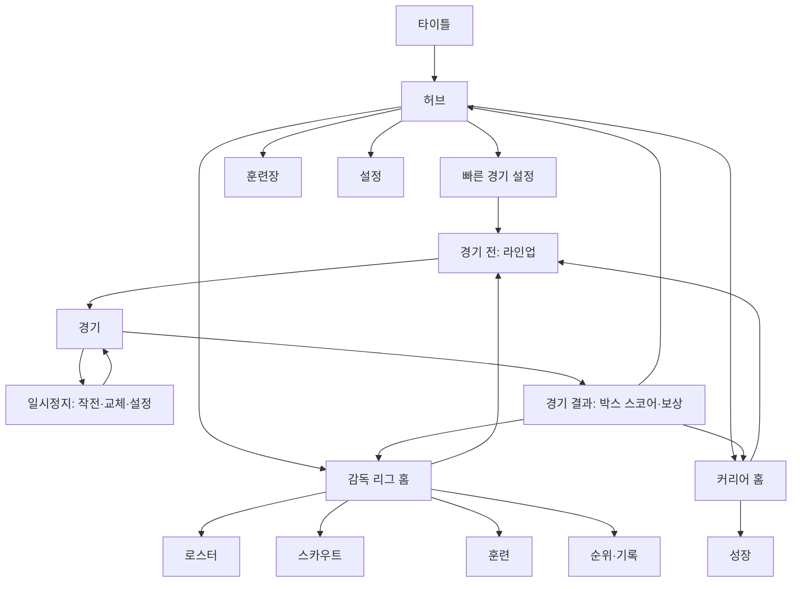

# 05. 조작·카메라·UI

입력이 경기에 어떻게 들어가는지, 화면에 무엇을 어떻게 보여 주는지의 설계. 키 배치와 화면 디자인은 새로 만든다. 참고작에서 가져오는 것은 "게이지 투구, 타이밍 타격, 보조 옵션"이라는 조작 구조다.

## 1. 입력 원칙

- 기본은 **마우스 + 키보드**. 키보드 전용과 게임패드도 지원한다
- 모든 키는 바꿀 수 있다. Godot의 `InputMap` 액션으로 정의하고 설정 화면에서 재지정한다
- 간편 조작이 기본이다. 고급 조작은 선택이고, 어려운 만큼 보상이 있다
- 입력은 `HumanController`가 받아 결정 객체로 바꾼다. 경기 엔진은 그것이 사람인지 AI인지 모른다
- 입력 시각은 물리 틱(1/120초) 단위로 기록한다. 리플레이가 정확히 재현된다
- 화면 지연 보정: 설정에서 입력 지연 보정값(ms)을 조정할 수 있다. 훈련장에 측정 도구를 둔다

## 2. 조작

### 2.1 투구

**간편 (기본)**

| 단계 | 조작 | 결과 |
|---|---|---|
| 1. 구종 | **구종 고리**: 오른쪽 버튼을 누른 채 마우스를 구종 쪽으로 보내고 뗀다(가운데에서 떼면 그대로). 숫자 키 `1`~`6`도 된다. 포수 리드가 켜져 있으면 추천 구종이 선택되어 있다 | |
| 2. 코스 | 마우스로 목표 지점을 옮긴다. 포수 리드가 켜져 있으면 포수 미트 위치에서 시작 | 휘는 구종은 도달 지점 기준 |
| 3. 던지기 | **왼쪽 버튼을 누르고 있으면 바깥의 고리가 목표의 초록 원으로 좁혀 온다. 두 원이 겹칠 때 버튼을 뗀다.** 뗄 때가 투구다 | 구속(고리가 원에 닿을 때 최고 구속), 실행 오차 |

- **구종 고리**(2026-11-22, 사용자 요청): 한 투수가 던지는 구종은 최대 6개이고, 고리(도넛)를 6칸으로 나눠 한 칸에 하나씩 둔다. 첫 구종이 위쪽, 나머지는 시계 방향. 고리가 열려 있는 동안 마우스가 고리 가운데에서 향한 방향의 칸이 채워지고, 목표 지점은 움직이지 않는다. 화면 오른쪽의 작은 고리가 지금 고른 구종을 늘 보여 준다(`DuelScene.open_wheel`·`close_wheel`, `DuelHud._wheel`). 참고작과 같은 방식이라는 사용자 설명에 따랐고, 공개 자료로는 참고작의 화면을 확인하지 못했다
- **던지기 전 표시**(2026-11-22, 사용자 요청): 공의 길을 투수에서부터 그리지 않는다(화면에서 투수의 목에서 선이 나오는 것처럼 보였다). 목표 지점에는 **실제 야구공**(실밥 텍스처, 투수 시점에서 보이게 1.6배)이 놓이고, 움직이는 공은 마지막 0.17초(약 6m)의 길이 그 공으로 휘어 들어가게 그린다(`DuelScene.aim_ball`·`preview`, `STRAIGHT_PITCHES`). **던진 뒤에는 아무것도 남기지 않는다**: 공이 잡힌 뒤에도 남던 꼬리선이 잔상처럼 보였다(사용자 지적)
- **게이지는 한 번 누르고 떼는 타이밍 놀이다**(2026-11-22, 사용자 지적: "꾹 누르고 원에 맞게 던지는 것"인데 예전 방식은 누르고 떼고 다시 클릭하는 세 동작이라 타이밍을 맞추는 느낌이 없었다). 버튼을 누르면 바깥 고리가 목표의 초록 원(띠의 두께가 좋은 투구의 폭)으로 1.15초 동안 좁혀 오고, 원에 닿는 순간(누른 지 0.86초)이 정확·최고 구속이다. 겹친 동안은 금색, 지나치면 빨강. 끝까지 누르고 있으면 아무 데로나 던진다(`DuelScene.GAUGE_TIME`·`gauge_accuracy`)
- **사람이 던진 공은 타이밍만큼 정확하다**(사용자 지적: 제구가 아예 안 된다). 예전에는 컴퓨터 투수의 오차식(제구 σ × 0.5~2)을 그대로 써서 완벽히 맞춰도 평균 12cm, 0.05초 늦으면 22cm 빗나갔다. 지금은 σ × 0.15(완벽)~2(놓침): 제구 60 투수가 완벽하면 평균 3.5cm(전부 10cm 안), 0.05초 늦으면 7.9cm, 0.1초 11.5cm, 0.2초 23cm(`PitchDuel.player_scatter`, `tools/pitch_control_report.gd`)
- 구종 고리를 닫으면 마우스가 고리를 연 자리로 돌아간다: 구종을 고르느라 목표가 옮겨지지 않는다
- 구종·코스 지정에서 투구 동작 시작까지 약 3초, 동작 시작에서 릴리스까지 약 2초가 기준 속도다([10](10-reference-video-notes.md#32-투구-화면))
- 정확도 영역의 폭 = 제구 × 구종 숙련 × (1 − 피로). 난이도가 폭 전체에 배율을 건다
- 영역 한가운데는 "완벽": σ × 0.5, 무브먼트 +3%
- 일찍 누르면 높은 팔 쪽, 늦게 누르면 낮은 글러브 쪽으로 빠진다
- 다시 클릭하지 않으면 최악 판정

**고급 (제스처)**

3·4단계 대신 구종별 마우스 제스처를 그린다. 직구 계열은 아래에서 위로 직선, 변화구는 휘는 방향을 따라 꺾는다. 궤적의 정확도와 속도가 품질을 정한다. 완벽 판정의 보상이 더 크다(σ × 0.4, 무브먼트 +6%, 구속 +1km/h).

**기타**

| 동작 | 키 |
|---|---|
| 견제 | `Shift` + `D`·`W`·`A` (1루·2루·3루) |
| 투구판에서 발 빼기 | `Q` |
| 고의사구 | 작전 메뉴 |
| 퀵 모션 / 와인드업 전환 | `E` |
| 피치아웃 | `Shift` + 투구 |

### 2.2 타격

| 동작 | 조작 |
|---|---|
| 조준 | 마우스. 존 위에 **반투명 나무 배트**가 스윙이 지나갈 자리에 눕고, 스위트 스폿이 포인터에 온다(원은 없다, 사용자 요청) |
| 컨택 스윙 | 왼쪽 버튼 |
| 파워 스윙 | 오른쪽 버튼 |
| 번트 | `Space`를 누르고 있기. 마우스로 배트 높이와 방향. 투구 동작 중에 누르면 기습 번트 |
| 스윙 멈추기 | 스윙 버튼을 80ms 안에 떼면 체크 스윙 |
| 코스 예측 | 투구 전에 마우스 휠 또는 `1`~`9`로 존 구역 선택 |
| 타임 요청 | `T` |

- **도착 지점 원**(2026-11-22, 사용자 요청 "치는 게 너무 어렵다"): 공이 손을 떠나는 순간 존에 공이 들어올 자리를 원으로 띄운다(스트라이크는 금색, 볼은 푸른빛). 바깥 고리가 그 원으로 좁혀 와 공이 도착할 때 겹친다: 어디로, 언제. 설정 "투구 도착 지점"으로 끌 수 있다(`DuelHud._draw_arrival`)
- **타격 카메라는 홈플레이트 바로 뒤, 그 타자의 스트라이크 존 가운데를 정면으로** 본다(존 중심보다 0.6m 위): 존이 화면 정중앙에 온다(사용자 요청, `DuelScene.bat_camera`). 예전 카메라는 타자 어깨 쪽으로 비켜 있어 존이 화면 오른쪽 아래에 있었다

**타이밍 → ψ (배트 수평각)**

스윙 버튼을 누르면 `T_swing`(컨택 110ms, 파워 130ms) 뒤에 임팩트가 일어난다. 공이 이상적인 접촉 지점에 도달하는 시각과의 차이가 타이밍 오차 Δt다.

```
τ = Δt / W                     W = 타이밍 창 (난이도, 스윙 종류, 컨택 능력치)
|τ| > 1 이면 헛스윙
ψ = −τ × 55° + 80°/m × 몸쪽 거리  일찍 휘두르면, 몸쪽 공이면 당겨치기
```

| 난이도 | 기본 W |
|---|---|
| 쉬움 | 90ms |
| 보통 | 65ms |
| 어려움 | 45ms |
| 리얼 | 30ms |

- 컨택 스윙 W × 1.15, 파워 스윙 W × 0.8
- 컨택 능력치가 W에 `lerp(0.85, 1.15, 컨택/100)`을 곱한다
- ψ가 ±27°를 넘으면 파울이 된다([04](04-physics.md#73-결과-기준-계산)). 즉 한가운데 공이면 |τ| < 0.49가 페어, 그 밖은 당겨친 파울이나 밀린 파울, 창을 벗어나면 헛스윙이다. 처음 설계(34°)에서는 파울이 거의 나오지 않아 S3에서 50°로, S5의 분포 보정(파울이 투구의 19%)에서 55°로 넓혔다
- 코스: 몸쪽 공은 앞에서 맞아 당겨지고 바깥쪽 공은 밀린다(1m당 80°). 타구 방향 분포(당겨치기 38%, 밀어치기 24%)를 맞춘 값이다
- 타이밍이 어긋나면 배트 속도가 떨어진 지점에서 맞는다: 배트 속도 × (1 − 0.3τ²)
- 판정 표시: |τ| < 0.15 완벽, < 0.45 좋음, 그 밖은 빠름·늦음

**상하 조준 → d (상하 어긋남)**

```
e = 조준 높이 − 공의 높이 (접촉면에서)
d = d_ideal − e × s(e) + N(0, σ_v)
s(e) = k_aim + (1 − k_aim) × smoothstep(6cm, 26cm, |e|)
```

| 항목 | 값 |
|---|---|
| d_ideal | 컨택 스윙 +2.1cm(라인드라이브), 파워 스윙 +3.3cm(뜬공). S5에서 리그 발사각 분포(평균 12.8°, 땅볼 44%)에 맞췄다 |
| k_aim | 화면 조준 오차를 접촉 오차로 줄이는 비율. 쉬움 0.035, 보통 0.05, 어려움 0.075, 리얼 0.10 |
| σ_v | `lerp(1.6, 0.6, 컨택/100)` cm. 컨택 스윙 × 0.8, 파워 스윙 × 1.2 |

- 공보다 위를 휘두르면 공의 윗부분을 쳐서 땅볼이 되고(d가 음수), 아래를 휘두르면 뜬다
- 작은 조준 오차(6cm 이하)는 k_aim만큼만 반영되어 너그럽고, 크게 빗나가면(26cm 이상) 오차가 그대로 반영되어 헛스윙이 된다. 변화구에 속아 헛스윙하는 상황이 여기서 나온다
- 조준은 공의 그 순간 위치가 아니라 **투구 궤적이 접촉면을 지나는 지점**과 비교한다. 스윙 궤도가 투구 궤적을 따라가므로, 타이밍이 어긋나면 방향(ψ)이 바뀔 뿐 상하가 어긋나지는 않는다
- 조준 방식이 "타이밍만"이면 조준 높이는 자동이다. 대신 구종 인식 오차가 들어간다. 공이 존 가운데에서 멀수록, 예상과 다른 구종일수록 오차가 커진다
- "타이밍 + 상하" 또는 "전 방향"이면 마우스로 조준 원을 직접 옮긴다. 정타 시 타구 속도 +2%
- 조준 원의 크기는 컨택(가로)과 선구안(세로)으로 정한다

**좌우 조준 → s (배트 위 위치)**

공이 몸쪽이면 손잡이 쪽에, 바깥쪽이면 끝 쪽에 맞는다. 전 방향 조준에서는 가로 조준 오차가 s를 정한다. 그 밖의 방식에서는 코스와 타이밍으로 계산한다(몸쪽 공을 늦게 치면 먹힌다).

**코스 예측**

투구 전에 구역(3×3) 하나를 찍는다. 맞으면 W × 1.25, 배트 속도 +4%. 틀리면 W × 0.8. 구종까지 찍을 수 있고 둘 다 맞으면 보상이 더 크다.

**선구안 표시**

투구 후 일정 시간이 지나면 구종 아이콘과 예상 도달 지점이 표시된다. 표시 시점은 `lerp(릴리스 후 55%, 25%, 선구안/100)`, 위치 오차도 선구안으로 줄어든다. 리얼 난이도에서는 표시하지 않는다.

### 2.3 수비

| 동작 | 조작 |
|---|---|
| 이동 | `W` `A` `S` `D` (설정 "수비 방식: 수동"일 때). 카메라 기준 W가 앞 |
| 야수 전환 | `Tab` 또는 공에 가장 가까운 야수 자동 선택 |
| 송구 | 방향 키 `→` 1루, `↑` 2루, `←` 3루, `↓` 홈. 또는 화면의 다이아몬드를 클릭 |
| 송구 힘 | 키를 누르고 있는 시간. 초록 영역에서 떼면 정확, 넘기면 강하지만 부정확 |
| 중계 | `Shift` + 방향 키 |
| 잡기 | `C` (직접 수비). 누르면 글러브가 0.6초 올라가 있다. 공이 닿기 0.5초 전부터 야수 머리 위에 `C` 표시가 깜박인다 |
| 다이빙 / 점프 | `Space`. 상황에 따라 자동 선택(낮은 타구는 다이빙, 펜스 앞은 점프). 다이빙은 그 자체로 잡으려는 동작이라 `C`가 필요 없다 |
| 베이스 밟기·태그 | 공을 가진 채 베이스나 주자 쪽으로 이동 |
| 송구 취소 | `Esc` 또는 `C` |

- **수비 방식은 "자동"과 "수동" 중에서 고른다**(2026-11-22, 사용자 요청; 설정 → 게임, 일시정지 메뉴에서도 바꿀 수 있다)
- "자동": 낙하 지점까지 알아서 간다. 플레이어는 송구만 결정
- "수동": 타구가 가는 쪽 야수(처음 공을 잡을 야수) 하나를 플레이어가 움직인다. 그 선수의 주력으로 달리고(뒤로 갈 때는 느림, 범위가 좋으면 빨리 가속), 공이 글러브 범위(약 1.1m, 높이 2.3m)에 들어왔을 때 글러브가 올라가 있어야 잡는다: `C`를 누르면 0.6초 동안 올라가 있고(공이 닿기 0.5초 전부터 머리 위에 깜박이는 `C` 표시), 안 누르거나 너무 일찍 누르면 공이 옆으로 지나가 동료가 받친다(사용자 요청 2026-11-22 "C를 눌러서 잡게 해"). `Space`는 다이빙(낮은 공) 또는 점프(높은 공): 0.9m 더 닿지만 넘어진 뒤 일어나는 데 1초쯤 걸린다. 펜스를 넘어가지 못한다(`ManualFielding`)
- 수동에서 공에 닿지 못하면 동료가 뒤를 받친다: 그 선수가 없는 것으로 플레이를 다시 계산해 이어 간다. 잡으면 잡은 때와 자리에서 플레이가 이어진다(`PlayContext.manual_*`, `PlaySim._own`). 송구는 방향 키로 정하고, 잡은 뒤 0.35초(누르고 있으면 0.8초)까지 기다린다
- 수동일 때 카메라는 그 야수 뒤(홈 쪽) 위에서 그와 낙하 지점을 함께 내려다본다. 그 야수 발밑에 금색 원과 머리 위 표시, 화면 아래에 조작 한 줄이 나온다
- 포구 전에 송구 키를 미리 눌러 두면 잡자마자 던진다(선입력)

### 2.4 주루

| 동작 | 조작 |
|---|---|
| 전체 진루 / 귀루 | `E` / `Q` |
| 주자 선택 | 화면 다이아몬드에서 클릭, 또는 `1`·`2`·`3` |
| 선택 주자 목표 | 방향 키 (송구와 같은 배치) |
| 리드 늘리기 / 줄이기 | `D` / `A` (투구 전) |
| 도루 | `Shift`를 누르고 있다가 투수 동작에 맞춰 뗀다. 떼는 타이밍이 스타트 품질 |
| 슬라이딩 | 베이스 근처에서 `Space`. 방향 키로 슬라이딩 방향 |
| 멈추기 | `S` |

자동 주루가 기본이다. 자동에서도 `E`·`Q`로 개입할 수 있다.

### 2.5 감독 지휘

| 동작 | 조작 |
|---|---|
| 작전 메뉴 | `F` 또는 화면 버튼. 열면 경기가 멈춘다 |
| 직접 개입 | `Enter`. 남은 횟수 표시 |
| 속도 | `1`× `2`× `4`×, `Space` 일시정지 |
| 이번 타석 건너뛰기 | `→` |
| 이닝 끝까지 건너뛰기 | `Shift` + `→` |
| 예약 | 작전 메뉴의 "조건 추가" |

### 2.6 게임패드

| 동작 | 버튼 |
|---|---|
| 투구 구종 | 오른쪽 스틱 방향 또는 버튼 조합 |
| 투구 코스 | 왼쪽 스틱 |
| 투구 힘·정확도 | A 누르고 떼기 → A |
| 컨택 / 파워 / 번트 | A / X / Y |
| 조준 | 왼쪽 스틱 |
| 송구 | B·Y·X·A = 1루·2루·3루·홈 (다이아몬드 배치) |
| 전체 진루 / 귀루 | LB / RB |

## 3. 화면 구성 (HUD)

디자인은 새로 한다. 원칙은 "경기장을 가리지 않는다"와 "지금 필요한 것만 보인다"다. 어떤 요소가 있어야 하는지는 참고 영상에서 확인했다([10](10-reference-video-notes.md#3-경기-화면의-구성-요소)). 모양과 배치는 우리 것이다.

### 3.1 요소 목록

| 요소 | 위치 | 표시 시점 |
|---|---|---|
| 점수 표시 | 좌상단 (방송 그래픽 자리) | 항상. 두 팀을 위아래로(구단 색 띠·엠블럼·이름·점수, 공격 팀 옆에 공), 이닝(▲초·▼말), 주자, B-S-O 램프. 아래 얇은 줄에 투구 수와 날씨·바람, 옆에 투구 시간 |
| 하단 바 | 하단 양끝 | 항상. 왼쪽에 타자, 오른쪽에 투수. 구단 색 띠와 엠블럼, 회색 윗줄(타순·포지션·타석 / 보직·투구 수·체력 막대), 이름, 오른쪽 칸에 종합 수치(메뉴 선수 카드와 같은 숫자 글꼴) |
| 상세 패널 | 하단 바 위로 펼침 | `Tab`을 누르는 동안. 타자: 능력치, 시즌 기록, 오늘 기록. 투수: 체력·평정 막대, 시즌 기록, 오늘 기록 |
| 키 안내 줄 | 하단 바 가운데 아래 | 그 화면에서 쓸 수 있는 기능 키. 메뉴 아래쪽 줄처럼 키 모양 칸과 회색 설명 |
| 스트라이크 존 | 경기장 안 (3D) | 타격·투구 시. 반투명 테두리 |
| 목표 지점 게이지 | 존 위 (3D) | 투구 시. 고리 모양. 구종 이름과 판정 글자 포함 |
| 구종 선택 | 우측 | 투구 시. 구종 목록과 키, 숙련도 |
| 조준 원 | 존 위 (3D) | 코스 예측 또는 타격 조준이 켜져 있을 때 |
| 타이밍 판정 | 존 아래 | 스윙 직후 0.8초 |
| 구속·구종 표시 | 공이 도착한 지점 (3D) | 투구 직후 1.2초. 구속과 구종 이름 |
| 투구 기록 패널 | 우측 | 타격·투구 시. 3×3 존에 이번 타석의 투구 위치. 버튼으로 "투수의 코스 분포"(칸별 횟수)로 전환 |
| 화면 속 화면 | 우상단 | 주자가 있으면 주자의 리드, 없으면 투수의 다른 각도 |
| 투구 궤적 잔상 | 경기장 안 (3D) | 투구 직후 0.6초 (옵션) |
| 타구 정보 | 화면 중앙 하단 | 타구 직후. 속도, 발사각, 비거리 |
| 낙하 지점 표시 | 경기장 안 (3D) | 수비 시 (옵션) |
| 미니 다이아몬드 | 좌상단 | 수비·주루 시. 주자 위치 배지와 진행 방향, 클릭 가능. 가운데에 중계 키 안내 |
| 베이스 표식 | 베이스 위 (3D) | 수비·주루 시. 번호와 홈 표시 |
| 송구 게이지 | 대상 베이스 표식 옆 (3D) | 송구 키를 누르는 동안. 녹색 구간이 정확 |
| 선택 표시 | 선수 발밑 (3D) | 조작 중인 선수에게 고리와 이름 |
| 방향 표시 | 화면 가장자리 | 공이나 조작 대상이 화면 밖에 있을 때 그쪽 가장자리가 빛난다 |
| 판정 글자 | 화면 중앙 | 접전 판정 1초 |
| 개입 버튼 | 하단 중앙 | 감독 지휘 시. 남은 횟수, 승부처면 강조 |
| 작전 표시 | 상단 | 지시한 작전과 예약 목록 |
| 텍스트 중계 | 하단 한 줄 | 이벤트마다 |
| 승리 확률 | 점수 표시 아래 | 감독 지휘·관전 시 (옵션) |
| 승부처 효과 | 화면 가장자리 | 레버리지가 높은 타석 동안 |

**구현**: 메뉴와 2D HUD는 `Control` 노드, 경기장 안 표시는 3D 노드(`MeshInstance3D`, `Decal`, `Label3D`). 색과 글꼴은 `Theme` 리소스 하나에서 관리한다. 한글 글꼴은 Pretendard 또는 Noto Sans KR(둘 다 OFL)을 넣는다.

**모양 (R5)**: HUD의 판은 메뉴의 판과 같다. 그라파이트, 위가 조금 밝은 그러데이션, 왼쪽 위·오른쪽 아래 모서리 사선 컷, 가는 테두리와 윗선, 옅은 그림자(`HudCanvas.panel`). 셰이더 없이 그리기 호출 몇 번으로 그려 비용이 없다. 제목은 메뉴처럼 강조색 사선과 흰 글자, 숫자는 Barlow Condensed. 색은 구단(띠·엠블럼)과 기록 종류(B 초록·S 노랑·O 빨강)에서만 나온다. 일시정지·작전 교체·작전 지시 창은 메뉴 키트(`GlassPanel`과 같은 판, `GameButton`, 켜기/끄기 선택 버튼)로 만든다.

**디자인 토큰 (초기안)**: 배경은 어두운 남색 반투명, 강조색은 팀 색에서 가져온다. 숫자는 고정폭 숫자 글꼴. 판정 색은 완벽 금색, 좋음 초록, 빠름 파랑, 늦음 주황.

### 3.2 타격 화면

타자가 화면 한쪽 3분의 1을 차지하고 나머지에 투수와 외야가 보인다. 점수 표시, 존과 조준 원, 투구 기록 패널, 화면 속 화면, 하단 바가 나온다. 외야 전광판에는 현재 타자의 사진과 기록이 실제로 표시된다. 타격 순간에는 존 테두리와 공이 빛난다.

### 3.3 투구 화면

투수의 등이 화면 한쪽에 크게 보이고 가운데에 타자·포수·심판이 있다. 목표 지점 게이지, 구종 선택, 포수의 요구 위치, 투구 기록 패널, 하단 바와 키 안내 줄이 나온다. 배경은 백스톱 뒤의 광고판과 가까운 관중이다.

### 3.4 수비·주루 화면

공을 따라가는 높은 카메라. 미니 다이아몬드, 베이스 표식, 낙하 지점, 화면 밖 공 방향이 나온다. 내 팀이 수비할 때만 공을 쫓는 야수 발밑의 원과 송구 게이지가 나오고, **상대가 수비할 때는 아무것도 그리지 않고 수비만 보여 준다**("자동 이동" 글자는 없앴다, 사용자 요청). 타구가 맞는 순간 화면은 이 카메라로 바로 넘어간다(예전에는 투수 카메라에서 한 프레임에 10m씩 날아왔다). 공 쪽으로 보이던 존·구속·타이밍 글자는 플레이 중에 숨긴다.

### 3.5 상황판

감독 지휘의 관전 구간과 커리어의 건너뛰는 구간에 쓰는 화면이다. 3D 경기장을 어둡게 깔고 그 위에 표를 올린다.

| 영역 | 내용 |
|---|---|
| 상단 | 이닝별 점수표 (득점, 안타, 실책, 볼넷 합계) |
| 좌우 | 양 팀 타순 9명과 투수. 포지션, 종합 수치, 주요 능력치. 현재 타자 강조, 컨디션 표시 |
| 가운데 | 다이아몬드(이닝, 초·말, 아웃, 주자). 그 아래로 타석 결과가 한 줄씩 쌓인다 |
| 하단 | 현재 타자와 투수의 대결 카드(사진, 시즌 기록, 오늘 기록, 투수 체력) |
| 조작 | 진행 속도, 작전 메뉴, 개입, 예약. 커리어에서는 내 장면이 오면 장면 카드가 뜬다 |

타석 하나가 지나가는 속도는 기본 1.5초다. 승부처에서는 자동으로 3D 화면으로 넘어간다(감독 지휘).

**장면 카드**: 3D 장면에 들어가기 직전의 작은 창. 미니 점수표, 상황 한 줄, 이번 장면의 목표, 시작 버튼.

## 4. 카메라

필드 좌표 기준. FOV는 수직 화각이다. 우타자·우투수 기준이며 좌는 x를 반전한다.

| 카메라 | 위치 | 바라보는 곳 | FOV | 용도 |
|---|---|---|---|---|
| 타격 (3인칭) | (0, −2.7, 존 가운데 + 0.6) | 존 가운데 | 45° | **타격 시 기본.** 홈플레이트 바로 뒤에서 그 타자의 스트라이크 존 가운데를 정면으로 본다: 존이 화면 정중앙(2026-11-22, 사용자 요청). 이 카메라에서는 포수와 심판을 그리지 않는다. 처음 값 (0.55, −2.7, 0.9) → (−0.2, 18.4, −0.45)은 참고 영상에서 역산했지만 존이 오른쪽 아래로 치우쳤다 |
| 타격 (포수 뒤) | (0.35, −2.6, 1.45) | (0, 18.4, 1.2) | 32° | 옵션. 존이 정면으로 보여 코스 판단이 쉽다 |
| 투구 (3인칭) | (−7.2, 79.2, 4.6) | (0.17, 3.37, 0.9) | 3.6° | **투구 시 기본.** 투수 뒤 약 61m에서 아주 좁은 망원으로 잡는다. 투수가 화면 왼쪽에 화면 높이의 절반쯤으로 서고, 타자도 거의 같은 크기(투수 대 타자 1.3 대 1)로 보인다. 참고 화면(`reference/target-pitchview.png`)에서 투수·타자·심판의 위치로 역산했다(`tools/reference/fit_camera.py`, 오차 20픽셀). 처음 값(투수 뒤 36m, 6.5°)은 타자가 너무 작게 보였다(1.6 대 1) |
| 투구 (높음) | (−0.6, 21.8, 2.6) | (0, 0, 0.9) | 20° | 옵션. 존이 가려지지 않는다 |
| 전경 | (0, 30, 9) | (0, 6, 1) | 30° | 투구 전·이닝 시작의 1초 샷 |
| 중계 | (−4.5, 128, 12) | (0, 9, 1.2) | 6.5° | 관전·감독 지휘. 중견수 뒤 망원 |
| 수비 (내야) | (0, −14, 16) | 공을 따라감 | 38~48° | 타구 후. 타구 깊이에 따라 화각 조정 |
| 수비 (외야) | 공 뒤 위쪽을 따라감 | 낙하 지점 | 45° | 뜬공 |
| 주루 | (0, −22, 24) | 내야 전체 | 42° | 주자가 여럿일 때 |
| 포지션 | 내 선수 뒤 2.2m, 위 2.0m | 타석 또는 공 | 50° | 커리어 모드 수비 |
| 리플레이 | 사건별 지정 | | 15~40° | 홈런, 호수비, 삼진 |
| 연출 | 더그아웃, 관중석, 선수 클로즈업 | | 20~35° | 이닝 교대, 타석 진입 |

- 카메라 전환은 `CameraDirector`가 이벤트를 받아 결정한다. 전환 규칙은 데이터(`data/camera_rules.json`)로 둔다
- 타구 직후 0.25초는 타격 카메라를 유지하다가 수비 카메라로 넘어간다. 타구 방향을 눈으로 따라갈 수 있게 한다
- 공 추적은 예측 궤적을 이용해 앞서 움직인다. 공이 화면 밖으로 나가지 않는다
- 홈런성 타구는 예측으로 미리 알 수 있으므로 타구를 따라가는 전용 카메라로 바꾼다
- **명장면 슬로모션**(2026-11-22, 사용자 요청, `PlayHighlight`): 내가 타석일 때(상대 수비)만, 진짜 그럴 만한 때만, 자주 나오지 않게.
  - 강한 타구: 홈런, 또는 152km/h 이상으로 맞아 펜스 4m 안까지 날아간 뜬공. 맞는 순간 0.22초 멈춘 뒤 0.09배속으로 0.16초 동안 타자 앞쪽 옆(타석에서 2.9m·3.3m, 높이 1.35m, 화각 27~31°)에서 스윙을 보여 주고, 공은 화면 밖으로 나가게 둔다
  - 아슬아슬한 수비: 잡을 확률이 55% 이하인데 잡았거나, 30% 이상이었는데 놓친 다이빙·러닝캐치. 공이 닿기 0.42초 전부터 0.22초 뒤까지 0.22배속, 공이 오는 길의 옆(9.5m, 높이 1.6m, 화각 34°)에서 야수와 그 자리를 함께
  - 하나를 보여 주면 타구 6개가 지나야 다음 것이 나온다(홈런은 늘). 60경기 시뮬레이션에서 한쪽 공격 기준 경기당 타격 1.25번, 수비 0.72번(`tools/highlight_report.gd`)
  - 느려지는 것은 그 장면뿐이다(경기 시계·투구 시간은 그대로). 끝나면 평소 카메라로 바로 넘어간다. 설정 "명장면 슬로모션"으로 끈다
- 흔들림: 망원 카메라에 아주 작은 손떨림, 큰 타구에 짧은 흔들림. 설정에서 끌 수 있다

## 5. 화면 흐름

> **상황별 서체 (2026-11-22, 사용자: "모든 곳에서 폰트가 다 똑같다"):** 실제 중계·전광판·광고는 저마다 글자가 다르다. `UiTheme.face(역할)`이 정한다 — 메뉴는 Paperlogy, 경기 위에 얹는 중계 그래픽(점수 표시·하단 바·투구 패널·한 줄 중계)은 S-Core Dream, 심판 콜과 판정 글자는 Black Han Sans, 전광판은 도트 매트릭스체 Galmuri, 펜스의 거리 숫자는 College Block, 광고판은 브랜드마다 다른 서체(`data/sponsors.ko.json`의 face), 숫자와 영문 대문자는 어디서나 Barlow Condensed, 유니폼은 [13의 S11 3차](13-implementation-spec.md). 파일과 라이선스는 `game/ui/fonts/README.md`

> **메뉴의 모양 (2026-11-21 확정, 네 번째 안):** 그래파이트 바탕(야구장이 뒤에 비친다) + 모드별 색(`UiTheme.MODE_COLOURS`: 친선 주황, 리그 골드, 커리어 블루, 연습 그린, 상점 바이올렛) + 주요 버튼은 브랜드 레드 + 흰 글자. 모서리는 사선 컷. 서체는 Paperlogy 한 가족과 Barlow Condensed(숫자·영문). 화면은 `Screen`(상단 탭 바, 제목 줄, 하단 키 안내)을 상속하고 `ui/kit/`의 부품으로만 짓는다. 피할 것(사용자가 반려한 것): 화면 전체가 한 색(파랑), 유광·외곽선 글자, 둥근 유리 카드에 작은 아이콘, 한 화면에 기능을 다 넣기, 제목과 본문에 다른 서체 섞기.

> **UI 참고 이미지 (2026-11-21, 사용자 제공):** 2K14의 마이 플레이어 만들기·리그 정보·스킬포인트(투구/타격), 라인업·로테이션 표, 선수 상세 카드가 `reference/ui/`(git 밖)에 있다. 목록은 `reference/ui/README.md`. 메뉴·로스터·선수 카드·커리어 화면을 만들 때 배치와 정보 밀도를 이걸 기준으로 하고, 로고·아트·이름은 가져오지 않는다.



- 허브의 주요 메뉴는 화면 하단에 한 줄로 둔다
- 어느 화면에서든 주요 기능까지 3번 이내 클릭
- 모든 목록 화면에 정렬·필터·비교가 있다. 선수 카드는 어디서든 같은 모양이다
- 로딩은 경기 진입 시 한 번만. 경기 중 화면 전환에는 로딩이 없다

## 6. 설정

| 분류 | 항목 |
|---|---|
| 게임 | 난이도, 이닝 수, 보조 옵션 전부([02](02-game-design.md#11-난이도와-보조-옵션)), 연출 길이 |
| 조작 | 키 재지정, 마우스 감도, 입력 지연 보정, 게임패드 진동 |
| 화면 | 해상도, 전체 화면, 품질 프리셋(낮음·보통·높음), 그림자, 관중 밀도, 프레임 제한, 카메라 흔들림 |
| 소리 | 전체, 관중, 효과음, 장내 방송, 음악 |
| 표시 | 낙하 지점, 투구 도착 지점, 타구 정보, 승리 확률, 텍스트 중계, 명장면 슬로모션, 색각 보조 |
