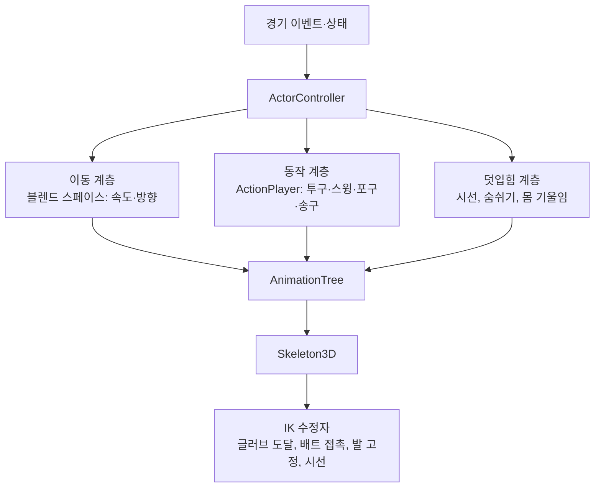

# 06. 3D 아트 파이프라인

선수 모델, 애니메이션, 구장, 관중, 조명의 제작 규격과 Godot 안에서의 구성. 재료를 어디서 구하는지는 [09 콘텐츠 확보](09-content-acquisition.md)에 있다. 이 문서는 "어떤 규격으로 만들어 어떻게 넣는가"다.

## 1. 방향과 단계

실사 지향이다. 비율과 동작은 사실적으로, 재질은 PBR 기본 범위에서 단순하게.

| 단계 | 내용 | 목적 |
|---|---|---|
| A. 그레이박스 | 관절 마네킹, 코드로 만든 구장, 키 포즈 애니메이션 | 에셋 없이 게임 전체를 돌린다 (S3~S9) |
| B. 기본 에셋 | 공통 몸체와 유니폼, 조합 얼굴, 모션캡처 기반 투타 동작, 가상 구장 | 게임 본체만으로 완성된 모습 (S10~S16) |
| C. 로컬 콘텐츠 팩 | 실제 선수 외형과 폼, 실제 구장 | 실제 야구와 같은 인상 (S17~S18) |

A 단계의 뼈 이름과 클립 이름을 B·C 단계가 그대로 쓴다. 에셋을 바꿔 끼울 때 코드가 바뀌지 않는다.

## 2. 도구

| 도구 | 용도 | 설치 |
|---|---|---|
| Blender (헤드리스) | 모델·애니메이션 변환과 일괄 처리. `blender -b -P tools/blender/<script>.py` | `.tools/`에 압축 해제. Windows에 설치한 Blender로 직접 열어 다듬을 수도 있다 |
| Godot 임포터 | `.glb` 자동 임포트. `godot --headless --import` | |
| glTF 2.0 (`.glb`) | 모든 3D 에셋의 교환 형식 | |
| Python + ezc3d | C3D 모션캡처 읽기 | |

규칙: 1단위 = 1m, Y가 위, 캐릭터는 −Z를 바라본다(Godot 기본). 원본(`.blend`, 원자료)은 `assets-src/`와 `content-local/raw/`에, 게임이 읽는 결과물만 `game/assets/`와 `content-local/`에 둔다.

## 3. 선수 모델

### 3.1 스켈레톤

Godot의 표준 인체 프로필(`SkeletonProfileHumanoid`)의 뼈 이름을 그대로 쓴다. 외부 애니메이션을 가져올 때 임포터의 리타깃 기능을 쓸 수 있다.

| 구분 | 뼈 |
|---|---|
| 몸통 | Root, Hips, Spine, Chest, UpperChest, Neck, Head |
| 팔 (좌우) | Shoulder, UpperArm, LowerArm, Hand |
| 손가락 (좌우) | Thumb·Index·Middle·Ring·Little × 3마디 |
| 다리 (좌우) | UpperLeg, LowerLeg, Foot, Toes |
| 추가 | LeftHandProp, RightHandProp (공·배트·글러브를 붙이는 자리), 팔뚝·허벅지 비틀림 보조 뼈 |

합계 약 62개. 얼굴은 뼈 대신 블렌드셰이프를 쓴다.

### 3.2 메시와 재질

| 항목 | 규격 |
|---|---|
| 삼각형 | LOD0 18,000 / LOD1 8,000 / LOD2 2,500. 머리 3,500 포함 |
| LOD 전환 | 화면 높이 비율 25% / 8% 기준. Godot의 자동 LOD 사용 |
| 텍스처 | 몸·유니폼 2048², 머리 1024², 장비 1024². 알베도, 노멀, ORM(거칠기·금속·차폐) |
| 뼈 영향 | 정점당 최대 4개 |
| 체형 | 블렌드셰이프 4개(마름, 건장, 육중, 근육) + 뼈 길이 비율(키, 팔다리 길이) |
| 머리 | 전원 같은 정점 구조와 UV. 형태 블렌드셰이프 40~60개 + 표정 6개(무표정, 집중, 기쁨, 실망, 외침, 눈 깜빡임) |

**유니폼 재질**: 색을 텍스처에 굽지 않는다. 마스크 텍스처의 채널(R 주색, G 보조색, B 포인트색, A 줄무늬)과 팀 색 파라미터를 셰이더에서 합친다. 팀 하나가 색 값 몇 개로 정의된다. 홈·원정·얼트 유니폼은 파라미터 묶음이다. 실제 구단 유니폼은 로컬 팩의 텍스처로 덮어쓴다.

**등번호와 이름**: `SubViewport`에 글자를 그려 텍스처로 만들고 등·가슴의 지정 UV 영역에 입힌다. 경기 시작 시 출전 선수만큼 한 번 만든다.

**더러움**: 슬라이딩과 다이빙 횟수에 따라 흙 마스크가 진해진다.

### 3.3 장비

| 장비 | 변형 |
|---|---|
| 모자, 타격 헬멧(귀 보호 좌·우·양쪽, 턱 보호대) | 팀 색 |
| 글러브 | 내야용, 외야용, 1루 미트, 포수 미트. 색 5종 |
| 배트 | 나무색 4종, 길이 3종 |
| 포수 장비 | 마스크, 가슴 보호대, 다리 보호대 |
| 보호대·액세서리 | 팔꿈치, 발, 타격 장갑, 팔 토시, 고글, 목걸이 |

장비는 별도 메시로 `BoneAttachment3D`에 붙인다. 선수별 장비 목록은 데이터다.

### 3.4 관절 마네킹 (단계 A)

최종 스켈레톤과 같은 뼈 이름을 가진 `Skeleton3D`를 코드로 만들고, 뼈마다 캡슐·상자 메시를 붙인다. 팀 색을 입힌 마네킹이다. 이 마네킹으로 애니메이션 시스템, IK, 이벤트 동기화를 전부 개발한다. 나중에 진짜 메시로 바꿔도 애니메이션과 코드는 그대로다.

## 4. 애니메이션 시스템

### 4.1 구성



- `AnimationTree`의 상태 기계와 블렌드 노드는 **코드로 만든다**. 클립 목록(JSON)을 읽어 구성하므로 클립을 추가해도 에디터 작업이 없다
- IK는 `SkeletonModifier3D`를 상속한 자체 수정자로 만든다. 두 뼈 IK(팔·다리)는 해석식이라 코드가 짧다. 엔진 내장 IK 노드가 요구를 채우면 그것으로 바꾼다
- 이동은 제자리 클립 + 코드가 정한 위치다([04](04-physics.md#10-선수-운동-모델)). 한 번 하는 동작(다이빙, 슬라이딩)만 클립의 이동량을 쓴다

### 4.2 이벤트 프레임 동기화

클립마다 사건 시각을 기록한 파일이 있다.

```json
{ "clip": "pitch_windup_ot_01", "length": 2.40,
  "events": { "leg_lift": 0.62, "foot_plant": 1.31, "release": 1.52, "ready": 2.10 } }
```

| 동작 | 누가 시각을 정하나 | 맞추는 방법 |
|---|---|---|
| 투구 | 애니메이션 | 클립의 `release` 시각에 `BallSim`이 공을 발사한다 |
| 스윙 | 입력 | 입력 후 `T_swing` 뒤가 임팩트다. 클립의 "시동 → 임팩트" 구간 길이를 `T_swing`에 맞춰 재생 속도를 조정 |
| 포구 | 물리 | 공의 도착 시각을 예측으로 안다. `catch` 프레임이 그 시각에 오도록 시작 시점을 역산. 시간이 모자라면 중간부터 블렌딩하거나 재생 속도 0.8~1.3배 |
| 송구 | 애니메이션 | 클립의 `release` 시각에 공 발사 |
| 태그, 베이스 밟기 | 물리 | 포구와 같은 방식 |
| 슬라이딩 | 물리 | 베이스 도착 시각에 `touch` 프레임 |

**구현 상태(Q2)**: 투구와 스윙이 이 표대로 동작한다. 클립은 뼈 회전이 아니라 관절 위치로 저장한다([4.5](#45-관절-위치-클립)).

**위치 보정**: 임팩트 순간 배트의 스윗 스폿이 공의 실제 위치에 오도록 손목 목표를 IK로 보정한다. 포구도 같다. 글러브가 공 위치에 온다. 보정량이 크면 어색해지므로 코스별 클립을 블렌딩해 먼저 가깝게 만든 뒤 남은 차이만 IK로 메운다.

### 4.3 폼

투구 폼과 타격 폼은 "클립 묶음 + 파라미터"다.

| 폼 요소 | 내용 |
|---|---|
| 투구 폼 | 와인드업 클립, 세트 클립, 퀵 모션 배율, 릴리스 지점(팔 각도·익스텐션에서 계산), 견제 클립 |
| 타격 폼 | 준비 자세 클립, 스윙 클립 묶음(코스별), 스트라이드 종류, 팔로스루 종류 |

선수 데이터에는 폼 ID만 있다. 폼 정의는 `data/forms/*.json`(본체)과 `content-local/animations/`(팩)에 있다. OBP에서 변환한 동작은 하나하나가 폼이 된다(`animations/pitch/<폼>.json`, `animations/swing/<폼>.json`. 지금은 `default` 하나씩).

**좌우 반전**: 모든 클립은 오른손 기준으로 만들고, 변환 스크립트가 반전본을 만든다(좌우 뼈 교환 + 회전 반전).

### 4.4 클립 목록 (본체 1차, 약 110개)

| 분류 | 클립 | 수 |
|---|---|---|
| 투구 | 와인드업 3(오버·스리쿼터·사이드), 세트 3, 견제 3, 대기 2, 수비 자세 전환 1 | 12 |
| 타격 | 준비 자세 4, 스윙 9(높이 3 × 코스 3), 파워 팔로스루 3, 체크 스윙 1, 번트 2, 헛스윙·지켜보기 반응 3, 타격 후 출발 2, 홈런 팔로스루 1, 회피 2 | 27 |
| 주루 | 리드, 셔플, 스타트, 질주, 베이스 돌기, 귀루 다이빙, 슬라이딩 3, 멈춤, 홈런 조깅 | 11 |
| 수비 이동 | 준비 자세 2, 방향별 이동 6, 조깅 1 | 9 |
| 포구 | 땅볼 3(정면·포핸드·백핸드), 숏바운드, 뜬공 2, 점프, 다이빙, 펜스 점프, 태그 2, 1루 스트레치, 병살 피벗 2 | 15 |
| 송구 | 오버핸드, 스냅, 러닝, 점프 스로, 외야 크로우 홉, 토스, 중계 턴 | 7 |
| 포수 | 대기 2, 사인, 포구 5(구역별), 블로킹, 송구, 번트 처리, 홈 태그 | 12 |
| 심판 | 스트라이크, 아웃, 세이프, 파울, 홈런, 타임 | 6 |
| 기타 | 걷기, 대기 3, 세리머니 4, 실망 2, 더그아웃 3 | 13 |

로컬 팩은 여기에 투구 폼 100개, 타격 폼 98개까지 더한다.

단계 A에서는 이 목록을 키 포즈(JSON으로 쓴 뼈 회전 6~10개와 보간)로 채운다. 뻣뻣하지만 타이밍과 흐름을 검증하기에 충분하다.

### 4.5 관절 위치 클립

모션캡처 동작은 뼈 회전으로 굽지 않고 **관절 위치 그대로** 저장한다. 게임이 실행 중에 모델에 맞춘다(`match/joint_clip.gd`, `SkinnedPuppet.apply_joints`).

```json
{ "format": 1, "kind": "pitch", "side": "R", "fps": 360.0, "duration": 2.41, "ankle_height": 0.08,
  "source": "OBP pitching 3037_2", "licence": "… CC BY-NC-SA 4.0 …",
  "events": { "knee_peak": 1.289, "foot_plant": 1.975, "max_layback": 2.067, "release": 2.095 },
  "joints": ["RightUpperArm", "RightLowerArm", "RightHand", "RightHandTip", "…", "ThoraxTop", "ThoraxBottom", "ThoraxRight"],
  "frames": [[x, y, z, x, y, z, …], …] }
```

- 좌표는 선수 기준이다. +X 오른쪽, +Y 위, −Z 정면(투수·타자 모두 홈 플레이트 쪽). 원점은 지면
- 관절 이름은 그 관절에서 시작하는 뼈의 이름이다(`RightLowerArm` = 오른 팔꿈치). 스윙 클립에는 `BatGrip`, `BatSweetSpot`이 더 있다
- 스윙의 사건: `stride`(앞발이 뜨기 직전), `launch`(손이 앞으로 나가기 시작), `contact`, `finish`

**이렇게 한 이유**

| 이유 | 내용 |
|---|---|
| 모델을 바꿔도 다시 굽지 않는다 | 선수 모델은 스크립트로 계속 다시 만든다. 뼈 회전으로 구우면 그때마다 전부 다시 변환해야 한다 |
| 선수마다 체형이 다르다 | 키와 팔다리 길이가 다른 선수에게 같은 클립을 실행 중에 맞춘다 |
| 발과 손을 정확히 놓을 수 있다 | 발은 녹화된 자리에 고정되고, 배트를 쥔 두 손의 간격이 유지된다. 회전만 옮기면 체형 차이만큼 발이 미끄러진다 |
| 자료가 이미 이 형태다 | OBP가 관절 중심 표를 준다. Blender를 거치지 않는다 |

**맞추는 순서**: 골반·가슴 방향(녹화 그대로) → 척추는 둘 사이를 나눠 굽힘 → 골반 위치(다리 길이 비율로 축소) → 팔다리 두 뼈 IK(무릎·팔꿈치는 녹화된 쪽으로) → 무릎·팔꿈치 축에 맞춰 뼈 비틀림 → 손(녹화된 손 방향, 배트를 쥔 손은 배트 방향) → 발(낮으면 바닥에 붙이고 들리면 정강이를 따름) → 머리(시선 목표).

## 5. 애니메이션

재료별 변환 경로.

| 재료 | 경로 |
|---|---|
| OBP 관절 중심 표 (투구·타격) | `tools/mocap/convert_obp.py`가 좌표축·원점·사건 시각을 맞춰 관절 위치 클립(JSON)으로 저장 → 실행 중에 모델에 맞춤([4.5](#45-관절-위치-클립)) |
| CMU BVH | Blender 임포트 → 리타깃 → 정리 → `.glb` |
| 영상 추출 결과 (FBX·BVH) | Blender 임포트 → 리타깃 → 떨림 제거, 발 고정 → `.glb` |
| 공개 라이브러리 | Godot 임포터의 뼈 매핑으로 리타깃 |
| 키 포즈 JSON | 게임 시작 시 코드가 `Animation` 리소스로 변환 |

정리 스크립트가 하는 일: 저역 통과 필터(떨림), 발이 땅에 닿은 구간의 발 위치 고정, 시작·끝 자세를 표준 대기 자세로 연결, 루프 클립의 이음매 맞춤, 뿌리 뼈 이동량 제거 또는 유지, 30Hz 또는 60Hz로 재표본화(투구·스윙은 60Hz 유지).

참고작과의 격차를 줄이는 방법 전체는 [09](09-content-acquisition.md#2-모션)에 있다.

## 6. 구장

### 6.1 구장 정의

```json
{
  "id": "harbor_park",
  "name": "하버 파크",
  "surface": "grass",
  "roof": "open",
  "orientation_deg": 35,
  "fence": [
    { "az": -45, "dist": 99.0, "height": 3.2 },
    { "az": -22, "dist": 113.0, "height": 3.2 },
    { "az": 0, "dist": 122.0, "height": 2.6 },
    { "az": 22, "dist": 111.0, "height": 4.5 },
    { "az": 45, "dist": 97.0, "height": 4.5 }
  ],
  "foul_territory": { "backstop": 16.5, "width_at_base": 14.0, "width_at_pole": 4.0 },
  "stands": [
    { "from_az": -135, "to_az": 135, "tiers": 2, "rows": [28, 22], "rake_deg": [22, 33] },
    { "from_az": -44, "to_az": 44, "tiers": 1, "rows": [16], "rake_deg": [20], "setback": 6.0 }
  ],
  "modules": ["scoreboard_cf_large", "bullpen_lf_rf", "light_towers_6"],
  "capacity": 22000
}
```

`az`는 홈에서 본 방위각(0°가 중견수, +가 우익수 쪽). 구간 사이의 펜스 거리는 매끄럽게 보간한다.

### 6.2 생성기

`stadium/stadium_builder.gd`(`@tool`)가 정의를 읽어 씬을 만든다.

| 단계 | 결과물 |
|---|---|
| 1. 필드 | 지면 메시 하나 + 필드 셰이더. 마운드는 규정 형태(평평한 윗면, 홈 쪽으로 1/12 경사)의 높이 함수 `Field.ground_height`로 만든 메시 |
| 2. 펜스 | 폴리라인을 세워 만든 메시 + 패드 재질 + 콜라이더(`surface: wall_pad`) |
| 3. 파울 폴, 백스톱 그물 | 메시 + 콜라이더(`surface: net`) |
| 4. 더그아웃, 불펜 | 모듈 배치 |
| 5. 관중석 | 단면(층수, 줄 수, 경사)을 방위각 구간을 따라 쓸어 만든 계단 메시. 좌석은 인스턴싱 |
| 6. 통로, 난간, 지붕 | 관중석 단면에서 파생 |
| 7. 모듈 | 전광판, 조명탑, 외야 구조물 |
| 8. 광고판 띠 | 백스톱 벽, 외야 펜스, 관중석 층 전면에 띠 모양 광고판. 칸 단위로 텍스처를 배정 |
| 9. 원경 | 구장 밖 배경. 산 능선, 아파트와 건물 무리를 낮은 다각형 띠로 둘러 세운다. 구장 정의의 `backdrop` 항목(산, 도심, 바다, 없음) |
| 10. 하늘 | 절차적 하늘, 움직이는 구름, 가끔 지나가는 비행선·새 |
| 11. 해석용 정의 | 같은 정의에서 `AnalyticField`를 만든다. 헤드리스 시뮬레이션용 |

**카메라별로 화면을 채우는 것**이 다르다는 점을 기준으로 품질을 배분한다([10](10-reference-video-notes.md#5-구장과-관중)). 투구 화면은 백스톱 벽의 광고판과 그 뒤 관중이 화면의 절반이다. 타격 화면은 외야 전광판, 외야 관중석, 원경, 하늘이 절반이다. 이 네 곳에 삼각형과 텍스처를 먼저 쓴다.

**필드 셰이더**: 텍스처를 그리지 않고 필드 좌표에서 영역을 계산한다. 내야 흙(투수판 중심 원호와 베이스 주변), 주루선, 마운드, 홈 주변, 파울 라인과 타석 선, 경고 트랙(펜스까지의 거리. 펜스 거리 표를 1차원 텍스처로 전달), 잔디 깎은 무늬(줄·바둑판·방사형). 어느 거리에서 봐도 선이 깨끗하고, 구장 정의만 바꾸면 그림이 따라 바뀐다.

**전광판**: `SubViewport`에 실제 UI를 그려 화면에 입힌다. 이닝별 점수, 타자 정보, 구속, 리플레이 화면이 경기 중 실제로 나온다.

**광고판**: 본체에는 가상 상호를 생성해 넣는다. 로컬 팩의 텍스처가 있으면 그것을 쓴다.

### 6.3 본체의 가상 구장 (4곳)

| 구장 | 특징 | 치수 성향 |
|---|---|---|
| 대형 구장 | 대칭, 넓은 외야 | 좌우 100m, 중앙 125m, 펜스 2.6m. 투수 친화 |
| 소형 구장 | 짧은 좌우중간 | 좌우 97m, 중앙 118m. 타자 친화 |
| 돔 | 인조 잔디, 실내 조명, 높은 펜스 | 좌우 99m, 중앙 122m, 펜스 4.0m |
| 비대칭 구장 | 우측에 높은 벽, 좌측은 깊다 | 좌 101m, 중앙 122m, 우 95m에 펜스 7m |

실제 구장은 로컬 팩의 정의로 추가한다([09](09-content-acquisition.md#4-구장)).

## 7. 관중

참고 영상에서 백스톱 뒤 관중은 한 명 한 명이 3D 인물이었다. 투구 화면에서 가장 크게 보이는 배경이므로 거리에 따라 3단계로 나눈다.

| 단계 | 대상 구역 | 표현 | 인원 |
|---|---|---|---|
| 가까운 관중 | 백스톱 뒤 8줄, 더그아웃 위 4줄 | 600삼각형 인물 메시. 체형 4종 × 머리 6종 × 옷 조합. 앉은 자세와 선 자세 | 300~500 |
| 중간 관중 | 내야 1층 나머지 | 60삼각형 인형 | 3,000~5,000 |
| 먼 관중 | 외야, 상단 층 | 사각형 한 장(인물 그림 아틀라스) | 나머지 |

- 세 단계 모두 `MultiMeshInstance3D`다. 뼈는 쓰지 않고 정점 셰이더가 동작을 만든다. 앉아서 흔들림, 박수, 일어서기, 팔 들기, 응원 도구 흔들기, 파도타기
- 인스턴스별 데이터: 옷 색, 피부색, 동작 위상, 상태, 응원 도구 유무
- 옷 색은 구역에 따라 정한다. 홈 응원석은 홈팀 색 비율이 높고 원정 응원석은 원정팀 색, 나머지는 섞인다
- 응원 도구(막대풍선, 수건, 깃발)는 응원석 구역의 인스턴스에 붙는 추가 메시다
- 상태는 구역 단위로 흥분도와 이벤트가 정한다. 응원 리듬의 박자를 셰이더에 넘겨 움직임이 소리와 맞는다([11](11-audio-and-atmosphere.md#7-보이는-관중과의-연동))
- 가까운 관중은 그 구역이 화면에 들어오는 카메라(투구, 포수 뒤, 더그아웃 연출)에서만 그린다
- 관중 수는 경기 중요도와 요일에 따라. 빈 좌석은 인스턴스를 만들지 않는다
- 품질 설정으로 밀도 조절(100% / 60% / 30%)

## 8. 공, 배트, 효과

| 요소 | 구현 |
|---|---|
| 공 | 실제 크기(지름 73.2mm)의 구 + 실밥이 그려진 겉면(`assets/props/ball.png`). `BallSim`의 회전을 그대로 적용해 구종마다 실밥 무늬가 다르게 보이게 한다(회전 적용은 아직) |
| 공 잔상 | 투구에 짧은 궤적 띠(옵션). 빠른 공은 진행 방향으로 늘여 속도감 |
| 공 그림자 | 지면에 원형 그림자. 뜬공의 높이 판단에 쓰인다 |
| 배트 | 33.5인치 프로파일을 돌려 만든 메시(`assets/props/bat.glb`) + 꾸밈용 강체(놓았을 때) |
| 글러브, 포수 미트 | 12인치 글러브와 33인치 미트(`assets/props/glove.glb`, `mitt.glb`). 손 기준 좌표로 모델링해서 손에 그대로 얹는다 |
| 흙먼지 | 슬라이딩, 바운드, 스파이크에 `GPUParticles3D` |
| 분필 가루 | 라인에 공이 맞을 때 |
| 타격 순간 | 강한 타구에 2프레임 정지와 약한 흔들림(옵션) |

## 9. 조명과 렌더링

| 항목 | 설정 |
|---|---|
| 렌더러 | Forward+ (Windows). 낮음 프리셋은 Mobile |
| 시간대 | 낮, 해 질 녘, 밤, 돔. 해의 위치는 구장 방위와 시각에서 계산 |
| 태양 | `DirectionalLight3D`, 그림자 4단 분할 |
| 야간 | 조명탑 방향의 약한 방향광 4~6개(그림자는 1개만) + 높은 주변광. 선수 발밑에 여러 방향의 옅은 그림자 |
| 간접광 | 하늘 주변광 + 반사 프로브 1~2개. 실시간 전역 조명은 쓰지 않는다 |
| 하늘 | 절차적 하늘 + 구름. 야간은 어두운 하늘과 조명 번짐 |
| 후처리 | 톤 매핑, 약한 블룸, 약한 색 보정. 피사계 심도는 연출 카메라에서만 |
| 안티에일리어싱 | MSAA 2× 또는 TAA. 그물과 선이 많아 중요하다 |

## 10. 성능 예산

기준: Intel Arc 140V 내장 그래픽, 1920×1080, 60fps.

| 항목 | 예산 |
|---|---|
| 화면 삼각형 | 150만 이하 |
| 드로 콜 | 400 이하 |
| 선수 | 24명(선수 18~22, 심판 4, 코치 2). LOD0는 4명까지 |
| 구장 | 40만 삼각형 |
| 관중 | 인스턴스 2만. 가까운 관중 400명 × 600 = 24만, 중간 4,000명 × 60 = 24만, 먼 관중은 사각형. 가까운 관중은 보이는 카메라에서만 |
| 그림자 | 방향광 1개, 4단 분할, 2048² |
| 텍스처 메모리 | 1.5GB 이하 |
| 프레임 시간 | CPU 6ms(경기 로직 1ms, 애니메이션 2ms, 그 밖 3ms), GPU 10ms |

화면 캡처 검증은 WSL의 소프트웨어 렌더링으로 하므로 성능 측정은 Windows에서만 한다.

## 11. 에셋 규칙

| 항목 | 규칙 |
|---|---|
| 폴더 | `game/assets/{characters,animations,stadiums,props,audio,fonts}/` |
| 이름 | 소문자와 밑줄. `pitch_windup_ot_01.glb`, `glove_infield_a.glb` |
| 클립 이름 | `<분류>_<동작>_<변형>_<번호>` |
| 사건 파일 | 클립과 같은 이름의 `.events.json` |
| 임포트 설정 | `.import` 파일을 저장소에 포함. 임포트 결과(`.godot/`)는 제외 |
| 출처 기록 | 외부에서 온 에셋은 `assets/CREDITS.md`에 출처와 라이선스 |
| 금지 | 다른 게임에서 추출한 에셋 |
