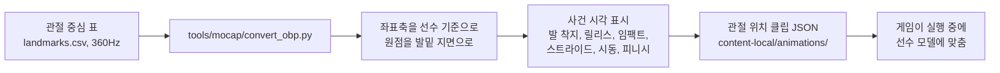

# 07. 콘텐츠 확보 — 모션·얼굴·구장·기록

참고작과의 격차는 엔진이 아니라 콘텐츠 양에서 난다. 이 문서는 그 격차를 줄이는 방법이다. 전제는 **출시하지 않는 개인용 프로젝트**라는 것이다. 그래서 비상업 라이선스 자료와 실제 선수·구장 정보를 쓸 수 있다.

조사일 2026-11-20. 라이선스 조건은 쓰기 직전에 원문을 다시 확인한다.

## 1. 원칙

### 1.1 두 층으로 나눈다

| 층 | 위치 | 내용 | 공개 가능 여부 |
|---|---|---|---|
| 게임 본체 | `game/` | 코드, 가상 리그, 직접 만든 에셋, CC0 에셋 | 가능 |
| 로컬 콘텐츠 팩 | `content-local/` (git 제외) | 실명 로스터, 선수 얼굴, 실제 구장 정의, 비상업 모션에서 만든 애니메이션, 사용자가 넣은 음원 | **불가. 이 PC에서만** |

게임은 팩이 없으면 가상 리그로 돌아가고, 팩이 있으면 그 내용을 우선해서 읽는다. 코드와 실제 콘텐츠가 섞이지 않으므로 나중에 코드를 공개하고 싶어져도 문제가 없다.

### 1.2 비상업이어도 지키는 선

- **배포하지 않는다.** 실행 파일, 저장소, 팩 파일 어느 형태로도. 비상업 라이선스 대부분과 초상·상표·방송 영상에 대한 권리는 "개인이 혼자 쓰는 것"까지만 문제가 없다. 플레이 영상을 공개 채널에 올리는 것도 같은 범위로 본다
- **다른 게임의 에셋은 쓰지 않는다.** 참고작, MLB 2K, 그 밖의 야구 게임 클라이언트에서 모델·모션·텍스처·음성을 추출하지 않는다. 이 프로젝트는 그 게임의 사본이 아니라 같은 종류의 새 게임이다. 아래의 자료만으로 그 수준에 갈 수 있다
- 각 자료의 조건을 팩 안의 `SOURCES.md`에 기록한다(출처, 라이선스, 받은 날짜)

## 2. 모션

가장 큰 격차이고, 가장 좋은 자료가 있는 영역이기도 하다.

### 2.1 드라이브라인 OpenBiomechanics Project — 투구와 타격

실제 선수의 광학식 모션캡처 데이터가 공개되어 있다.

| 항목 | 내용 |
|---|---|
| 투구 | 투수 100명, 직구 411구 |
| 타격 | 타자 98명, 스윙 677개 (피칭 머신 약 105km/h) |
| 선수 수준 | 대부분 대학 선수 |
| 형식 | C3D(마커 3D 궤적, 360Hz), 관절 중심 위치·관절각 시계열, 지면반력, 지표 CSV |
| 용량 | 약 1.1GB. GitHub Releases에서 내려받는다 |
| 라이선스 | CC BY-NC-SA 4.0. 비상업, 출처 표시, 동일 조건 |
| 제외 대상 | 프로 스포츠 구단이나 금융 분석 회사에 소속·관련된 사람은 어떤 용도로도 사용 금지 |
| 저장소 | [drivelineresearch/openbiomechanics](https://github.com/drivelineresearch/openbiomechanics) |

**의미**: 참고작이 자랑한 것이 "특이 폼 263명"이었다. 이 자료로 **실제 투수 100명의 서로 다른 투구 동작과 타자 98명의 스윙**을 넣을 수 있다. 360Hz라 팔 스윙처럼 빠른 동작도 뭉개지지 않는다. 투구·타격 애니메이션은 참고작과 같은 수준(모션캡처)이 된다.

**한계**: 직구만 있다(변화구는 손목·손가락 차이라 같은 몸동작에 손 포즈만 바꾼다). 실험실 촬영이라 투구 후 수비 자세로 이어지지 않는다. 수비·주루·포수 동작은 없다.

**변환 과정** (Q2에서 구현)



```bash
./dev mocap                      # 자료를 받고(약 100MB) 기본 투구·스윙을 변환
./dev mocap list pitch           # 구속이 빠른 시험 순서로 보기 (swing은 타구 속도)
./dev mocap pitch 2916_4 fast    # 다른 시험을 "fast"라는 폼으로 변환
```

- 처음 계획은 C3D를 Blender에서 뼈 회전으로 굽는 것이었다. 관절 중심 표만으로 충분하고 모델을 바꿔도 다시 변환할 필요가 없어서 관절 위치 클립으로 바꿨다([05](05-art-pipeline.md#45-관절-위치-클립))
- 릴리스·발 착지·임팩트 시각은 표에 들어 있다. **시간 열은 소수 넷째 자리로 반올림돼 있으므로** 프레임 시간은 전체 구간에서 구해야 한다(0.0028이 아니라 1/360초)
- 시험마다 녹화 시작 시점이 다르다. 세트 자세부터 담긴 것은 일부다. 투구는 다리를 들기 전의 마지막 정지 순간부터 잘라 쓴다
- 좌표: 투구 표는 +x가 홈 쪽·+z가 위, 타격 표는 +x가 투수 쪽·+z가 위다. 투구 표의 팔다리 이름은 역할(던지는 팔, 내딛는 다리) 기준이고 타격 표는 좌우 기준이다
- `thorax_ap`는 이름과 달리 가슴 위쪽 점에서 **오른쪽으로 0.1m** 떨어진 점이다. 가슴의 방향을 이것으로 정한다
- 100명의 동작을 팔 각도(오버핸드·스리쿼터·사이드암), 다리 높이, 템포로 분류해 선수에게 배정한다. 실제 선수와 닮은 폼을 고르는 것은 수작업이다
- 손가락은 자료에 없다. 구종별 그립 포즈를 따로 만들어 릴리스 직전까지 덮어씌운다
- 머리 방향도 없다. 시선 목표(투수는 포수, 타자는 공)로 정한다

### 2.2 CMU 모션캡처 데이터베이스 — 보충

무료 공개 자료. 124번 피험자가 스포츠 동작이고 야구 투구(124_01, 124_02), 스윙(124_07), 번트(124_08)가 있다. 달리기, 점프, 던지기, 걷기 같은 일반 동작도 많다. 품질은 OBP보다 낮지만 번트와 일반 동작을 메울 수 있다. 사용 조건은 [CMU 사이트](http://mocap.cs.cmu.edu/)에서 확인한다.

### 2.3 영상에서 동작 추출 — 나머지 전부

수비, 포구, 송구, 슬라이딩, 포수, 심판, 세리머니, 그리고 실제 선수의 특이 폼은 영상에서 뽑는다. 한 대의 카메라로 찍은 영상에서 3D 동작을 복원하는 기술이 2024년 이후 쓸 만해졌다.

| 도구 | 방식 | 조건 |
|---|---|---|
| GVHMR, WHAM, TRAM 계열 | 연구용 모델. 품질이 가장 좋다 | 비상업 연구 라이선스(SMPL 몸 모델 포함). NVIDIA GPU가 사실상 필요 |
| [toyxyz_RGBMocap](https://github.com/toyxyz/toyxyz_RGBMocap) | 위 모델들을 Windows에서 돌리고 FBX로 내보내는 도구 | 〃 |
| [mocapgate](https://github.com/MaverickGH/mocapgate) | MediaPipe(로컬, CPU 가능) 또는 GVHMR | MediaPipe 쪽은 Apache 라이선스. 품질은 낮다 |
| [Motion2MixamoRig](https://aipings.io/content/motion2mixamorig-open-source-video-motion-capture) | Blender 확장. 영상 → 리타깃 → .glb | |
| Rokoko Vision, DeepMotion, Move.ai, QuickMagic | 웹 서비스. 영상을 올리면 결과를 받는다 | 무료 구간이 있거나 유료. 설치 불필요 |
| FreeMoCap | 웹캠 여러 대로 직접 촬영 | 오픈소스 |

**이 PC의 제약**: 그래픽이 Intel Arc 내장이라 NVIDIA 전용 도구는 로컬에서 돌리기 어렵다. 세 가지 길이 있다. 웹 서비스를 쓴다. 무료 클라우드 GPU 노트북(Colab 등)에서 돌린다. CPU로 느리게 돌린다.

**영상 소스**

| 소스 | 장점 | 주의 |
|---|---|---|
| 직접 촬영 | 깨끗하다. 고정 카메라, 전신, 60fps 이상으로 찍으면 결과가 좋다 | 야구 동작을 할 수 있는 사람이 필요 |
| 실제 경기 영상(중계, 구단 영상, 슬로 모션) | 실제 선수의 특이 폼을 얻는 유일한 방법 | 영상은 방송사·구단의 저작물이다. 이 PC에서 분석 재료로만 쓰고 영상과 결과물을 공유하지 않는다 |

중계 기본 화면(중견수 뒤 카메라)은 멀고 가려져서 추출이 잘 안 된다. 투수 옆모습 리플레이, 불펜 영상, 타격 연습 영상처럼 한 사람이 크게 잡힌 장면을 고른다.

**품질의 한계**: 떨림, 발 미끄러짐, 깊이 오차가 있고 손가락은 거의 안 나온다. 30fps 영상에서는 투구의 팔 동작이 뭉개진다. 그래서 투구와 타격은 OBP를 쓰고, 영상 추출은 그보다 느린 동작(수비, 주루, 대기)과 폼의 "특징"을 얻는 데 쓴다. 특이 폼은 OBP의 비슷한 동작을 바탕으로 영상에서 얻은 특징(다리 드는 높이, 준비 자세, 팔 각도)만 덧입히는 방식이 가장 낫다.

### 2.4 일반 동작 라이브러리

걷기, 달리기, 대기, 몸 풀기, 박수 같은 동작은 공개 라이브러리로 채운다. Mixamo(게임에 넣어 쓰는 것은 허용, 원본 파일 재배포는 금지), CC0 애니메이션 묶음, AMASS(비상업). Mixamo에 야구 동작이 무엇이 있는지는 사이트에서 직접 확인해야 한다.

### 2.5 종류별 출처

| 동작 | 1순위 | 2순위 |
|---|---|---|
| 투구 (와인드업·세트) | OBP | CMU, 영상 |
| 타격 스윙 | OBP | CMU |
| 번트 | CMU | 영상 |
| 타격 준비 자세, 타석 루틴 | 영상 | 손으로 제작 |
| 선수별 특이 폼 | OBP 바탕 + 영상의 특징 | |
| 내야 포구·송구 | 영상 | 손으로 제작 + IK |
| 외야 포구·송구·펜스 플레이 | 영상 | 〃 |
| 다이빙, 슬라이딩 | 영상 | 손으로 제작 |
| 포수 (프레이밍, 블로킹, 송구) | 영상 | |
| 달리기, 방향 전환, 주루 | 라이브러리 | CMU |
| 심판 동작 | 영상 | 손으로 제작 |
| 세리머니, 더그아웃 | 라이브러리 | 영상 |

### 2.6 살 수 있는 것

스포츠 모션캡처 팩을 파는 마켓이 있다. 야구 전용 팩이 있다면 수비 동작처럼 무료 자료가 없는 영역을 한 번에 메울 수 있다(아직 조사하지 않았다).

## 3. 선수 외형

### 3.1 경기 화면에서 실제로 보이는 것

경기 카메라에서 선수는 화면 높이의 10~30%다. 이 거리에서 "그 선수"로 보이게 하는 요소는 영향이 큰 순서로 다음과 같다.

1. 투구·타격 폼
2. 체형(키, 몸무게)과 투타 방향
3. 유니폼, 등번호, 이름
4. 피부색, 수염, 머리 모양, 장비(보호대, 고글, 팔 토시)
5. 얼굴 생김새

얼굴은 클로즈업 연출(타석 진입, 리플레이)에서만 중요하다. 그래서 1~4를 전원에게 맞추고, 얼굴은 등급을 나눠 처리한다.

### 3.2 얼굴

| 등급 | 대상 | 방법 | 선수당 작업 |
|---|---|---|---|
| A | 팀당 간판 3~5명 | 사진 여러 장으로 머리 모델을 만드는 도구 사용 | 30~60분 |
| B | 나머지 1군 | 정면 사진 한 장 → 얼굴 형태 계수 자동 추정 + 사진을 텍스처로 투영 | 자동 (배치) |
| C | 2군, 가상 선수 | 피부·헤어·수염 조합 | 자동 |

| 도구 | 용도 | 조건 |
|---|---|---|
| KeenTools FaceBuilder (Blender) | A등급. 사진 1~여러 장으로 머리 메시와 텍스처. 표정 블렌드셰이프 51개 포함 | 유료 구독, 15일 무료 체험 |
| FLAME 기반 복원 모델(DECA, MICA, EMOCA 계열) | B등급. 사진 한 장에서 형태 계수 추정. 일괄 처리 가능 | 비상업 연구 라이선스. CPU로도 사진 한 장은 처리 가능 |
| MetaHuman | 최고 품질 머리 | 2025년에 다른 엔진에서도 쓸 수 있게 조건이 바뀌었다는 보도가 있으나 반대 설명도 있다. Epic 원문 확인이 필요하고, 언리얼 에디터가 있어야 만들 수 있다 |

**공통 머리 구조**: 모든 머리가 같은 정점 구조와 UV를 쓴다. 선수별 차이는 형태 계수(블렌드셰이프 가중치 40~60개)와 텍스처 한 장으로 저장한다. 300명이어도 메시는 하나고 용량이 작다.

**사진**: KBO 선수 조회의 프로필 사진은 정면이고 조명이 일정해 재료로 적합하다. 사진은 KBO와 구단의 저작물이고 얼굴은 선수 본인의 초상이다. 로컬 팩 안에서만 쓴다.

### 3.3 체형과 장비

- 키·몸무게는 KBO 프로필에서 가져와 몸 형태 파라미터로 바꾼다. 같은 키라도 체질량에 따라 마름·보통·건장·육중 사이를 보간한다
- 장비 태그(팔꿈치 보호대, 발 보호대, 고글, 팔 토시, 목걸이, 수염)는 선수별 CSV로 관리한다. 처음에는 손으로 입력하고, 사진에서 수염·안경을 자동 분류하는 것은 나중 과제다
- 유니폼과 로고는 구단의 상표다. 로컬 팩의 텍스처로 넣는다. 게임 본체에는 가상 구단 유니폼만 있다

## 4. 구장

### 4.1 재료

| 재료 | 얻는 곳 | 쓰는 곳 |
|---|---|---|
| 치수 (좌우·중앙 거리, 펜스 높이) | 구단·KBO 공개 자료, 구장 안내 | 구장 정의의 핵심. 치수는 사실 정보다 |
| 평면 윤곽 (펜스 선, 관중석, 파울 지역) | 항공·위성 사진을 보고 따라 그린다 | 펜스 폴리라인, 관중석 배치 |
| 관중석 단면, 지붕, 전광판, 조명탑 | 직접 찍은 사진, 중계 화면, 구장 소개 영상 | 구장별 특징 모듈 |
| 색과 재질 | 사진 | 텍스처 |
| 광고판, 전광판 그래픽 | 사진 | 로컬 팩 텍스처 |

국토부 브이월드의 3D 건물 API는 2019년에 중단된 것으로 확인된다. 건물 3D 데이터를 바로 받는 길은 없다고 보고 계획한다.

### 4.2 방법

**치수 기반 생성 + 구장별 특징 모듈**이 기본이다. [05](05-art-pipeline.md#6-구장)의 구장 생성기는 치수와 윤곽을 받아 필드·펜스·관중석을 만든다. 여기에 그 구장을 알아보게 하는 요소(지붕 모양, 전광판 위치와 크기, 높이가 다른 펜스 구간, 불펜 위치, 외야 구조물)를 모듈로 얹는다.

사진 측량(여러 장의 사진으로 3D 복원)은 보조로만 쓴다. 관중석처럼 반복 구조가 많은 큰 건물은 결과가 지저분하고, 대부분의 도구가 NVIDIA GPU를 요구한다. 복원 결과는 게임에 넣는 대신 Blender에서 모델링할 때 비율을 맞추는 참고 자료로 쓴다.

### 4.3 구장 목록

1군 홈 구장 9곳(잠실은 두 팀이 공유)과 제2구장. 구장마다 아래 항목을 수집해 `content-local/stadiums/<id>.json`에 넣는다.

| 수집 항목 | 예시 형식 |
|---|---|
| 방위각별 펜스 거리 | −45°부터 +45°까지 5° 간격, 미터 |
| 구간별 펜스 높이 | 구간 시작·끝 각도, 미터 |
| 파울 지역 폭, 백스톱 거리 | 미터 |
| 지면 | 천연 잔디 / 인조 잔디, 내야 흙 범위 |
| 지붕 | 없음 / 돔 |
| 관중석 층수와 좌석 수 | |
| 방위 | 홈에서 중견수 방향의 나침반 각도 (해의 위치 계산용) |
| 특징 모듈 목록 | |

잘 알려진 예로 잠실은 좌우 100m, 중앙 125m로 국내에서 가장 넓다. 정확한 값은 수집 단계에서 구단 자료로 확인한다.

## 5. 선수 기록 → 능력치

### 5.1 출처

| 자료 | 내용 | 비고 |
|---|---|---|
| KBO 공식 기록실 | 타자·투수의 기본·세부 기록, 수비, 주루, 선수 프로필(키, 몸무게, 투타, 생년, 등번호) | 누적 기록의 기준 |
| 네이버 스포츠 문자중계 | 투구 단위 기록. 구종, 구속, 결과. 2008년부터 | 구종 구성과 구속의 유일한 공개 출처 |
| 스탯티즈 | 세이버 지표, 상황별 기록 | 약관상 자동 수집 제한 여부 확인 |
| 비공식 분석 사이트 | 구종별 무브먼트 시각화, 구위 지표 | 참고와 교차 검증용 |

수집기 구조는 공개된 예제([kbo-analysis](https://github.com/ChaebinIm/kbo-analysis), [kbo-baseball](https://github.com/zubene1013/kbo-baseball))를 참고한다. 사이트 구조는 수집 시점에 직접 확인한다.

### 5.2 수집 규칙

- 요청 간격 2초 이상, 받은 페이지는 로컬에 저장해 다시 요청하지 않는다
- 사이트의 robots 정책과 약관을 먼저 확인한다
- 수집 결과는 `content-local/raw/`에만 둔다

### 5.3 변환

`tools/build_roster.gd`(또는 Python 스크립트)가 원자료를 로스터 팩으로 바꾼다. 산식은 [06](06-architecture.md#4-능력치)에 있다.

| 능력치 | 원자료 |
|---|---|
| 컨택, 파워, 선구안 | 삼진율, 순장타율, 타석당 홈런, 볼넷율. 좌투수·우투수 상대 기록을 따로 |
| 주력, 주루 | 도루 시도와 성공률, 3루타, 내야 안타, 추가 진루 |
| 수비 | 수비율, 수비 이닝, 포지션별 출장. 범위 지표가 있으면 사용 |
| 구속 | 문자중계의 구종별 평균·최고 구속 |
| 구종 구성 | 문자중계의 구종 구사율. 5% 이상인 구종만 |
| 구종별 위력 | 구종별 헛스윙률, 피안타율, 땅볼 비율 |
| 제구 | 볼넷율, 스트라이크 비율 |
| 체력 | 선발 평균 투구 수, 이닝 |

공개 자료에 없는 것: 구종별 무브먼트 실측값, 타자의 코스별 성적. 무브먼트는 구종별 헛스윙률에서 역산하고, 코스별 성적은 좌우 타자의 일반적인 분포로 대신한다.

같은 과정을 과거 시즌에 돌리면 연도별 로스터 팩이 된다. 참고작의 "연도별 선수 카드"에 해당한다.

## 6. 소리

| 요소 | 방법 |
|---|---|
| 관중 소리 | 직접 구장에서 녹음하거나 CC0 음원을 층으로 쌓는다. 흥분도에 따라 섞는 비율이 변한다 |
| 타격음, 포구음 | CC0 음원 또는 직접 녹음. 타구 속도에 따라 여러 개 |
| 장내 방송 | 음성 합성. 선수 이름을 읽어야 하므로 합성이 현실적이다 |
| 중계 음성 | 텍스트 중계 문구를 음성 합성으로 읽힌다. 문구는 새로 쓴다. 후순위 |
| 응원가 | 게임 본체에는 새로 만든 리듬과 구호만 있다. 로컬 팩에 팀별·선수별 음원 슬롯이 있고, 가지고 있는 음원 파일을 넣으면 해당 타석에서 재생된다. 음원 수집은 직접 한다 |

## 7. 로컬 콘텐츠 팩 구조

```
content-local/                  # .gitignore에 등록
  SOURCES.md                    # 자료별 출처, 라이선스, 받은 날짜
  raw/                          # 수집한 원자료 (HTML, CSV, 영상, 사진)
    obp/                        # OBP 관절 중심 표와 지표 (./dev mocap이 받는다)
  rosters/
    kbo-2026.json               # 로스터 팩 (07 문서의 형식)
    kbo-2025.json
  heads/
    <player_id>.json            # 얼굴 형태 계수
    <player_id>.webp            # 얼굴 텍스처
  appearance.csv                # 선수별 체형, 장비 태그, 배정된 폼 ID
  animations/
    pitch/<form_id>.json        # OBP에서 변환한 투구 동작 (관절 위치 클립)
    swing/<form_id>.json
    field/...
  stadiums/
    <stadium_id>.json           # 구장 정의
    <stadium_id>/               # 특징 모듈 메시, 텍스처
  teams/
    <team_id>/uniform_*.webp    # 유니폼, 로고
  audio/
    chants/<team_id>/...        # 사용자가 넣은 음원
```

게임은 시작할 때 `content-local/`을 찾는다. 위치는 설정에서 바꿀 수 있다. 팩에 있는 항목은 팩을 쓰고, 없는 항목은 본체의 기본값(가상 선수, 조합 얼굴, 기본 폼, 가상 구장)을 쓴다. 팩이 부분적으로만 채워져 있어도 동작한다.
