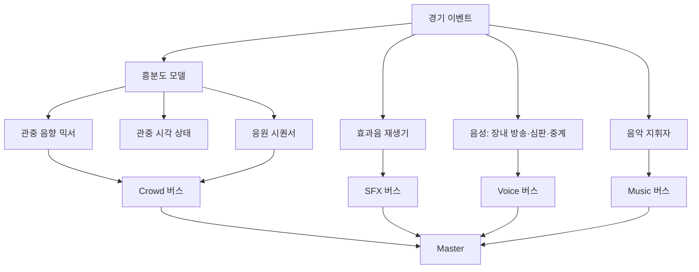

# 08. 소리·관중·중계 연출

경기장의 분위기를 만드는 세 가지, 즉 소리(관중음·음악·효과음·음성), 보이는 관중, 중계 연출의 설계. 관중 메시와 구장의 제작 규격은 [05](05-art-pipeline.md), 재료를 구하는 경로는 [07](07-local-content.md#6-소리)에 있다.

## 1. 구조

참고 영상의 소리 구조를 따른다. **메뉴에서는 음악이 계속 나오고, 경기 중에는 상시 음악이 없다.** 경기 중의 바탕은 관중 소리이고 그 위에 응원, 효과음, 음성이 얹힌다.



| 버스 | 내용 | 처리 |
|---|---|---|
| Music | 메뉴 음악, 징글, 등장 음악 | 음성이 나올 때 3dB 낮춤 |
| Crowd | 관중 바탕음, 반응, 응원 | 구장 잔향(돔은 길게). 상황판·일시정지에서 저역 통과 필터와 −8dB |
| SFX | 타격, 포구, 발소리, 충돌 | 거리 감쇠, 카메라 기준 위치 |
| Voice | 장내 방송, 심판 콜, 중계 | 장내 방송에는 구장 잔향과 지연 |
| UI | 메뉴 조작음 | |

## 2. 흥분도 모델

관중의 소리와 움직임을 하나의 값(0~1)이 움직인다.

```
기본값 = 0.25 + 0.15 × 관중 수 비율
       + 0.20 × 레버리지 지수 보정 (2.0 이상에서 최대)
       + 0.10 × (7회 이후) + 0.10 × (득점권 주자) + 0.05 × (풀카운트)
순간값 = 이벤트가 주는 충격량. 0.5~4초에 걸쳐 감쇠
흥분도 = clamp(기본값 + 순간값, 0, 1)
```

홈과 원정을 따로 계산한다. 같은 홈런이라도 홈팀이 치면 홈 응원석의 순간값이 오르고 원정 응원석은 내려간다.

| 이벤트 | 유리한 쪽 | 불리한 쪽 |
|---|---|---|
| 홈런 | 폭발적 환호 4초 + 기립 | 탄식, 조용해짐 |
| 안타, 득점 | 환호 2초, 박수 | 탄식 |
| 삼진 | 환호와 박수 | 탄식 |
| 호수비 | 감탄 뒤 박수 | 탄식 |
| 볼넷 | 가벼운 박수 | |
| 큰 뜬공 | 타구가 뜬 동안 소리가 점점 커지다가 결과에 따라 환호 또는 탄식 | 반대 |
| 병살 | 환호 | 큰 탄식 |
| 투수 교체, 이닝 교대 | 웅성임, 박수 | |
| 실책 | 야유 섞인 탄식 | 환호 |

"큰 뜬공의 상승음"은 타구 예측(낙하 지점과 체공 시간)을 알기 때문에 타구가 맞는 순간부터 정확히 맞출 수 있다.

## 3. 관중 음향

| 층 | 내용 | 제어 |
|---|---|---|
| 바탕 웅성임 | 조용함·보통·시끄러움 3단계의 긴 반복음. 흥분도에 따라 섞는다 | 연속 |
| 박수 | 드문드문·보통·열렬 3단계 | 이벤트 |
| 환호 | 짧은 것, 긴 것, 폭발 | 이벤트 |
| 탄식, 야유 | | 이벤트 |
| 상승음 | 기대감이 커지는 소리. 길이를 늘이고 줄일 수 있게 여러 길이로 | 큰 타구 |
| 개별 소리 | 가까운 관중의 외침, 휘파람, 행상 | 무작위, 타격·투구 카메라에서만 |
| 응원 | 아래 3.1 | 공격 팀 타석 |

- 홈·원정 응원석의 위치에 따라 좌우 음상이 다르다. 카메라가 바뀌면 음상도 바뀐다
- 관중 수가 적은 경기는 층 전체의 음량과 밀도가 낮다
- 반복음은 길이가 서로 다른 여러 개를 겹쳐 반복이 들리지 않게 한다

### 3.1 응원 시퀀서

한국 야구장의 응원은 공격 팀의 타석 동안 리듬을 타고 이어진다. 본체에는 새로 만든 리듬과 구호를 넣는다.

| 요소 | 내용 |
|---|---|
| 악기 | 북, 막대풍선 부딪는 소리, 호루라기, 짧은 관악 리프 |
| 패턴 | 4·8박 리듬 패턴 12종. 흥분도가 오르면 빠르고 촘촘한 패턴으로 |
| 구호 | 여러 사람이 외치는 짧은 소리("안타", "홈런", 박자에 맞춘 함성). 팀 이름이 들어가지 않는 범용 구호 |
| 진행 | 타석 시작 → 리듬 시작 → 투구 동작 때 잦아듦 → 결과에 따라 환호로 전환 또는 다음 타석으로 |
| 특수 | 풀카운트, 득점권, 후반 리드에서 전용 패턴 |

**로컬 팩 슬롯**: `content-local/audio/chants/<팀>/`에 팀 응원 음원, `players/<선수>/`에 선수 등장·응원 음원을 넣으면 시퀀서가 본체 패턴 대신 그것을 재생한다. 음원은 직접 구해 넣는다.

## 4. 음악

| 종류 | 수량 | 나오는 곳 |
|---|---|---|
| 메뉴 음악 | 4곡 | 허브, 구단 관리, 커리어 화면. 화면이 바뀌어도 끊기지 않는다 |
| 타이틀 | 1곡 | 게임 시작 |
| 경기 시작 음악 | 1곡 (15초) | 경기 전 연출 |
| 이닝 교대 징글 | 6종 (3~6초) | 공수 교대 |
| 오르간 리프 | 10종 (2~5초) | 투구 사이, 득점권 |
| 타자 등장 음악 | 본체 8종 (5~8초). 로컬 팩에서 선수별로 교체 | 홈팀 타자의 타석 진입 |
| 홈런 팡파르 | 2종 | 홈런 |
| 승리·패배 | 각 1곡 | 경기 종료 |
| 결과 화면 | 1곡 | 박스 스코어, 보상 |
| 승부처 | 1종 (저음 지속음 + 심장 박동) | 레버리지가 높을 때 |

**만드는 방법**

| 방법 | 내용 |
|---|---|
| 코드로 작곡 | 악보를 Python으로 써서 MIDI로 만들고, 공개 사운드폰트로 소리를 입혀 OGG로 내보낸다. 징글, 오르간 리프, 응원 리듬처럼 짧은 것에 적합하다. `tools/music/` |
| 공개 음원 | CC0 또는 출처 표시 조건의 음악. 메뉴 음악처럼 긴 곡에 쓴다. `assets/CREDITS.md`에 기록 |
| 직접 넣는 음원 | 로컬 팩의 음악 슬롯. 메뉴 음악, 등장 음악, 응원가 |

참고작의 음악은 쓰지 않는다. 분위기(밝은 스포츠 방송풍의 메뉴 음악, 짧은 구장 징글)를 참고해 새로 만든다.

## 5. 효과음과 음성

### 5.1 효과음

| 분류 | 변형 |
|---|---|
| 타격음 | 타구 속도 4단계 × 접촉 종류 3(정타, 빗맞음, 배트 끝·손잡이) × 변형 3 |
| 포구음 | 포수 미트(구속 3단계), 야수 글러브, 맨손 |
| 공 | 바운드(잔디, 흙), 펜스 충돌(패드, 단단한 벽, 그물), 폴 맞는 소리 |
| 선수 | 발소리(잔디, 흙), 슬라이딩, 다이빙, 베이스 밟는 소리, 스윙 바람 소리 |
| 환경 | 바람, 돔의 공조음, 멀리서 들리는 도시 소리 |
| UI | 이동, 선택, 취소, 완료, 게이지, 판정(완벽·좋음·나쁨) |

재생 음량과 음색은 물리 값에서 정한다. 타구 속도가 타격음의 단계를, 구속이 미트 소리의 단계를 고른다.

### 5.2 음성

| 종류 | 방법 |
|---|---|
| 심판 콜 | 스트라이크, 스트라이크 아웃, 아웃, 세이프. Supertonic 3의 M1 목소리로 만든 녹음(`tools/audio/umpire_calls.py` → `game/audio/voice/`, 구장 잔향). 시스템 TTS는 쓰지 않는다(2026-11-23 사용자). 캐스터(M3)와 다른 목소리 |
| 장내 방송 | "N번 타자, 포지션, 이름". 이름을 미리 녹음할 수 없어 지금은 소리 없이 넘어간다(시스템 TTS를 뺀 뒤). 음성 서버에 두 번째 목소리를 붙이면 읽을 수 있다 |
| 텍스트 중계 | 화면 하단 한 줄(`data/commentary.ko.json`, 66상황 418줄). 실제 KBO 중계의 말투를 따른다: 타구 방향의 야수와 담장("좌익수 뒤로! 좌측 담장!"), 당겼는지 밀었는지, 몇 구째, 리드한 쪽부터 점수, 투런·쓰리런, 시즌 n호, 투수 이름과 오늘 삼진 수. 모르는 값이 들어가는 줄은 건너뛰고, 이름 뒤 조사는 받침에 맞춘다 |
| 음성 중계 | 남자 캐스터(Supertonic 3의 M3 목소리). 이 PC의 음성 서버(`tools/audio/voice_server.py`, `./dev play`가 켠다)가 숫자를 중계식으로 읽어(`korean_numbers.py`) 모든 줄을 같은 목소리로 말한다(아래). 게임은 연결 없이 curl로 묻고, 서버가 없으면 조용히 글자만 나온다 |

**캐스터 목소리**: 사용자가 들어 보고 고른 "남자_M3" 견본 그대로다(2026-11-23, "AI 느낌이 가장 덜 난다, 목소리는 절대 건들지 말 것"). Supertonic 3의 M3, 10단계, 속도 1.18. "!"가 있는 줄만 견본처럼 1.08배 빠르고 3% 높고 1.6dB 크게, 그 위에 방송 마이크 음질. 고친 것은 숫자 읽기(`korean_numbers.py`)뿐이다. 실제 중계 측정값에 맞춘 흥분 변환(WORLD 보코더)도 만들어 비교했지만 기계음 때문에 쓰지 않는다.

## 6. 중계 연출

카메라와 화면 표시로 방송처럼 보이게 하는 장치. 모든 연출은 2초 안팎이고 버튼 하나로 넘어간다.

| 시점 | 연출 | 길이 |
|---|---|---|
| 경기 전 | 구장 전경 → 팀 소개 전환 → 선발 투수 카드(승패, 평균자책점, 삼진) → 주목할 타자 → 타순 표시 | 12초 (건너뛰기 가능) |
| 이닝 시작 | 구장 전경 + 이닝 표시 + 징글 | 2초 |
| 타석 진입 | 타자 클로즈업, 이름과 오늘 기록, 장내 방송, 등장 음악(홈팀) | 2.5초 |
| 투구 전 | 3구에 한 번꼴로 다른 각도(전경, 더그아웃, 주자, 관중) | 1초 |
| 투구 후 | 삼진: 투수 반응. 볼넷: 타자가 걸어 나감 | 1.5초 |
| 타구 | 타격 화면 0.25초 유지 → 수비 화면. 홈런성 타구는 타구를 따라가는 화면 | |
| 판정 | 접전이면 화면 가운데에 판정 글자 | 1초 |
| 리플레이 | 홈런, 호수비, 득점, 삼진(승부처) 뒤에 다른 각도로 느리게 | 4초 (건너뛰기 가능) |
| 득점 | 홈을 밟는 주자 → 더그아웃 반응 → 점수 표시 갱신 | 2초 |
| 승부처 | 화면 가장자리 효과, 좁은 화각, 관중음 상승, 심장 박동 | 타석 동안 |
| 투수 교체 | 불펜에서 걸어 나오는 투수, 기록 카드 | 3초 |
| 이닝 종료 | 이닝 요약(득점, 안타, 잔루) | 2초 |
| 경기 종료 | 마지막 아웃 → 선수들 반응 → 경기 MVP → 박스 스코어 | 10초 |

연출 규칙은 `data/presentation_rules.json`에 "이벤트 → 연출 → 조건 → 확률"로 적는다. 같은 연출이 연달아 나오지 않게 한다.

## 7. 보이는 관중과의 연동

| 흥분도 | 관중의 움직임 | 소리 |
|---|---|---|
| 0~0.3 | 앉아 있음. 가끔 몸을 움직임 | 조용한 웅성임 |
| 0.3~0.6 | 응원 도구를 흔듦. 일부 박수 | 보통 웅성임 + 응원 리듬 |
| 0.6~0.85 | 응원석은 대부분 일어남. 리듬에 맞춰 움직임 | 시끄러운 웅성임 + 빠른 응원 |
| 0.85~1 | 거의 전원 기립, 팔을 들어 올림 | 환호 |

응원 리듬의 박자를 관중 셰이더에 넘겨, 응원 도구를 흔드는 움직임이 소리와 맞는다. 홈런 때는 타구가 넘어가는 쪽 관중석부터 일어난다.

## 8. 제작 목록

| 분류 | 수량 (본체) |
|---|---|
| 관중 반복음과 반응 | 약 40개 |
| 응원 악기 샘플과 구호 | 약 30개, 패턴 12종 |
| 음악 | 긴 곡 9, 짧은 것 27 |
| 효과음 | 약 120개 |
| 심판 음성 | 약 20개 |
| 중계 문구 | 상황 약 80종 × 변형 5 |

## 9. 검증

| 항목 | 기준 |
|---|---|
| 반응 지연 | 이벤트에서 관중 반응 시작까지 0.15~0.4초(사람의 반응처럼). 타격음은 즉시 |
| 반복 | 3분 동안 같은 반복음의 이음매가 들리지 않는다 |
| 음량 균형 | 경기 중 평균 음량이 메뉴와 3dB 이내. 환호가 최대 음량을 넘어 찌그러지지 않는다 |
| 구조 확인 | 한 경기 녹음의 스펙트로그램에서 "바탕 관중음 + 주기적인 응원 + 이벤트 때의 폭발"이 보인다 |
| 연동 | 관중의 움직임과 응원 리듬의 박자가 맞는다 |
| 음원 없이 동작 | 로컬 팩의 음원이 없어도 본체 음원만으로 빈 구간이 없다 |
