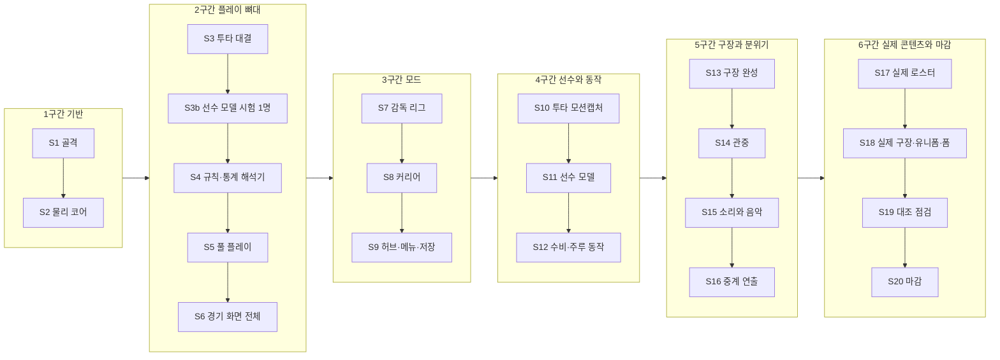

# 08. 구현 파이프라인

설계를 실제 게임으로 만드는 순서. 6개 구간, 20개 단계로 나눴다. 기간은 적지 않는다. 각 단계는 완료 기준을 통과하면 끝난 것이다.

## 1. 전체 그림

| 구간 | 끝나면 | 화면의 모습 |
|---|---|---|
| 1. 기반 | 물리가 검증된 빈 프로젝트 | 빈 구장 |
| 2. 플레이 뼈대 | 9이닝 야구가 된다 | 색칠한 관절 인형과 단순한 구장 |
| 3. 모드 | 리그와 커리어를 처음부터 끝까지 할 수 있다 | 같은 인형, 메뉴와 화면 구성은 완성 |
| 4. 선수와 동작 | 사람처럼 생긴 선수가 모션캡처 동작으로 던지고 친다 | 선수는 실사에 가깝고 구장은 아직 단순 |
| 5. 구장과 분위기 | 관중이 찬 구장에서 소리와 연출이 붙는다 | 가상 리그 상태로 완성된 야구 게임 |
| 6. 실제 콘텐츠와 마감 | 실제 선수·구장이 들어가고 영상과 대조해 빠진 것이 없다 | 최종 목표 |

**순서의 원칙**

- 2구간에서 일찍 손에 잡히게 한다. 조작감이 재미있는지는 인형 상태에서 판단할 수 있다
- 그림은 4구간부터. 뼈 이름과 클립 이름을 처음부터 최종 규격으로 써서, 에셋을 바꿔 끼울 때 코드가 바뀌지 않는다
- 단계마다 헤드리스 테스트가 늘어난다. 뒤 단계가 앞 단계를 깨뜨리면 바로 드러난다
- S10(모션 변환)과 S17(기록 수집)은 다른 작업과 독립이라 앞당겨 병행할 수 있다
- 사람 모델은 S11에서 전원 교체하지만, **한 명만 먼저 만드는 시험(S3b)을 S3 직후에 한다.** 투수와 타자가 일찍 사람처럼 보이고, 모델 제작 과정이 이 PC에서 되는지 초반에 확인한다

**진행 상황**

| 단계 | 상태 | 결과 |
|---|---|---|
| S1 골격 | 완료 (2026-11-20) | 테스트 16개 통과. Windows에서 1080p 평균 221fps(Arc 140V, Vulkan Forward+, 수직 동기 끔). WSL과 Windows 양쪽에서 화면 캡처 저장 |
| S2 물리 코어 | 완료 (2026-11-20) | 테스트 76개 통과. 난수(PCG32), 공 시뮬레이션, 구종 8종과 조준 해법, 배트-공 충돌, 구장 충돌(지면·펜스·파울 지역 벽·백스톱), 궤적 예측. 땅볼 상수 조정 완료 |
| S3 투타 대결 | 완료 (2026-11-20) | 테스트 95개 통과. 타격·투구·관전 세 모드, 관절 인형의 투구·스윙, 목표 지점 게이지, 타이밍 판정, 구속·구종·타구 정보 표시, 타구 추적 카메라. Windows 1080p 평균 241fps |
| S3b 선수 모델 시험 | 완료 (2026-11-20) | 테스트 102개 통과. Blender와 MakeHuman 도구로 사람 모델을 생성해 투수와 타자에 적용. `./dev model` 한 번으로 재생성. Windows 1080p 평균 249fps |
| Q1 화면 품질 1차 | 완료 (2026-11-20) | 테스트 106개 통과. 잔디·흙 질감(필드 셰이더), 조명·그림자·색 보정, 임시 관중석, 손 쥐는 모양, 시선, 등번호·이름, 타자 헬멧, 투구 카메라 재조정. Windows 1080p 평균 129fps(음영·그림자·4배 안티에일리어싱을 켠 상태. 이전 249fps) |

## 2. 단계별 내용

### 1구간 — 기반

| 단계 | 만드는 것 | 완료 기준 |
|---|---|---|
| **S1 골격** ✔ | Godot 프로젝트(Jolt, 120Hz, 타입 강제, Forward+), 폴더 구조, 테스트 프레임워크, 명령 도구 틀, 화면 캡처 스크립트, Windows 실행 경로 | 테스트 1개가 헤드리스로 통과. 빈 구장 씬이 Windows에서 60fps. 캡처 PNG 저장 |
| **S2 물리 코어** ✔ | `Rng`, `BallSim`, `PitchModel`, `ContactModel`, `AnalyticField`, 물리 데이터 파일 | [04의 검증 표](04-physics.md#12-검증-결과) 전체가 회귀 테스트로 통과. 땅볼 항목 조정 완료 |

### 2구간 — 플레이 뼈대

| 단계 | 만드는 것 | 완료 기준 |
|---|---|---|
| **S3 투타 대결** ✔ | 구장 생성기 초판(필드, 펜스), 관절 인형, 키 포즈 투구·스윙, 타자 뒤·투수 뒤 3인칭 카메라, 목표 지점 게이지, 타이밍 타격, 존과 판정 표시 | AI 투수의 공을 사람이 친다. 사람이 던진 공을 AI가 친다. 타이밍 판정, 구속·구종 표시가 나온다. 타구가 펜스에 맞고 튄다 |
| **S3b 선수 모델 시험** ✔ | Blender 설치, 사람 모델 생성 도구로 몸과 머리 1개 생성, 최종 스켈레톤(뼈 이름)에 맞춤, 유니폼·모자·등번호 초안, `.glb`로 내보내 게임에 넣기. S3의 키 포즈 동작을 이 모델에 입힌다 | 타격·투구 화면의 타자와 투수 한 명이 사람 모델로 보인다. 인형과 같은 동작이 코드 변경 없이 재생된다. 생성부터 게임 반영까지 명령 한 번으로 다시 만들 수 있다. 품질이 부족하면 대안(모델 구매)을 이 시점에 판단한다 |
| **S4 규칙·통계 해석기** | `GameState`, `GameFlow`, `Scorer`, `StatResolver`, `StatBook`, 가상 리그 생성기, 능력치와 OVR | 규칙 테스트 통과. 1만 경기 리그 분포가 [03의 기준](03-match-engine.md#13-보정과-검증) 안. 박스 스코어 출력 |
| **S5 풀 플레이** | `PhysicalResolver` 전체, 수비·주자·감독 AI, 송구, 포구·포스·태그 판정, 수비·주루 조작, 따라가는 카메라 | 사람이 9이닝을 풀 액션으로 끝낸다. AI 대 AI 500경기 분포가 통계 해석기와 ±5% 안. 불변식 테스트 통과 |
| **S6 경기 화면 전체** | 점수 표시, 투구 기록 패널, 화면 속 화면, 하단 바와 TAB 상세, 미니 다이아몬드, 베이스 표식, 송구 게이지, 방향 표시, 텍스트 중계 줄, 일시정지·교체 화면 | [10의 점검표](10-reference-video-notes.md#8-최종-점검표) 중 타격·투구·수비·주루 줄의 요소가 모두 화면에 있다 |

### 3구간 — 모드

| 단계 | 만드는 것 | 완료 기준 |
|---|---|---|
| **S7 감독 리그** | 상황판, 요약 재생, 작전·예약·개입, 리그·승강·포스트시즌, 로스터·코스트, 스카우트, 훈련, 특성, 컨디션, 팀 컬러 | 36경기 시즌을 시작부터 승격 판정까지. 감독 지휘 한 경기 10~15분 |
| **S8 커리어** | 선수 생성, 장면 카드와 목표, 내 장면만 플레이하는 진행, 포지션 카메라, 분야별 성장 포인트, 구종 진화, 선구안 표시, 경기 평점과 보상, 올스타전, 홈런 더비 | 신인이 2군에서 시작해 한 시즌을 마친다. 야수 한 경기 6~8분. 졸업한 선수가 감독 리그에 등록 |
| **S9 허브·메뉴·저장** | 3D 배경 허브, 메뉴 전체, 능력치 배분 화면(선수 3D 표시), 구단 관리 표, 설정, 저장·불러오기·마이그레이션, 훈련장 | 모든 화면이 3번 이내 클릭으로 닿는다. 저장 후 불러오면 이어진다. 처음 켠 사람이 훈련장을 거쳐 한 경기를 끝낸다 |

### 4구간 — 선수와 동작

| 단계 | 만드는 것 | 완료 기준 |
|---|---|---|
| **S10 투타 모션캡처** | Blender 변환 스크립트, 스켈레톤 확정, OBP 투구·타격 변환, `ActionPlayer` 동기화, IK 수정자, 폼 시스템, 좌우 반전 | 모션캡처 투구와 스윙이 인형에서 재생된다. 릴리스·임팩트와 물리 사건의 차이가 1/60초 이내. 투구 폼 20개, 타격 폼 20개 이상 |
| **S11 선수 모델** | 몸체와 체형 변형, 유니폼 재질(팀 색 마스크), 등번호·이름, 공통 머리와 조합 얼굴, 표정, 장비 일체, LOD | 인형이 선수 모델로 바뀐다. 24명이 화면에 있을 때 [성능 예산](06-3d-art-pipeline.md#10-성능-예산) 안. 능력치 배분 화면에 선수 상반신이 나온다 |
| **S12 수비·주루 동작** | 일반 동작 리타깃, 포구·송구·다이빙·슬라이딩·포수·심판 동작(영상 추출 또는 수작업), 이동 블렌드, 포구 IK | [06의 클립 목록](06-3d-art-pipeline.md#44-클립-목록-본체-1차-약-110개)이 모두 채워진다. 포구 순간 글러브와 공의 거리 5cm 이내. 발 미끄러짐이 눈에 띄지 않는다 |

### 5구간 — 구장과 분위기

| 단계 | 만드는 것 | 완료 기준 |
|---|---|---|
| **S13 구장 완성** | 관중석 단면 생성, 통로·난간·지붕, 더그아웃·불펜, 광고판 띠, 동작하는 전광판, 조명탑, 원경(산·건물), 하늘과 구름, 낮·해 질 녘·밤·돔 조명, 필드 셰이더 완성 | 가상 구장 4곳에서 시간대 4종이 모두 된다. 타격 화면의 전광판에 현재 타자가 나온다 |
| **S14 관중** | 3단계 관중(가까운 3D 인물, 중간, 먼 카드), 옷 색과 응원석 구분, 응원 도구, 흥분도 연동 동작, 관중 수 조절 | 투구 화면의 백스톱 뒤 관중이 개별 인물로 보인다. 2만 명 표시에서 성능 예산 안. 홈런에 관중석이 일어난다 |
| **S15 소리와 음악** | 버스 구성, 관중 음향 믹서, 응원 시퀀서, 효과음 전체, 심판 음성, 장내 방송 합성, 음악(메뉴·징글·등장·팡파르), 로컬 팩 음원 슬롯 | [11의 검증 표](11-audio-and-atmosphere.md#9-검증) 통과. 음원이 빠진 구간이 없다 |
| **S16 중계 연출** | 경기 전 연출, 타석 진입, 전경 샷, 리플레이, 득점·교체·이닝 연출, 승부처 효과, 경기 MVP, 텍스트 중계 문구 | [11의 연출 표](11-audio-and-atmosphere.md#6-중계-연출) 전부 동작. 모든 연출을 건너뛸 수 있다. 연출을 포함해도 경기 시간 예산 안 |

### 6구간 — 실제 콘텐츠와 마감

| 단계 | 만드는 것 | 완료 기준 |
|---|---|---|
| **S17 실제 로스터** | 기록 수집기, 능력치 변환기, 2026 시즌 로스터 팩, 선수별 체형·장비 표 | 팩으로 시즌을 50회 시뮬레이션한 선수별 OPS와 실제의 상관계수 0.85 이상, 팀 승률 상관계수 0.7 이상 |
| **S18 실제 구장·유니폼·폼** | 구장 정의와 특징 모듈(한 곳부터), 유니폼 텍스처, 선수별 폼 배정, 얼굴(간판 선수 수작업 + 나머지 자동), 음원 슬롯 채우기 | 실제 팀 두 개가 실제 구장에서 경기한다. 간판 선수가 폼과 체형으로 구분된다 |
| **S19 대조 점검** | 참고 영상의 같은 장면과 나란히 놓고 [점검표](10-reference-video-notes.md#8-최종-점검표)를 확인. 빠진 요소 추가, 정보 밀도·속도 조정 | 점검표의 모든 줄이 채워진다. 투구 한 개의 흐름과 한 경기 길이가 영상과 ±20% 이내 |
| **S20 마감** | 밸런스, 성능 최적화, 오류 수정, 튜토리얼 문구, 설정 기본값, Windows 배포 빌드 | 세 모드를 처음부터 끝까지 막힘 없이. 1080p 60fps 유지. 치명적 오류 없음 |

## 3. 최종 상태의 정의

S20이 끝났을 때의 모습.

| 영역 | 상태 |
|---|---|
| 화면 구성 | 참고 영상의 각 화면에 있는 요소가 모두 있다. 같은 정보가 같은 시점에 나온다 |
| 카메라 | 타자 뒤·투수 뒤 3인칭, 따라가는 수비 화면, 포지션 시점, 중계 연출 |
| 선수 | 실명, 실제 기록 기반 능력치, 실제 체형, 모션캡처 투타 동작, 닮은 폼 |
| 구장 | 실제 치수와 윤곽, 특징 구조물, 광고판, 동작하는 전광판, 원경, 낮과 밤 |
| 관중 | 가까운 구역은 3D 인물, 전체 2만 명, 상황에 반응, 응원 도구 |
| 소리 | 메뉴 음악, 관중 바탕음, 응원 리듬, 효과음, 심판 콜, 장내 방송, 징글과 팡파르 |
| 모드 | 빠른 경기, 감독 리그, 커리어, 훈련장, 홈런 더비, 올스타전 |

**참고작과 다른 채로 남는 것**

| 항목 | 이유 |
|---|---|
| UI의 생김새, 로고, 게임 이름 | 참고작의 디자인을 옮기지 않고 새로 만든다. 요소와 기능은 같다 |
| 음악 | 참고작의 곡이 아니라 새로 만든 곡과 직접 넣은 음원 |
| 광고판의 내용 | 참고작의 광고(게임사·후원사)가 아니라 가상 상호 또는 직접 넣은 텍스처 |
| 수비 동작의 자연스러움 | 모션캡처가 아니라 영상 추출과 수작업 |
| 얼굴 클로즈업 | 촬영이 아니라 사진에서 복원 |
| 음성 해설 | 캐스터 녹음이 아니라 텍스트와 합성 음성 |
| 온라인 대전 | 범위 밖 |

## 4. 단계마다의 확인 방법

| 확인 | 방법 | 누가 |
|---|---|---|
| 로직 | 헤드리스 테스트와 배치 시뮬레이션 | 자동 |
| 화면 | 화면 캡처 스크립트로 PNG를 저장해 확인. 영상 대조는 `reference/`의 같은 장면 프레임과 나란히 | 자동 캡처 + 검토 |
| 성능 | Windows에서 프레임 시간 기록 | Windows 실행 필요 |
| 조작감 | 직접 플레이 | 사람만 판단 가능 |
| 소리 | 한 경기 녹음의 스펙트로그램 구조 확인 + 직접 듣기 | 듣는 것은 사람만 가능 |

**직접 해 주셔야 하는 것**

| 시점 | 내용 |
|---|---|
| S3부터 | Windows에서 실행해 조작감(타이밍 창, 게이지 속도, 카메라)에 대한 의견. 수치는 데이터 파일이라 바로 바꾼다 |
| S12 | 영상 모션 추출 경로 선택(웹 서비스·클라우드). 직접 촬영한다면 촬영 |
| S15 | 소리를 들어 보고 음량과 분위기에 대한 의견. 로컬 팩에 넣을 음원 준비 |
| S18 | 간판 선수 폼 배정 확인(닮았는지), 유료 도구를 쓸지 결정 |

## 5. 위험 요소

| 위험 | 영향 | 대응 |
|---|---|---|
| 수비 동작의 품질 | 투타는 모션캡처인데 수비만 어색하다 | S12에서 영상 추출을 먼저 시험한다. 부족하면 모션캡처 팩 구매를 검토한다 |
| 물리 해석기의 분포 보정 | AI끼리 붙였을 때 타율·홈런이 현실과 다르다 | S5 시작부터 지표를 자동 측정한다. 조정 순서를 정해 두었다([03](03-match-engine.md#13-보정과-검증)) |
| 조작감 | 수치는 맞는데 재미가 없다 | S3에서 일찍 손에 잡히게 한다 |
| 가까운 관중의 비용 | 3D 인물 수백 명이 성능을 잡아먹는다 | 뼈 없는 메시 + 정점 셰이더 동작. 카메라별로 보이는 구역만 인물 메시 |
| 범위 | 20단계가 한 사람에게 크다 | S5(9이닝 풀 액션)가 1차 목표다. 거기까지가 "야구 게임"이고 이후는 층을 쌓는 것이다 |
| WSL과 Windows 사이의 작업 흐름 | 에디터가 WSL 경로를 못 열거나 느리다 | S1에서 확인한다. 대안은 내보낸 실행 파일 |
| 외부 자료의 변화 | 기록 사이트 구조 변경, 자료 라이선스 변경 | 원자료를 로컬에 보관. 수집기를 사이트별로 분리 |
| 영상 모션 추출에 NVIDIA GPU가 필요 | 이 PC에서 로컬 실행이 어렵다 | 웹 서비스 또는 클라우드 노트북 |
| 소리를 내가 들을 수 없다 | 음량 균형과 분위기를 자동으로 판단하지 못한다 | 스펙트로그램과 음량 측정으로 구조를 확인하고, 듣는 판단은 요청한다 |

## 6. 결정이 필요한 사항

진행을 막지 않는다. 해당 단계 전에 정하면 된다.

| 사항 | 선택지 | 시점 | 권장 |
|---|---|---|---|
| 유료 도구 | 얼굴 제작 도구 구독, 모션캡처 팩 구매 | S12, S18 | 무료 경로로 시험해 보고 부족한 부분에만 |
| 실제 시즌 범위 | 2026 한 시즌 / 과거 여러 시즌 | S17 | 한 시즌으로 완성한 뒤 확장 |
| 실제 구장 수 | 한 곳 / 전부 | S18 | 한 곳을 끝까지 해 보고 결정 |
| 음성 중계 | 텍스트만 / 합성 음성 | S15 | 장내 방송만 합성, 중계는 텍스트 |
| 게임 이름 | 가칭 "더그아웃" 유지 / 변경 | 언제든 | |

## 7. S3에서 계획과 달라진 것

| 항목 | 계획 | 실제 | 이유 |
|---|---|---|---|
| 구장 충돌 | 엔진 충돌 질의(`SceneSpace`) | `AnalyticField`를 그대로 사용 | 지금 구장은 펜스 정의 하나로 그림과 충돌 모델을 함께 만든다. 엔진 질의는 구조물이 생기는 S13에서 붙인다 |
| 관절 인형 | `Skeleton3D`와 키 포즈 애니메이션 | 관절 위치를 계산해 캡슐을 놓는 방식(`Puppet`). 관절 이름은 최종 뼈 이름 | 손·발의 목표 위치로 자세를 정하는 편이 손으로 만들기 쉽고 릴리스 지점을 물리와 정확히 맞출 수 있다. 뼈 회전으로 바꾸는 것은 사람 모델이 들어오는 S3b에서 한다 |
| 타이밍 → 배트 각 | 최대 34° | 최대 50° | 34°에서는 파울이 거의 나오지 않았다 |
| 조준 오차 | 일정 비율로 축소 | 작은 오차는 축소, 큰 오차는 그대로 | 헛스윙이 나오는 구조가 필요했다 |
| AI | 최소판 | 최소판 | 스윙당 헛스윙 24%, 파울 26%, 인플레이 50%. 실제(24·38·38)와의 차이는 S5에서 보정한다 |

아직 없는 것: 수비와 주루(타구는 멈출 때까지 따라가기만 한다), 정식 파울 판정(첫 접지 지점으로만 판단), 좌투·좌타, 번트.

## 8. S3b 결과와 판단

**된 것**

| 항목 | 결과 |
|---|---|
| 도구 | Blender 5.3과 MPFB 2.0.18(MakeHuman)을 `.tools/`에 설치. 화면 없이 스크립트로 실행 |
| 모델 | 키 1.77m의 성인 남성 체형. 정점 13,562개, 뼈 53개, 재질 7개(피부·상의·하의·신발·벨트·스타킹·모자), 파일 0.9MB |
| 뼈 이름 | 최종 규격(Godot 인체 프로필)으로 변환 |
| 구동 | 인형의 자세(`PuppetPose`)를 그대로 받아 뼈 회전으로 바꾼다. 척추를 먼저 굽히고, 모델의 실제 어깨·골반 위치에서 팔다리를 다시 푼다. 닿을 수 있는 목표에는 손목·발목이 1cm 이내로 도달 |
| 팀 색 | 상의·하의·모자·스타킹 색을 게임에서 바꾼다 |
| 재생성 | `./dev model` 한 번으로 생성 → 내보내기 → 임포트 |

**부족한 것** (S11에서 다룬다)

| 문제 | 원인 | 해결 방향 |
|---|---|---|
| 유니폼 경계가 톱니 모양 | 면 단위로 재질을 나눴다 | 유니폼을 별도 메시로 만들거나 텍스처로 칠한다 |
| 유니폼이 몸에 붙어 있다 | 몸 메시를 살짝 부풀린 것뿐이다 | 상의·하의를 헐렁한 별도 메시로 |
| 신발에 발가락이 보인다 | 발에 색만 칠했다 | 신발 메시를 씌우고 발은 숨긴다 |
| 손이 펴져 있다 | 손가락을 움직이지 않는다 | 쥔 손 자세(배트, 공, 글러브)를 추가 |
| 얼굴에 눈과 질감이 없다 | 기본 메시만 썼다 | 눈·피부 텍스처 에셋 추가, 사진 기반 얼굴([09](09-content-acquisition.md#32-얼굴)) |
| 머리가 투수나 공을 보지 않는다 | 자세에 시선 항목이 없다 | 시선 목표 추가 |
| 삼각형 수가 예산(18,000)을 넘는다 | 약 27,000 | 줄인 메시와 LOD 생성 |
| 일부 자세에서 손이 목표에 못 미친다 | 키 포즈를 팔이 긴 인형 기준으로 잡았다 | S10에서 모션캡처 동작으로 바뀌면 해소 |

**진행 중 발견한 것**: MPFB의 "발을 땅에 붙이기" 옵션은 메시만 옮기고 나중에 붙이는 리그는 옮기지 않아 둘이 0.82m 어긋난다. 옵션을 끄고 생성한 뒤 스크립트에서 둘을 함께 옮긴다.

**판단**: 모델 구매 없이 이 방식으로 계속한다. 체형과 비율은 실제 사람이고, 남은 문제는 모두 제작 스크립트에서 고칠 수 있는 것들이다. 경기 화면 거리에서는 지금도 선수로 읽힌다. 클로즈업 품질은 S11이 끝난 뒤 다시 판단한다.

## 9. 화면 품질을 앞당긴 이유와 순서

S3b까지의 화면은 참고 영상과 차이가 컸다. 모든 면이 무늬 없는 단색이고 조명이 기본값이라 만화처럼 보였고, 손이 펴져 있고 시선이 엉뚱했다. 규칙·AI(S4~S5)는 화면과 독립이라 순서를 바꿔도 다시 만들 것이 없으므로, **최종 방향과 같은 작업만** 앞당긴다. 손으로 잡은 키 포즈처럼 나중에 교체될 것은 다듬지 않는다.

| 순서 | 내용 | 원래 단계 | 상태 |
|---|---|---|---|
| Q1 | 필드 셰이더(잔디 줄무늬, 흙 입자, 타석·파울 선, 경고 트랙), 조명·그림자·접촉 음영·원경 안개·색 보정, 선수 재질의 표면 결, 임시 관중석, 손 쥐는 모양, 시선, 등번호·이름, 타자 헬멧, 투구 카메라 | S11·S13 일부 | 완료 |
| Q2 | 모션캡처 투구·스윙(OBP 자료)을 관절 위치로 변환해 재생 | S10 | 다음 |
| Q3 | 유니폼·신발을 별도 메시로, 얼굴 피부 텍스처와 눈, 포수 장비, 포수·야수·심판도 사람 모델로 | S11 | |
| 이후 | S4부터 원래 순서. 관중석 구조·광고판·전광판·관중은 S13~S14 | | |

**참고 영상과 비교해 남은 차이** (`build/compare/`에 나란히 놓은 이미지가 있다)

| 차이 | 해결 단계 |
|---|---|
| 동작이 뻣뻣하다 | Q2 |
| 유니폼이 몸에 붙어 있고 주름·팀 글자가 없다. 신발에 발가락이 보인다 | Q3 |
| 얼굴에 눈과 피부 질감이 없다 | Q3 |
| 포수·야수가 아직 관절 인형이고 심판이 없다 | Q3 |
| 관중석이 무늬뿐인 비탈면이고 관중·광고판·전광판이 없다 | S13~S14 |
| 화면 표시가 단순하다(투구 기록 패널, 하단 바 등 없음) | S6 |

## 10. 다음 할 일: Q2 모션캡처 투구와 스윙

1. OBP 자료에서 관절 중심 위치 시계열(투구·타격) 내려받기
2. 투수 1명·타자 1명의 동작을 골라 좌표계와 시간축을 맞춘다(릴리스·임팩트 시각 포함)
3. 관절 위치 클립 형식과 재생기: 프레임마다 관절 위치를 그대로 모델에 전달
4. 투구는 릴리스 시각에 공 발사, 스윙은 임팩트 시각을 입력에 맞춰 재생
5. 여러 명으로 확장하고 폼으로 등록
