# 13. 구현 명세

지금부터 끝까지 무엇을 어떤 순서로 만드는지 적었다. 위에서부터 차례로 하면 된다. 수치의 근거는 [12 실제 야구 기준 자료](12-baseball-reference.md)에 있고, 왜 이렇게 설계했는지는 [02](02-game-design.md)~[11](11-audio-and-atmosphere.md)에 있다. 이 문서는 그 둘을 "만들 순서와 완료 조건"으로 풀어 쓴 것이다.

각 작업은 `S4-3`처럼 번호가 있다. 한 작업은 **파일, 만들 것, 지켜야 할 실제 야구의 사정, 테스트** 네 가지로 적는다. 테스트가 통과하고 [작업 규칙](#1-작업-규칙)의 점검을 마치면 그 작업은 끝이다.

## 1. 작업 규칙

Q2까지 하면서 뒤늦게 고친 것들에서 나온 규칙이다. 모든 작업에 적용한다.

| # | 규칙 | 이 규칙이 생긴 일 |
|---|---|---|
| 1 | **숫자는 12번 문서에서 가져온다.** 없으면 먼저 근거와 함께 12번에 추가한다. 코드에 근거 없는 치수를 쓰지 않는다 | 공이 1.5배로 그려져 있었다. 홈 플레이트가 정사각형이었다 |
| 2 | **화면에 보이는 물체는 실제 크기로 만들고, 크기를 고정하는 테스트를 둔다.** 보기 편하게 키우려면 12번에 그 사실을 적는다 | 공·배트·글러브를 다시 만들었다 |
| 3 | **임시 대체물을 넣으면 [08의 "남은 차이" 표](08-roadmap.md#9-화면-품질을-앞당긴-이유와-순서)에 올린다.** 올리지 않은 대체물은 없어야 한다 | 공 모양 글러브가 표에만 있고 영상에는 그대로 나갔다 |
| 4 | **규칙은 공식 문서를 확인하고 구현한다.** 값은 `RuleSet`에 두고, 12번의 표시(K, O, A)를 갱신한다 | 스트라이크 판정 면이 규정과 달랐다 |
| 5 | **코드로 만든 메시는 면이 향하는 쪽을 테스트한다.** Godot는 위에서 볼 때 시계 방향인 면을 그린다 | 마운드가 뒤집혀 한동안 그려지지 않았다 |
| 6 | **캡처는 접지와 크기를 본다.** 발과 물체가 땅에 닿아 있고 그림자가 붙어 있는지, 옆 물체와 크기 비율이 맞는지, 몸을 뚫는 것이 없는지 | 투수판이 떠 있었다 |
| 6b | **참고 화면과 비교할 때는 같은 화면비로 찍고 격자를 그려 잰다.** 눈대중이 아니라 화면 높이 대비 비율로 비교한다. 카메라는 `tools/reference/fit_camera.py`로 역산한다 | 투구 카메라가 가까워 타자가 작게 보였다 |
| 7 | **외부 자료는 변환 직후에 검증 테스트를 둔다.** 단위, 좌표축, 시간 간격. 사건 시각에 물리적으로 맞는 일이 일어나는지(릴리스에서 손이 가장 빠른가) | 시간 열 반올림으로 릴리스가 0.02초 일찍 잡혔다 |
| 8 | **동작은 `motion_report`로 확인한다.** 한 프레임에 30° 넘게 도는 뼈가 있으면 원인을 본다 | 다리와 발이 프레임 사이에 튀었다 |
| 9 | **도구로 조작을 흉내 낼 때는 그 입력이 실제로 들어가는지 확인한다.** 영상은 프레임을 뽑아 조준점·결과·크기를 본 뒤 전달한다 | 녹화 스크립트가 조준을 못 해 빈볼 영상이 나갔다 |
| 10 | **AI는 사람이 하지 않을 일을 하지 않아야 한다.** 새 판단을 넣으면 극단 입력(존에서 1m 벗어난 공, 주자 없는 견제)으로 테스트한다 | AI가 머리로 오는 공을 쳤다 |
| 11 | **단계가 끝날 때 분포 검사를 돌린다.** `tools/sim_batch.gd`의 결과가 12번 8절의 목표 범위 안인지 | |
| 12 | **성능을 잰다.** `./dev perf`(Windows 1080p)가 60fps 아래로 내려가면 그 단계에서 해결한다 | |
| 13 | **단계가 끝나면** `./dev check`, `./dev test`, 문서 갱신(08의 진행 표, 12번의 표시), 커밋·푸시 명령 전달. 커밋은 사용자가 한다 | |

코드 규칙은 [07](07-data-and-architecture.md#2-코드-규칙) 그대로다. `game/core/`는 순수 로직(노드, 입력, 시간, 엔진 난수 금지)이고 `tests/meta/test_core_purity.gd`가 지킨다.

## 2. 지금 있는 것

| 영역 | 클래스·파일 | 상태 |
|---|---|---|
| 공 물리 | `BallSim`, `BallFlight`, `Trajectory`, `AnalyticField`, `FenceProfile`, `physics.json` | 완성. 실측과 대조한 테스트 |
| 투구 | `PitchType`, `PitchModel`, `PitchFlight`, `pitch_types.json`(8종) | 완성 |
| 충돌 | `ContactModel`, `SwingModel`(타이밍, 조준, 닿는 범위) | 완성. S5에서 분포 조정 |
| 한 구 | `PitchDuel`(비행 → 스윙 → 접촉 → 타구), `StrikeZone`(KBO 자동 판정), `DuelSettings` | 완성. S5에서 `PhysicalResolver`가 감싼다 |
| AI | `AiPitcher`(존 78% 조준), `AiBatter`(스윙 여부와 타이밍만) | 최소판. S5-8에서 교체 |
| 구장 | `Field`(치수, 마운드 높이, 베이스 위치), `GreyboxField`(임시 구장), `field.gdshader` | 내야는 규격대로. 관중석·펜스 뒤는 임시 |
| 선수 | `Puppet`(인형), `SkinnedPuppet`(모델, 키 포즈와 녹화 동작), `UniformStyle`, `UniformArt` | 한 체형. 투수·타자만 움직인다 |
| 동작 | `JointClip`, `PitchMotion`, `SwingMotion`, `MotionLibrary`, `PuppetClips`(키 포즈) | 투구 1개, 스윙 1개 |
| 장면 | `DuelScene`(타격·투구·관전), `DuelHud`, `BallActor` | 한 타석 반복. S5-10에서 `MatchScene`으로 교체 |
| 도구 | `sim`류 없음. `duel_shots`, `motion_shots`, `motion_report`, `closeup_shot`, `demo_reel`, `perf_probe`, `screenshot`, `ground_ball_report`, `physics_bench` | |
| 에셋 생성 | `tools/blender/make_player.py`, `make_props.py`, `tools/mocap/convert_obp.py` | `./dev model`, `props`, `mocap` |

아직 없는 것: 경기 규칙, 선수 데이터, 수비와 주루, 리그, 메뉴, 저장, 소리.

## 3. 사용자가 직접 해야 하는 것

대부분은 사용자의 손이 필요 없다. 아래만 예외이고, 그 작업에 도달하면 다시 알린다.

| 시점 | 일 | 안 하면 |
|---|---|---|
| S15 | 응원가·등장곡 음원을 `content-local/audio/`에 넣기 | 직접 만든 패턴 음원으로 재생 |
| S18 | 선수 얼굴 사진 자료의 선택(누구를 수작업으로 할지) | 조합 얼굴 |
| 각 단계 끝 | 커밋과 푸시, `./dev play`로 직접 해 보고 어색한 곳 알려 주기 | |

## 4. 순서

```mermaid
flowchart LR
    S4[S4 규칙·통계 해석기] --> S5[S5 풀 플레이] --> S6[S6 경기 화면]
    S6 --> S7[S7 감독 리그] --> S8[S8 커리어] --> S9[S9 허브·메뉴·저장]
    S9 --> S10[S10 폼 늘리기] --> S11[S11 선수 모델] --> S12[S12 수비·주루 동작]
    S12 --> S13[S13 구장] --> S14[S14 관중] --> S15[S15 소리] --> S16[S16 중계 연출]
    S16 --> S17[S17 실제 로스터] --> S18[S18 실제 구장·유니폼] --> S19[S19 대조 점검] --> S20[S20 마감]
```

S4~S6은 한 작업씩 자세히 적었다. 가장 가깝고, 뒤의 모든 것이 여기에 얹히기 때문이다. S7부터는 작업 목록과 지켜야 할 야구의 사정, 완료 조건을 적었고, 화면과 수치의 세부는 해당 설계 문서의 절을 가리킨다. 각 단계에 들어갈 때 그 단계를 S4처럼 작업 단위로 풀어 이 문서에 덧붙인다.

---

## S4. 규칙과 통계 해석기

**상태: 완료 (2026-11-21).** 아래 작업 전부. 명세와 달라진 점: `RuleSet.short_game(n)`은 연장 한도도 n + 2로 바꾼다(3이닝 경기가 11회까지 가지 않게). 명령은 `./dev sim`(한 경기), `./dev sim --games N`(리그 분포), `./dev sim league`(가상 리그 생성). 리그 평균은 KBO 기록실의 2025 투수 합계로 정했다([12의 8.1](12-baseball-reference.md#81-타석-결과-타석당)). 선수 능력치 50은 "실제로 경기에 나오는 선수의 평균"이라, 생성기가 후보를 주전보다 8점 약하게 만들고 타자·투수에 보정을 둔다(`LeagueGenerator.HITTER_OFFSET` 등). 해석기가 평균을 벗어나게 하는 효과(투수 피로, 감독의 선택)는 `league_env.json`의 `calibration`으로 맞췄다.

**S4 점검 (2026-11-21)**: 명세의 테스트 항목을 하나씩 대조해 빠진 것을 채웠다(스트라이크 존이 `RuleSet`을 따름, 사건의 저장·재생, 2스트라이크 대타 삼진과 볼카운트 중 투수 교체의 기록 귀속, 낫아웃·인필드 플라이 조건, 복사본 독립성, 1,000경기 불변식). 시즌 단위 분포도 확인했다(`./dev sim season`). 처음에는 개인 기록의 폭이 실제보다 훨씬 넓어(타율 1위 .503, 홈런 64개, 도루 96개) 생성기를 고쳤다. 능력치끼리의 상관을 약 25%로 낮추고, 파워형은 컨택·주력이 낮게, 투수의 구위는 한 가지 특성을 모든 구종이 따르게, 컨택·선구안에 하한 32를 두었다. 지금 한 부(10팀) 144경기: 타율 1위 .330 안팎, 도루 1위 30~70, 평균자책점 1위 2.3, 탈삼진 1위 약 210, 최다 이닝 약 190, 팀 승률 표준편차 .05~.07. 남은 차이(홈런 상위권, 세이브·홀드 상위권)는 S7에서 다룬다(S7의 "야구의 사정").

**목적**: 화면 없이 9이닝 경기가 규칙대로 진행되고 기록이 남는다. 다른 팀의 경기와 빠른 시뮬레이션에 쓰이고, S5의 물리 해석기가 같은 규칙 코드를 쓴다.

**끝났을 때**: `./dev sim --games 10000`이 12번 8절의 목표 범위 안의 리그 분포를 내고, `./dev sim`이 한 경기의 문자 중계와 박스 스코어를 출력한다(구현에서 정한 명령. 처음 명세의 `--game 1 --verbose`는 쓰지 않는다).

### S4-1 규칙 설정

- 파일: `game/core/rules/rule_set.gd` (`RuleSet`)
- 만들 것

| 필드 | 기본값(KBO 2026) | 비고 |
|---|---|---|
| `innings` | 9 | 3·6·9 |
| `extra_inning_limit` | 11 | 0이면 한도 없음 |
| `ties_allowed` | true | false면 한도 없이 승부가 날 때까지 |
| `designated_hitter` | true | |
| `auto_intentional_walk` | true | 투구 없이 1루로 |
| `zone_top_ratio`, `zone_bottom_ratio`, `zone_side_margin` | 0.5575, 0.2704, 0.02 | `StrikeZone.for_batter`가 이 값을 받게 바꾼다 |
| `pitch_clock_empty`, `pitch_clock_runners`, `between_batters`, `batter_ready`, `inning_break` | 18, 23, 33, 8, 130 | 초. S6에서 사용 |
| `batter_timeouts` | 2 | 타석당 |
| `active_roster`, `registered_roster` | 28, 29 | S7에서 사용 |

  `static func kbo_2026() -> RuleSet`, `static func short_game(innings: int) -> RuleSet`.
- 테스트: 기본값이 12번 5.1절과 같다. `short_game(3)`은 이닝만 바뀐다.

### S4-2 선수 데이터

- 파일: `game/core/ratings/player.gd`, `batting_ratings.gd`, `fielding_ratings.gd`, `pitching_ratings.gd`, `arsenal_pitch.gd`, `position.gd`
- 만들 것
  - `Position`: `P, C, B1, B2, B3, SS, LF, CF, RF, DH` 열거와 표시 이름(투, 포, 1, 2, 3, 유, 좌, 중, 우, 지), 기록지 번호(1~9)
  - `Player`: [07의 로스터 형식](07-data-and-architecture.md#5-로스터-팩) 그대로. `id, name, number, born, bats, throws, height_cm, weight_kg, positions, batting, fielding, pitching, forms, appearance`. `from_dictionary`, `to_dictionary`
  - 능력치 항목은 [07의 4.1](07-data-and-architecture.md#41-항목). 1~99, 평균 50, 표준편차 15
  - `overall()`: [07의 4.2](07-data-and-architecture.md#42-종합-능력치와-등급). 포지션별 가중치는 `data/ovr_weights.json`
  - `contact_against(throws)`, `power_against(throws)`: 좌·우 투수 상대 값. 스위치 타자는 투수의 반대 손으로 친다
- 야구의 사정
  - `bats`는 `R`, `L`, `S`. `throws`는 `R`, `L`. 포수·2루수·3루수·유격수는 오른손으로만 던진다(왼손 송구는 방향이 맞지 않는다). 가상 선수 생성기와 로스터 검사가 이것을 지킨다
  - 포지션 적성이 0인 자리에 세우면 수비 능력치에 0.5를 곱한다. 포수는 적성 없이는 0.3
  - 선수의 키가 스트라이크 존과 모델 크기를 정한다. 몸무게는 체형을 정한다
- 테스트: 사전 → 객체 → 사전이 같다. 모든 능력치가 50인 선수의 OVR은 50. 스위치 타자의 상대 손.

### S4-3 경기 중의 팀

- 파일: `game/core/rules/team_in_game.gd` (`TeamInGame`), `lineup_slot.gd`
- 만들 것
  - `lineup: Array[LineupSlot]`(9칸. 선수 ID와 수비 위치), `pitcher_id`, `bench`, `bullpen`, `removed`(나간 선수), `dh_active`
  - `validate() -> PackedStringArray`: 수비 9자리가 하나씩 있다, 중복 선수 없음, 지명타자가 있으면 투수는 타순에 없다
  - `substitute(out_id, in_id, position)`, `move(player_id, position)`, `batter_at(index)`
- 야구의 사정
  - 나간 선수는 다시 못 들어온다
  - 지명타자가 사라지는 세 경우([12의 5.3](12-baseball-reference.md#53-기록-규칙에서-틀리기-쉬운-것)). 사라지면 투수가 그 타순에 들어간다
  - 대타는 그 타석의 볼카운트를 이어받는다. 투수 교체도 같다(2스트라이크에서 바뀐 뒤 삼진이면 앞 타자의 삼진)
  - 타순은 이닝이 바뀌어도 이어진다
- 테스트: 잘못된 편성의 오류 문구, 재출장 거부, 지명타자 소멸 세 경우, 2스트라이크 이후 대타의 삼진 귀속.

### S4-4 경기 상태

- 파일: `game/core/rules/game_state.gd` (`GameState`), `base_runner.gd`
- 만들 것: [03의 2절](03-match-engine.md#2-경기-상태)의 필드에 더해
  - `bases: Array[BaseRunner]`(없으면 null). `BaseRunner`는 `player_id, responsible_pitcher_id, reached_by(안타·볼넷·실책·야수 선택), unearned`
  - `batters_faced`, `outs_recorded`(투수별), `half_events`(이번 반 이닝의 사건), `phantom_outs`(실책이 없었다면 잡혔을 아웃 수. 자책점 계산용)
  - `is_over`, `winner`(-1 무승부), `duplicate_state()`
- 테스트: 복사본을 바꿔도 원본이 그대로다.

### S4-5 사건

- 파일: `game/core/stats/game_event.gd`, `runner_move.gd`, `pa_result.gd`
- 만들 것
  - `GameEvent.Kind`: `PITCH, PLATE_APPEARANCE, STEAL, PICKOFF, WILD_PITCH, PASSED_BALL, SUBSTITUTION, HALF_END, GAME_END`
  - `PaResult`: `STRIKEOUT, WALK, INTENTIONAL_WALK, HIT_BY_PITCH, SINGLE, DOUBLE, TRIPLE, HOME_RUN, GROUND_OUT, FLY_OUT, LINE_OUT, POP_OUT, SAC_BUNT, SAC_FLY, FIELDERS_CHOICE, REACHED_ON_ERROR, DOUBLE_PLAY, TRIPLE_PLAY, DROPPED_THIRD_STRIKE`
  - `RunnerMove`: `runner_id, from(0 타자, 1~3), to(1~3, 4 홈, -1 아웃), reason, out_kind(포스·태그·플라이), fielders("6-4-3"), on_error`
  - 한 사건은 `moves`를 **일어난 순서대로** 가진다. 득점 인정이 순서에 달려 있기 때문이다
- 테스트: 사건을 사전으로 바꿨다가 되돌려도 같다(저장과 리플레이에 쓴다).

### S4-6 진행

- 파일: `game/core/rules/game_flow.gd` (`GameFlow`)
- 만들 것: `apply(state, event) -> Array[GameEvent]`. 상태를 바꾸고 뒤따르는 사건(`HALF_END`, `GAME_END`)을 돌려준다
- 야구의 사정(전부 테스트 이름이 된다)

| 분류 | 경우 |
|---|---|
| 카운트 | 볼 넷이면 볼넷. 스트라이크 셋이면 삼진. 2스트라이크의 파울은 그대로. 2스트라이크의 번트 파울은 삼진 |
| 밀어내기 | 볼넷과 사구는 밀려나는 주자만 한 베이스 간다. 1·3루에서 볼넷이면 3루 주자는 그대로 |
| 낫아웃 | 1루가 비었거나 2아웃일 때 포수가 세 번째 스트라이크를 못 잡으면 타자가 뛸 수 있다. 삼진 기록은 남는다 |
| 세 번째 아웃과 득점 | 포스 아웃이거나 타자가 1루에 닿기 전 아웃이면 그 플레이의 득점은 없다. 태그 아웃이면 그보다 먼저 홈을 밟은 득점은 인정 |
| 병살 | 1루 주자 2루 포스 아웃 뒤 타자 1루 아웃. 3루 주자가 먼저 들어왔어도 세 번째 아웃이 타자의 1루 아웃이면 득점 없음 |
| 인필드 플라이 | 조건이 맞으면 타자 아웃. 주자는 자기 책임으로 뛸 수 있다 |
| 태그업 | 뜬공이 잡히면 주자는 원래 베이스를 다시 밟고 나서 뛴다. 못 돌아가면 그 베이스에 송구되어 아웃 |
| 공수 교대 | 3아웃. 카운트, 주자 비움. 타순은 이어진다 |
| 9회 초가 끝났을 때 홈 팀이 이기고 있으면 | 9회 말 없이 끝 |
| 끝내기 | 9회 말 이후 홈 팀이 앞서는 순간 끝. 홈런이 아니면 결승점까지만 득점으로 센다. 타자의 안타는 결승 주자가 간 베이스 수를 넘지 못한다 |
| 연장 | `extra_inning_limit`회 말이 끝나고 동점이면 무승부 |
| 이닝 도중 도루 실패로 3아웃 | 타석이 끝나지 않았으므로 다음 이닝에 같은 타자가 새 카운트로 선다 |

- 테스트: 위 표의 줄마다 하나 이상. 무작위 1,000경기에서 불변식(아웃 수 = 이닝 × 3, 득점 합 = 이닝별 점수 합, 타순 순환, 잔루 = 출루 − 득점 − 아웃된 주자).

### S4-7 기록

- 파일: `game/core/rules/scorer.gd` (`Scorer`), `game/core/stats/stat_book.gd` (`StatBook`), `batting_line.gd`, `pitching_line.gd`
- 만들 것
  - 타자: 타석, 타수, 득점, 안타, 2루타, 3루타, 홈런, 타점, 볼넷, 고의사구, 사구, 삼진, 병살타, 희생 번트, 희생 플라이, 도루, 도루 실패, 잔루
  - 투수: 이닝(아웃 수), 타자 수, 투구 수, 피안타, 피홈런, 볼넷, 사구, 삼진, 실점, 자책점, 승·패·세이브·홀드
  - 팀: 이닝별 점수, 득점·안타·실책·사사구(KBO 박스 스코어의 R H E B)
  - `StatBook.box_score() -> String`
- 야구의 사정: [12의 5.3](12-baseball-reference.md#53-기록-규칙에서-틀리기-쉬운-것) 전부. 자책점은 이렇게 센다.
  1. 실책·포일로 살아난 주자는 `unearned`
  2. 실책이 없었다면 잡혔을 아웃을 `phantom_outs`에 센다. `outs + phantom_outs ≥ 3`이 된 뒤의 득점은 모두 비자책
  3. 득점한 주자의 `responsible_pitcher_id`에게 실점을 준다. 교체로 물려받은 주자가 야수 선택으로 지워지고 타자가 남으면 책임은 앞 투수에게 남는다
- 테스트: 병살타 타점 없음(참고작의 버그), 실책 득점 타점 없음, 만루 볼넷 타점 1, 희생 플라이 타수 제외, 물려받은 주자의 실점, 실책 뒤 2아웃 이후 득점 비자책, 선발 5이닝 미만 승리 투수 결정, 세이브 세 조건, 홀드.

### S4-8 리그 환경

- 파일: `game/data/league_env.json`, `game/core/resolve/league_env.gd` (`LeagueEnv`)
- 만들 것
  - 환경 프리셋 세 개([03의 6.2](03-match-engine.md#62-리그-평균-표준-환경-타석당)): 타석당 결과 비율, 인플레이 아웃의 종류(땅볼 45%, 뜬공 33%, 직선타 12%, 내야 뜬공 10%. A)
  - 능력치 계수 `K`([03의 6.3](03-match-engine.md#63-능력치--비율))
  - 상황 표: 주자의 추가 진루, 병살, 희생 플라이, 실책, 도루 시도와 성공, 폭투, 포일, 견제사
  - 목표값: 12번 8.2절(실책 팀 경기당 0.673, 병살 0.840, 도루 시도 0.842, 성공률 74.5%, 포일 0.056, 주루사 0.262, 견제사 0.042)
- 야구의 사정
  - 좌우 상성: 같은 손 대결은 투수가 유리하다. 반대 손 타자는 삼진 ×0.94, 볼넷 ×1.06, 홈런 ×1.10(A. 분포를 보고 조정)
  - 홈 팀 승률이 .52~.54가 되어야 한다(A). 홈 팀은 말 공격이라 9회 초가 끝난 뒤의 판단에서 유리한 것만으로 얼마나 나오는지 먼저 보고, 모자라면 홈 타자의 인플레이 안타에 작은 보정을 준다
  - 투수 피로 `f`(0~1): 삼진 ×(1 − 0.25f), 볼넷 ×(1 + 0.4f), 홈런 ×(1 + 0.5f)(A)
- 테스트: 비율의 합이 1. 환경 이름으로 불러온다.

### S4-9 통계 해석기

- 파일: `game/core/resolve/resolver.gd`, `stat_resolver.gd`
- 만들 것: `step(state) -> Array[GameEvent]`. 한 타석을 처리한다.
  1. 타석 전: 감독 AI의 교체·고의사구·작전(S4-10). 도루 시도(주자의 주력, 감독 성향, 상황), 견제사, 폭투·포일
  2. 타자의 결과별 비율, 투수의 허용 비율, 리그 평균을 오즈 비로 결합([03의 6.1](03-match-engine.md#61-타석-결과)). 상성·피로·구장 보정
  3. 추첨. 인플레이 아웃이면 종류를 정하고 상황 처리: 병살, 야수 선택, 희생 플라이, 진루, 실책
  4. 결과별 평균 투구 수(삼진 4.8, 볼넷 5.6, 인플레이 3.3)에서 투구 수를 뽑아 피로에 더한다
- 야구의 사정
  - 병살은 1루에 주자가 있고 2아웃 미만인 땅볼에서만. 타자의 주력과 내야 수비로 보정
  - 희생 플라이는 2아웃 미만, 3루 주자, 외야 뜬공
  - 2아웃에서는 주자가 타격과 동시에 뛰므로 단타에 2루 주자가 홈에 들어올 확률이 높다(60% → 85%. A)
  - 만루에서 볼넷·사구는 밀어내기 1점
  - 고의사구는 1루가 비었고 다음 타자가 눈에 띄게 약할 때만
- 테스트: 평균 대 평균이면 리그 평균(10만 타석, ±0.3%p). 삼진 능력 +1σ 타자와 +1σ 투수가 만나면 두 효과가 곱해진다. 같은 시드는 같은 경기.

### S4-10 감독 AI (시뮬레이션용)

- 파일: `game/core/ai/ai_manager.gd`
- 만들 것과 야구의 사정

| 판단 | 규칙 |
|---|---|
| 선발 교체 | 투구 수가 `lerp(75, 115, 체력/100)`을 넘거나, 피로 0.9 이상이거나, 5회 이전 5실점. 이닝 중간보다 이닝 사이 교체를 선호 |
| 구원 선택 | 7회 이후 3점 이내 리드는 필승조, 9회 3점 이내 리드는 마무리, 큰 점수 차는 추격조. 전날 던진 투수는 피로가 남아 있다(S7) |
| 좌우 맞춤 | 다음 세 타자 중 같은 손이 둘 이상이면 그 손의 구원을 선호 |
| 대타 | 7회 이후 2점 이내, 득점권, 타자의 상대 OVR이 벤치보다 10 이상 낮을 때. 포수 대타는 남은 포수가 있을 때만 |
| 대주자 | 8회 이후 1점 차 이내, 주자의 주력이 40 미만이고 벤치에 70 이상이 있을 때 |
| 대수비 | 8회 이후 리드 중, 수비 능력 차 15 이상 |
| 번트 | 무사 1루 또는 1·2루, 7회 이후 1점 차 이내, 타자의 컨택 45 미만 |
| 도루 | 감독 성향(팀마다 0.2~1.4배. 실제 팀별 시도가 31~214회로 크게 다르다) × 주자 주력 × 상황 |
| 고의사구 | 1루가 비었고, 2아웃 또는 병살이 필요한 상황, 다음 타자와의 OVR 차 15 이상 |

- 테스트: 100구 넘긴 선발은 다음 이닝에 나오지 않는다. 마지막 포수는 대타로 빠지지 않는다. 15점 차에서 마무리가 나오지 않는다.

### S4-11 가상 리그 생성기

- 파일: `game/tools/gen_league.gd`, `game/data/names.ko.json`, 결과물 `game/data/rosters/fiction-2026.json`
- 만들 것: 3개 디비전 × 10팀. 팀당 28명(선발 5, 구원 8, 포수 2, 내야수 7, 외야수 6)
- 야구의 사정

| 항목 | 분포 |
|---|---|
| 능력치 평균 | 1부 56, 2부 50, 3부 44. 팀 안의 표준편차 11 |
| 포지션 보정 | 유격수·중견수 수비 범위 +8, 포수 송구 +6·주력 −10, 1루수·지명타자 파워 +6·주력 −6, 3루수 송구 +5 |
| 키 | 투수 186±5cm, 포수 180±4, 내야수 180±5, 외야수 182±5 (A) |
| 몸무게 | `(키 − 100) × 0.95 + 8` ± 6kg. 포수·1루수 +5 (A) |
| 치는 손 | 우 60%, 좌 35%, 양 5% (A) |
| 던지는 손 | 투수 좌 28%. 포수·2루수·3루수·유격수는 우. 1루수·외야수는 치는 손이 좌면 좌 50% (A) |
| 구종 | 3~5개. 직구 평균 144±3.5km/h, 최고는 평균 +5. 변화구는 [04의 구종 표](04-physics.md#53-구종-카탈로그-우완-초기값)의 직구 대비 속도 비율 |
| 나이 | 19~38세. 능력의 정점은 27~30 |
| 등번호 | 팀 안에서 겹치지 않는다. 투수는 두 자리가 많다 |
| 이름 | 성 분포(김 21%, 이 15%, 박 8% 등)와 이름 음절 조합. 실존 선수와 같은 이름이 나오면 다시 뽑는다 |
| 팀 | 이름·색·구장은 가상. 실제 구단의 이름, 색 조합, 로고를 쓰지 않는다 |

- 테스트: 같은 시드는 같은 리그. 모든 팀이 `TeamInGame.validate()`를 통과하는 기본 편성을 만든다. 손 제약.

### S4-12 일괄 시뮬레이션과 보정

- 파일: `game/tools/sim_batch.gd`, `dev`에 `sim` 명령
- 만들 것: `./dev sim --games N --env standard --seed S`. 리그 평균 능력치 팀끼리 N경기를 돌려 타율, 출루율, 장타율, 타석당 삼진·볼넷·홈런, 팀 경기당 득점·실책·병살·도루 시도·도루 성공률, 무승부 비율, 홈 승률을 목표와 나란히 출력하고 범위 밖이면 표시한다
- 먼저 할 것: 12번 8.1절의 타석당 비율을 KBO 기록실의 합계로 바꾼다([3절](#3-사용자가-직접-해야-하는-것))
- 통과 기준: [03의 13절](03-match-engine.md#13-보정과-검증) 표의 첫 줄(타율 ±.008, OPS ±.020, 경기당 득점 ±0.25, 삼진율 ±1.0%p, 볼넷율 ±0.7%p, 홈런율 ±0.3%p)과 12번 8.2절(각 ±10%), 무승부 2~4.5%, 홈 승률 .51~.55
- 테스트: 1,000경기 축소판이 넓힌 범위 안(테스트 시간 5초 이내).

### S4-13 한 경기 출력

- 파일: `game/tools/sim_game.gd`, `./dev sim` (`--seed`, `--quiet`, `--physical`)
- 만들 것: 타석마다 한 줄("3회 말 1사 1·2루, 4번 한도윤: 좌중간 2루타, 2타점. 2-1")과 경기 뒤의 박스 스코어(KBO 형식: 이닝별 점수, R H E B, 타자 줄, 투수 줄, 승·패·세이브)
- 테스트: 박스 스코어의 합이 맞는다(팀 안타 = 타자 안타 합 등).

**S4 완료 조건**: 위 테스트 전부 통과. `./dev sim --games 10000` 통과. 08의 진행 표와 12번의 표시 갱신.

---

## S5. 풀 플레이

**상태: 핵심 완료, 수비·주루 직접 조작 남음 (2026-11-21).** 투구 하나하나를 물리로 날리고 타구를 수비·주루까지 처리하는 물리 해석기가 돌고, AI끼리 붙인 800경기(6.2만 타석)가 KBO 2025 목표의 리그 지표를 2루타 한 항목만 빼고 모두 맞춘다(아래 S5-12). 사람은 `./dev play`로 3·6·9이닝 경기에서 자기 팀의 타격과 투구를 하고, F 키로 작전·교체를 한다. 수비와 주루는 자동이다(사람이 송구할 베이스·진루를 고르는 조작은 남은 항목. 아래).

실제 파일 배치(명세와 다른 곳): 선수 운동은 `core/motion/motion_model.gd` 하나에 모았다(수비수·주자 시간, 포구 확률, 송구 시간, 팝 타임). 수비 위치는 `core/motion/fielding_alignment.gd`, 타구 처리·송구·주자·실책은 `core/play/play_sim.gd`(입력 `PlayContext`, 출력 `PlayResult`와 장면용 `PlayTimeline`), 판정은 `core/rules/umpire.gd`, 조작 주체는 `core/control/controller.gd`와 `ai_controller.gd`, 교체 목록은 `core/rules/substitution_options.gd`. 데이터는 `data/motion.json`, `data/fielding_positions.json`, `data/physics.json`의 `batted_aero`.

**명세와 달라진 점과 이유**
- 타구의 공기역학: 타구는 A. Nathan의 궤적 계산기(2015 Statcast 타구에 맞춘 항력·양력)를 쓴다. 투구는 S2의 계수 그대로다. 같은 회전에서 S2 계수가 타구를 3~8% 멀리 보내 홈런이 두 배로 나왔기 때문이다. 문헌도 두 값을 따로 쓴다. 계산기 표(발사각 15~40°, 80~115mph, 48칸)를 회귀 테스트로 고정했고 모두 ±2% 안이다([04의 4.2](04-physics.md#42-힘)). "공기역학 상수는 건드리지 않는다"는 S5-12의 원칙은 통계를 맞추려고 상수를 비트는 것을 막는 규칙이라, 실측 자료로 모델을 바로잡은 것은 예외로 기록한다
- 제구 오차: `command_sigma`를 34~12cm에서 26~9cm로 줄였다. 34~12에서는 존 안 투구가 29%, 볼넷이 30%였다
- 배트 속도: 능력치 0~100에 104.5~128.5km/h. 컨택 스윙 ×0.96, 강타 ×1.04. 타이밍이 어긋나면 배트 속도가 떨어진 지점에서 맞는다(τ²에 비례해 최대 30%)
- 수비수 반응: 땅볼에는 내야수가 준비 자세라 빠르고(능력치 60에서 0.2초), 뜬 공은 내야수도 궤적을 읽어야 해서 외야수와 같은 시간을 쓴다(0.47초). "KBO 평균 = 50, MLB 평균 ≈ 60" 원칙([12의 7절](12-baseball-reference.md#7-선수-운동-수치))을 반응·경로 효율 범위에 반영했다
- 주자: 2차 리드에서 움직이며 출발한다(0.15초 앞섬). 아무도 잡을 수 없는 뜬공은 0.9초 만에 안타로 읽고 뛴다. 타자는 장타를 노릴 때 주자보다 0.25초 신중하다
- 짧은 송구(18m 미만: 유격수의 2루 토스 등)는 송구 동작의 60% 시간으로 놓는다. 긴 송구(40m 넘게)는 방향·바운드가 흔들려 도착이 늦어질 수 있다
- 컴퓨터 타자의 오차: 사람용 "작은 오차 용서" 곡선 대신 읽기 오차를 그대로 비례시켜(세로 0.14, 가로 1.0) 빗맞은 타구와 배트 끝·손잡이 타구가 나온다. 배트 각도에 11°의 자연 산포를 둔다(사람의 타구 방향은 자기 타이밍으로 정해지므로 사람에게는 없다)
- 홈 이점: 홈 타자의 컨택·선구 +5(통계 해석기의 안타 ×1.045에 해당)
- 도루는 타석 시작에 한 번, 주자의 스타트·속도와 투수의 퀵모션·포수 팝 타임을 비교해 정하고 0~2구 사이에 뛴다

**남은 항목** (08의 임시 대체물 표에 올렸다)
- 수비 송구 선택과 주루 개입(05의 2.3, 2.4): 지금은 AI가 정한다. 동작이 생기는 S12와 함께 한다
- 포수가 미트로 목표를 보여 주는 동작, 좌타자·좌투수는 모델을 좌우 반전해 표시(전용 클립 없음)
- 2루타 비율 5.6%(목표 4.13%). 목표가 가정값(A)이라 KBO 팀 타격 합계를 받으면(S17) 다시 본다
- 사람이 3이닝·9이닝 경기를 끝까지 해 보는 확인은 사용자가 할 몫이다(헤드리스로는 3이닝 경기가 끝까지 진행되는 것을 테스트로 확인)

**목적**: 타구가 나간 뒤가 생긴다. 야수가 쫓아가 잡고 던지고, 주자가 뛰고, 아웃과 세이프가 갈린다. 사람이 9이닝을 직접 끝낼 수 있다.

**끝났을 때**: `./dev play`에서 3이닝 경기를 처음부터 끝까지 한다. `./dev sim --physical --games 500`의 분포가 통계 해석기와 ±5% 안이다.

### S5-1 한 구의 결과 넓히기

- 파일: `game/core/duel/pitch_duel.gd` 확장, `game/core/resolve/pitch_outcome.gd`
- 만들 것: 지금의 볼·스트라이크·헛스윙·파울·인플레이·홈런에 더해

| 결과 | 판정 |
|---|---|
| 몸에 맞는 공 | 타자의 몸통(타석에 선 위치의 반지름 0.22m 원기둥, 발목~어깨)과 공의 궤적이 닿고, 스윙하지 않았고, 공이 존 밖일 때. 스윙했으면 스트라이크. AI 타자는 피하려 하고(반응 시간 0.25초) 성공하면 볼 |
| 폭투·포일 | 공이 포수의 포구 범위(미트 기준 좌우 0.9m, 높이 0.1~1.9m) 밖이거나 원바운드면 포수의 포구 능력으로 막을 확률을 정한다. 주자가 있을 때만 사건이 된다. 투수 탓이면 폭투, 잡을 수 있었으면 포일 |
| 파울 팁 | 2스트라이크에서 빗맞은 공이 바로 미트에 들어가면 삼진 |
| 낫아웃 | 세 번째 스트라이크를 포수가 놓쳤고 조건이 맞으면 타자가 1루로 뛴다 |
| 번트 | 타자가 번트 자세면 배트를 고정하고 접촉 모델에 낮은 배트 속도(2~4m/s)를 넣는다 |

- 야구의 사정: 투구 조준 범위는 존 밖 좌우 25cm, 상하 30cm(지금 값). 제구 오차로 그보다 벗어날 수 있고 그때 몸에 맞는 공이 나온다. 리그의 타석당 사구가 약 1.2%이므로 제구 오차 분포의 꼬리로 이 비율이 나오는지 본다
- 테스트: 타자 몸통을 지나는 공은 사구. 스윙하면 스트라이크. 포수 머리 위 2m는 폭투. 주자가 없으면 폭투 사건이 없다.

### S5-2 수비 위치

- 파일: `game/data/fielding_positions.json`, `game/core/motion/fielding_alignment.gd`
- 만들 것: 포지션별 시작 위치(필드 좌표. 홈에서의 거리와 방위각으로 적는다)

| 포지션 | 거리(m) | 방위각 | 근거 |
|---|---|---|---|
| 투수 | 18.44 | 0° | 투수판 |
| 포수 | −1.0 | 0° | 포수석 안 |
| 1루수 | 33.5 | +36° | A. MLB의 평균 시작 위치(약 110 ft)에 가깝게 |
| 2루수 | 45.5 | +12° | A (약 150 ft) |
| 유격수 | 45.0 | −12° | A (약 147 ft) |
| 3루수 | 36.0 | −33° | A (약 118 ft) |
| 좌익수 | 90.5 | −27° | A (약 298 ft) |
| 중견수 | 97.5 | 0° | A (약 322 ft) |
| 우익수 | 90.0 | +27° | A (약 295 ft) |

  변형: 병살 수비(2루수·유격수가 2루 쪽으로 2m, 앞으로 3m), 전진 수비(내야수가 잔디 경계까지), 번트 수비(1·3루수 전진), 장타 대비(외야수 +6m, 선상으로), 주자 묶기(1루수가 베이스에)
- 야구의 사정
  - 시프트 제한: 투구 순간 2루 양쪽에 내야수 둘씩, 넷 모두 내야 흙 안. AI와 사람의 수비 위치 선택이 이것을 넘지 못하게 한다
  - 좌타자면 내야가 1루 쪽으로 2~3m, 우타자면 3루 쪽으로 옮긴다. 타자의 당겨치기 성향으로 조정
  - 외야 거리는 구장의 펜스 거리보다 최소 8m 안쪽
- 테스트: 모든 변형이 시프트 제한을 지킨다. 1루수가 베이스를 묶을 때 베이스 1m 안.

### S5-3 선수의 움직임

- 파일: `game/core/motion/fielder_motion.gd`, `runner_motion.gd`, `game/data/motion.json`
- 만들 것: [04의 10절](04-physics.md#10-선수-운동-모델)의 식. 위치와 속도를 시간의 함수로 준다
  - `time_to_reach(from, to, speed_rating, reaction) -> float`
  - `position_at(t)`: 가속 `v(t) = v_max(1 − e^(−t/1.0))`
  - 주자: 베이스를 도는 경로(직선이 아니라 바깥으로 부풀린 호. 1루를 돌 때 4~5m 바깥), 리드, 귀루, 슬라이딩 감속
- 야구의 사정
  - 타자는 스윙을 마치고 뛰기 시작한다. 타석을 떠나기까지의 시간(우타자 0.9초, 좌타자 0.8초. A)이 가속 모델에 들어간다. 좌타자가 1루에 한 걸음 가깝다. 타석~1루 4.0~4.7초([12의 7절](12-baseball-reference.md#7-선수-운동-수치))
  - 1루는 지나쳐 달려도 된다(오버런). 2·3루는 멈춰야 하므로 슬라이딩이나 감속이 필요하다
  - 야수는 뒤로 뛸 때 느리다. 뒤쪽 이동은 최고 속도 ×0.85(A)
  - 공을 잡은 야수가 베이스를 밟으러 가는 것과 던지는 것 중 빠른 쪽을 고른다
- 테스트: 주력 50의 타석~1루 4.3±0.1초. 주력 99의 최고 속도 9.3m/s. 1루에서 3루까지의 경로 길이가 직선 두 변보다 3~6% 길다.

### S5-4 타구 처리

- 파일: `game/core/ai/ai_fielding.gd`, `game/core/motion/catch_model.gd`
- 만들 것: [03의 8.3](03-match-engine.md#83-수비) 순서 그대로
  1. 타구가 맞는 순간 `BallFlight.run`으로 궤적 전체를 얻는다
  2. 야수마다 궤적 위에서 공보다 먼저 닿을 수 있는 가장 이른 지점을 구한다
  3. 가장 일찍 잡는 야수가 맡고, 뜬공이 겹치면 중견수 > 코너 외야수 > 내야수
  4. 나머지는 책임표대로 베이스 커버, 백업, 중계
  5. 포구 성공 확률: 여유 시간으로([04의 10절](04-physics.md#10-선수-운동-모델))
- 야구의 사정(책임표에 들어가야 하는 것)

| 상황 | 움직임 |
|---|---|
| 1루 쪽 땅볼(1루수가 베이스를 떠남) | 투수가 1루로 달려 커버 |
| 번트 | 1·3루수 전진, 2루수가 1루, 유격수가 2루(주자 2루면 3루), 포수는 홈 앞 처리 |
| 내야 땅볼 | 포수가 1루 뒤 백업(주자 없을 때) |
| 외야 단타 | 타구 쪽 내야수가 중계 위치, 반대쪽이 2루 커버, 투수는 3루와 홈 사이 뒤 백업 |
| 외야 깊은 타구 | 중계 두 명(유격수·2루수), 1루수가 홈 앞 커트 위치 |
| 도루 | 타자가 우타면 2루수, 좌타면 유격수가 2루 커버 |
| 뜬공 | 근처 야수가 낙하 지점 뒤로 가서 백업 |
| 파울 플라이 | 잡을 수 있으면 잡는다. 3루 주자가 태그업으로 들어올 수 있는 깊은 파울은 무사·1사 접전에서 일부러 안 잡을 수 있다(AI 감독 성향) |

  - 땅볼은 야수가 앞으로 달려 들어오며 잡는 것이 정석이다. 기다리면 타자가 산다. 요격 지점 계산이 이것을 자연히 고르는지 본다
  - 펜스 근처: 경고 트랙에 들어서면 감속(최고 속도 ×0.7), 펜스에서 1m 안은 점프 포구만
  - 햇빛·조명으로 공을 놓치는 일은 1차 범위 밖
- 테스트: 유격수 정면 땅볼은 유격수가 맡는다. 중견수와 우익수 사이 뜬공은 중견수. 1루수가 땅볼을 잡으러 나가면 투수가 1루에 간다. 여유 0.5초 뜬공의 포구율 98% 이상.

### S5-5 송구

- 파일: `game/core/motion/throw_model.gd`
- 만들 것: [04의 9절](04-physics.md#9-송구). 송구도 `BallSim`으로 날린다
  - 속도: 내야 `lerp(112, 146, 송구력/100)`, 외야 `lerp(120, 156, 송구력/100)` km/h
  - 공 빼는 시간, 자세 보정(달려오며 ×0.9, 점프 ×0.85, 무릎 꿇고 ×0.8)
  - 정확도 원뿔, 악송구, 원바운드 송구(55m 이상)
  - 받는 쪽: 포구 시각과 베이스 접촉. 송구가 빗나가면 베이스에서 떨어져 잡고 태그를 시도
- 야구의 사정
  - 1루 송구는 가슴 높이. 태그 플레이(2루 도루, 홈)는 베이스 앞 무릎 높이로 던져야 태그가 빠르다
  - 외야에서 홈 송구는 커트맨의 머리 높이를 지나게 던진다. 커트맨은 잡을지 흘릴지를 주자 상황으로 정한다(뒤 주자가 뛰면 잡아서 그쪽으로)
  - 병살의 전환: 2루에서 받아 1루로 던지는 시간 `lerp(0.75, 0.50, 포구/100)`초(A)
  - 포수의 2루 송구는 팝 타임([12의 7절](12-baseball-reference.md#7-선수-운동-수치))에 맞춘다
- 테스트: 송구력 50 유격수의 깊은 타구 송구가 주력 50 타자보다 0.1~0.3초 빠르다(평범한 땅볼 아웃). 송구력 50 포수의 팝 타임 2.0±0.05초.

### S5-6 주자

- 파일: `game/core/ai/ai_running.gd`, `game/core/rules/base_state.gd`
- 만들 것: [03의 8.4](03-match-engine.md#84-주자). 주자마다 작은 상태기계(리드 → 스타트 → 주행 → 슬라이딩 → 세이프·아웃)
- 야구의 사정
  - 포스 상태의 주자는 타구가 땅에 닿으면 무조건 뛴다. 뜬공이면 잡힐 확률에 따라: 확실히 잡히면 베이스에서 태그업 준비(3루 주자, 깊은 타구의 2루 주자), 애매하면 베이스 사이 중간에서 기다린다
  - 2아웃이면 타격과 동시에 전원 전력 질주
  - 풀카운트 2아웃에 포스 주자는 투구와 함께 스타트
  - 직선타에 뛰어나간 주자는 귀루하지 못하면 병살
  - 앞 주자를 추월하지 않는다. 한 베이스에 둘이 서지 않는다
  - 3루 코치의 역할: 2루 주자가 홈으로 갈지는 주자 AI가 정하되, 사람이 조작하는 팀에는 화면에 "멈춤/돌려" 표시를 준다
  - 도루: 리드 3.0~4.2m, 투수의 동작 시작에 반응. 성공률이 리그 74.5%에 맞는지가 S5-12의 검사 항목
  - 견제: 리드가 3.8m를 넘으면 견제사 위험이 급격히 커진다
  - 협살은 단순화한다. 공이 앞뒤 베이스에 모두 닿을 수 있으면 85% 아웃(A)
- 테스트: 2아웃 단타에 2루 주자가 홈으로 뛴다. 얕은 뜬공에 3루 주자가 태그업하지 않는다. 주자 둘이 같은 베이스를 차지하지 않는다(무작위 1,000이닝).

### S5-7 판정

- 파일: `game/core/rules/umpire.gd`
- 만들 것: [03의 7절](03-match-engine.md#7-물리-해석기) 판정 표
- 야구의 사정
  - 페어·파울: 1·3루 베이스를 지나기 전의 땅볼은 **멈추거나 야수가 닿은 위치**로, 베이스를 지난 타구는 **베이스를 지날 때의 위치**로, 뜬공은 **처음 닿은 위치**로 정한다. 베이스에 맞으면 페어. 파울 폴에 맞으면 홈런. 지금의 `PitchDuel._classify`(처음 닿은 곳만 본다)를 이것으로 바꾼다
  - 선은 페어다. 공의 어느 부분이든 선에 닿으면 페어
  - 포스 아웃과 주자가 동시면 세이프
  - 인정 2루타: 바운드된 공이 펜스를 넘거나 펜스에 끼면 타자와 주자 모두 두 베이스
  - 펜스 위를 맞고 넘어가면 홈런, 맞고 들어오면 인플레이
  - 인필드 플라이는 심판(코드)이 타구가 뜬 순간 선언한다. 화면에 표시
- 테스트: 3루 선상 땅볼이 베이스 전에 파울 지역으로 나가 멈추면 파울. 베이스 위를 지난 뒤 파울 지역으로 가면 페어. 1루 베이스에 맞은 타구는 페어.

### S5-8 투수·타자 AI

- 파일: `game/core/ai/ai_pitcher.gd`, `ai_batter.gd` 교체
- 만들 것: [03의 8.1, 8.2](03-match-engine.md#8-ai). 타자는 인식 모델(시간이 갈수록 구종과 도달 지점 추정이 정확해진다), 투수는 카운트별 구종 비율과 목표 지점
- 야구의 사정과 목표값(전부 A. MLB의 공개 수치에 가깝게 두고 KBO의 삼진·볼넷 비율에 맞춰 조정)

| 지표 | 목표 |
|---|---|
| 존 안 공에 스윙 | 65~69% |
| 존 밖 공에 스윙 | 26~31%. 존에서 30cm 넘게 벗어나면 0 |
| 스윙 중 접촉 | 77~82% |
| 초구 스트라이크 | 59~63% |
| 존 안 투구 비율 | 47~52%. 3볼에서는 65% 이상, 0-2에서는 30% 이하 |
| 타석당 투구 수 | 3.8~4.0 |

  - 2스트라이크에서는 타자가 존을 넓히고 스윙을 줄인다(접촉 위주)
  - 3볼 0스트라이크에서는 대부분 지켜본다. 감독 사인이 있을 때만 친다
  - 투수는 같은 구종·같은 코스를 연달아 세 번 던지지 않는다
  - 변화구는 스트라이크 존에서 벗어나는 방향으로 떨어뜨리는 것이 기본이다(슬라이더는 글러브 쪽 바깥 낮게, 포크볼은 존 아래)
  - 타자마다 약한 코스가 있다. 가상 선수는 생성 때 9칸 중 2~3칸을 약점으로 받는다
- 테스트: 존에서 1m 벗어난 공에 스윙하지 않는다. 3-0에서 스윙률 10% 이하. 표의 지표가 범위 안(2만 구).

### S5-9 물리 해석기

- 파일: `game/core/resolve/physical_resolver.gd`, `game/core/control/controller.gd`, `decision.gd`
- 만들 것: [03의 7절](03-match-engine.md#7-물리-해석기) 순서도. 1/240초 단위로 진행하고, 결정이 필요한 순간마다 `Controller`(사람 또는 AI)에게 묻는다. 결과는 S4의 `GameEvent`로 내보내 `GameFlow`와 `Scorer`가 그대로 처리한다
- 야구의 사정: 한 플레이가 끝나는 조건은 "공이 투수에게 돌아왔고 모든 주자가 베이스에 멈췄다" 또는 "3아웃" 또는 "공이 죽었다(홈런, 파울, 사구, 인정 2루타)"
- 테스트: 같은 시드와 같은 결정이면 같은 경기. 헤드리스로 한 경기가 10초 이내.

### S5-10 경기 장면

- 파일: `game/match/match_scene.gd`, `match.tscn`, `match_session.gd`, `actors/actor_controller.gd`, `camera/camera_director.gd`, `input/human_controller.gd`. `DuelScene`은 타격 연습 모드로 남긴다
- 만들 것
  - 야수 9명, 타자, 주자 최대 3명, 심판 4명(주심, 1·2·3루심. KBO는 4심제), 1·3루 코치, 대기 타석의 다음 타자
  - 조작: [05의 2.3, 2.4](05-controls-camera-ui.md#23-수비)
  - 카메라: [05의 4절](05-controls-camera-ui.md#4-카메라)
  - 공수 교대, 타자 교체의 짧은 전환
- 야구의 사정
  - 수비·주루 동작은 S12 전까지 키 포즈(달리기 두 자세 번갈아, 포구, 송구)다. **임시 대체물이므로 08의 표에 올린다**
  - 포수는 타자가 치는 손의 반대쪽으로 미트를 내밀고 앉는다. 투구 전에 미트로 목표를 보여 준다
  - 주심은 포수 어깨 너머, 타자와 포수 사이의 틈(슬롯)에 선다. 우타자면 포수의 왼쪽 뒤
  - 1루심·3루심은 베이스 뒤 파울 라인 바깥 3~5m, 2루심은 주자 상황에 따라 내야 안이나 2루 뒤
  - 코치는 코치 박스 안. 다음 타자는 대기 타석의 원 안
  - 타자는 오른손이면 3루 쪽 타석, 왼손이면 1루 쪽 타석
  - 공수 교대 때 야수는 더그아웃으로, 다음 팀이 수비 위치로. 장면 전환으로 줄인다(2초 이내)
- 테스트: 장면을 헤드리스로 500틱씩 돌려 3이닝 경기가 끝난다. 화면 캡처에서 [작업 규칙](#1-작업-규칙) 6번 확인.

### S5-11 교체와 타임

- 파일: `game/match/ui/substitution_panel.gd`
- 만들 것: 일시정지 화면에서 투수 교체, 대타, 대주자, 수비 위치 변경. `TeamInGame`의 검사를 통과해야 확정된다
- 테스트: 재출장 선수는 목록에 나오지 않는다.

### S5-12 분포 맞추기

**결과 (800경기, 6.2만 타석, `./dev sim --physical --games 800 --jobs 8`)**: 타율 .259(목표 .262), 득점 4.62(4.73), 평균자책점 4.11(4.31), 비자책점 11.7%(10.2), 삼진 20.1%(19.8), 볼넷 9.3%(9.2), 사구 1.34%(1.45), 홈런 2.17%(2.14), 안타 23.0%(23.0), 실책 0.66(0.67), 병살 0.79(0.84), 도루 시도 0.73(0.84, −13%로 수비·주루 지표 허용 ±15% 안)·성공 74.1%(74.5), 폭투 0.44(0.40), 포일 0.062(0.056), 견제사 0.034(0.042), 무승부 3.5%(3.1), 홈 승률 .518(.530). 2루타만 5.7%(4.13, 가정 목표)로 벗어난다. 투구 지표(S5-8 표): 존 안 스윙 66.8%, 존 밖 스윙 26.5%, 30cm 밖 스윙 0.2%, 스윙 중 접촉 80.9%, 초구 스트라이크 60.6%, 존 안 투구 47.1%(3볼 66.1%, 0-2 25.1%), 3-0 스윙 5.4%, 타석당 투구 3.88, 파울 19.6%로 모두 범위 안. 타구: 평균 144km/h·12.9°, 땅볼 43.8%, 라인드라이브 21.8%, 뜬공 26.4%, 팝업 8.0%, 인플레이 타율 .310(땅볼 .317, 라인드라이브 .651, 뜬공 .126), 뜬공 대비 홈런 9.3%, 당겨치기 38.1%·가운데 38.1%·밀어치기 23.8%(가운데가 목표 33~37%보다 조금 많다). 주루(16경기 표본): 단타 때 2루 주자 득점 54%, 1루→3루 27%. 헤드리스 한 경기 1.5초, `--jobs 8`로 프로세스 8개.

조정 과정에서 알게 된 것: (1) 타구 속도 분포가 너무 좁아(130~150km/h에 72%) 빗맞은 타구와 아주 강한 타구가 없었다. 배트 속도를 실측 수준(평균 약 32m/s)으로 올리고 빗맞음을 넣어 고쳤다. (2) 라인드라이브 안타율이 낮았던 것은 낮은 라인드라이브를 내야수가 땅볼 반응 시간으로 잡았기 때문이다. (3) 2루 주자가 단타에 들어오지 못한 것은 잡힐 수 없는 타구에도 공이 떨어질 때까지 기다렸기 때문이다. 각각 실제 야구의 동작으로 고쳤다.

- 파일: `sim_batch.gd`에 `--physical`
- 통과 기준: AI 대 AI 500경기가 통계 해석기와 ±5%. 타구 품질과 방향이 [12의 8.3](12-baseball-reference.md#83-타구-품질-물리-해석기의-목표). 12번 8.2절의 수비·주루 지표 ±15%. S5-8의 표
- 어긋날 때 고치는 순서([03의 13절](03-match-engine.md#13-보정과-검증)): 타자 AI의 타이밍·상하 오차 → 투수 AI의 실투율 → 수비 범위 → 충돌 모델 상수. 공기역학 상수는 건드리지 않는다

**S5 완료 조건**: 사람이 3이닝과 9이닝 경기를 끝낸다. 위 분포 통과. 불변식 테스트 통과. 임시 대체물이 08의 표에 모두 올라 있다.

---

## S6. 경기 화면

**상태: 완료 (2026-11-21, 밤 작업).** S6-1~10 전부. 점검표(10의 8절)의 타격·투구·수비·주루 줄 가운데 이 단계 몫은 모두 화면에 있고, 다른 단계 몫 세 가지는 그 단계에서 한다: 동작하는 전광판(S13 구장), 가까운 관중과 광고판(S13~14), 송구 게이지(S12, 사람이 송구할 베이스를 고르는 조작과 함께). 720p·1080p 캡처에서 글자가 겹치지 않음을 확인했다.

명세와 달라진 점: 테마는 `ui/theme.tres` 대신 코드(`game/ui/ui_theme.gd`)로 만든다(글꼴·색·크기를 한 곳에서). 모든 HUD를 1920×1080 기준 단위로 그리고 창 높이에 맞춰 배율을 건다(`match/hud/hud_canvas.gd`). 글꼴은 Pretendard 1.3.9(SIL OFL 1.1)를 `game/ui/fonts/`에 넣었고 프로젝트 기본 글꼴로 지정했다. 키: Esc 일시정지, F 작전·교체, Tab(누르는 동안) 상세, C 투구 기록 ↔ 코스 분포, Space 번트, F3 관전. 일시정지 메뉴에 투구 시간 켜고 끄기, "우리 팀 교체를 컴퓨터가 함께 할지"(끄면 감독 AI는 규칙상 필요한 교체만 한다)가 있다. 경기 MVP는 `core/stats/game_mvp.gd`(이긴 팀에서 루타·득점·타점, 투수는 아웃·삼진·자책점으로 점수).

**목적**: 경기 중 필요한 정보가 화면에 있다. [05의 3절](05-controls-camera-ui.md#3-화면-구성-hud)의 요소 전부.

| 작업 | 만들 것 | 야구의 사정 |
|---|---|---|
| S6-1 테마 | `ui/theme.tres`, 글꼴(Pretendard 또는 Noto Sans KR을 프로젝트에 넣는다. 지금은 시스템 글꼴) | |
| S6-2 점수 표시 | 팀, 점수, 이닝(▲▼), 아웃, 볼카운트, 주자 다이아몬드, 투구 수 | 볼카운트는 **B-S-O 순서**(볼 3칸, 스트라이크 2칸, 아웃 2칸). 이닝 초는 ▲, 말은 ▼ |
| S6-3 하단 바와 상세 | 타자(타순, 이름, 오늘 기록 "2타수 1안타"), 투수(이름, 투구 수, 체력) | 타율은 소수 셋째 자리, 앞의 0 없이(.287). 평균자책점은 둘째 자리(3.45). 이닝은 5⅔처럼 |
| S6-4 투구 기록 패널 | 이번 타석의 투구 위치와 순서, 구종 색 | 포수 시점(투수가 보는 좌우와 반대)으로 그린다. 중계 화면과 같다 |
| S6-5 화면 속 화면 | 주자의 리드, 없으면 투수의 다른 각도 | |
| S6-6 수비·주루 표시 | 미니 다이아몬드, 베이스 표식, 송구 게이지, 낙하 지점, 선택 표시, 방향 표시 | |
| S6-7 판정과 중계 줄 | 판정 글자, 한 줄 중계(`data/commentary.ko.json`) | 기록지 표기를 따른다: "유격수 땅볼", "6-4-3 병살", "좌익수 희생 플라이", "스트라이크 아웃 낫아웃" |
| S6-8 투구 시간 | 18초·23초 시계, 위반 처리 | 사람이 투구를 고르는 동안만 흐른다. 설정에서 끌 수 있다(기본 켬. 넉넉해서 평소에는 걸리지 않는다) |
| S6-9 일시정지와 교체 | S5-11의 화면을 정식으로 | |
| S6-10 경기 뒤 화면 | 박스 스코어, 승·패·세이브, 경기 MVP | |

**완료 조건**: [10의 점검표](10-reference-video-notes.md#8-최종-점검표)에서 타격·투구·수비·주루 줄의 요소가 모두 화면에 있다. 1080p와 720p에서 글자가 겹치지 않는다(캡처 확인).

---

## S7. 감독 리그

**상태: 완료 (2026-11-21).** S7-1~9와 "야구의 사정"(외국인 선수·불펜 연투·출전 기회), 시즌 화면까지. 완료 조건 세 가지를 확인했다: 36경기 시즌을 화면에서 시작부터 승격 판정까지(`tests/league/test_league_screen.gd`), 감독 지휘 9이닝 10.7~12.0분, `./dev sim season` 목표(아래 S7 결과). 남은 것: 히트 앤드 런·런 앤드 히트(S12), 삼진·볼넷 결정구의 3D 재생(S16), 상황 조건이 붙은 특성의 정확한 효과, 허브·저장(S9). 명세와 달라진 점: 엔트리는 12번 표대로 등록 29명(명세를 쓸 때의 28명은 2026년 규정 전), 시즌이 36·72경기면 한 구장에서 2·4번 만나므로 3연전 대신 2연전(144경기는 3·3·2연전), 2군은 팀당 11명(유망주와 후보, 1군 후보보다 13점 약함).

설계: [02의 4, 5절](02-game-design.md#4-감독-리그). 순서대로.

1. `Schedule`: 디비전 10팀, 36·72·144경기. 3연전 단위, 홈과 원정이 같은 수, 주 6경기(하루 쉼)
2. `Standings`: 승률 = 승 ÷ (승 + 패). **무승부는 승률 계산에서 뺀다**(KBO 방식). 동률이면 상대 전적
3. `Season`: 하루 진행. 내 경기는 `MatchSession`, 나머지는 `StatResolver`
4. 투수 운용: 5인 선발 로테이션(선발은 4~5일 쉰다), 구원의 연투 피로(이틀 연속 던지면 능력 저하, 사흘 연속은 금지)
5. 엔트리: 등록 28명, 그 밖은 2군. 말소하면 10일 뒤 재등록(KBO 방식)
6. 상황판과 타석 요약 재생, 작전 지시와 예약, 직접 개입 3회
7. 포스트시즌: 상위 4팀 계단식(3전 2선승 → 5전 3선승 → 7전 4선승). 연장 한도는 15회로 둔다(실제 KBO 포스트시즌의 연장 규정은 확인이 필요하다. [12의 10절](12-baseball-reference.md#10-확인이-필요한-항목))
8. 승격과 강등, 시상
9. 구단 운영: 로스터와 코스트, 스카우트, 훈련, 특성, 컨디션, 팀 컬러

**야구의 사정**

- **외국인 선수**: KBO 팀은 외국인 3명(대개 선발 투수 2, 타자 1)과 아시아쿼터 1명을 둔다. 홈런 상위권은 대부분 외국인 타자다(2025년 1위 50개). 가상 리그에도 팀마다 외국인 선수 자리를 두고(타자는 파워 +10, 선발은 재능 +7. A), 외래어 이름 표(지어낸 이름)를 만든다. S4 점검에서 가상 리그의 홈런 1위가 25개 안팎에 그친 원인이다
- **불펜의 연투**: 지금은 경기와 경기 사이 휴식이 없어 같은 마무리·셋업이 매일 나온다. 그래서 세이브·홀드 1위가 실제(35개 안팎)보다 많다(40~50). 투수별로 최근 3일 투구 수를 기록하고, 이틀 연속 던지면 능력 저하, 사흘 연속은 금지, 30구 이상 던진 다음 날은 휴식
- **출전 기회**: 감독이 부진한 타자를 빼고 후보를 쓴다(최근 20경기 OPS가 후보보다 크게 낮으면). 한 달에 1~2번 주전에게 휴식일. 그래서 규정타석 최저 타율이 .170 아래로 내려가지 않는다
- 실제 KBO의 포스트시즌은 5팀(와일드카드 → 준플레이오프 → 플레이오프 → 한국시리즈)이다. 가상 리그는 4팀 계단식을 쓰고, 실제 로스터 팩(S17)에는 5팀 방식을 `RuleSet`의 선택지로 넣는다. 실제 팩에서는 외국인 선수 3명과 아시아쿼터 1명 제한도 적용한다.

**완료 조건**: 36경기 시즌을 시작부터 승격 판정까지. 감독 지휘 한 경기 10~15분. 144경기 시즌을 통계 해석기로만 돌렸을 때(`./dev sim season`) 팀 승률의 표준편차가 .060~.085(실제 2025년은 .336~.603), 홈런 1위 35~50개, 세이브 1위 30~42개, 홀드 1위 25~38개, 규정타석 최저 타율 .200 이상.

### S7 결과 (S7-1~5)

- 코드: `core/league/` — `Schedule`(원형 방식 대진, 3·2연전, 월요일 휴식), `ScheduledGame`, `Standings`·`StandingsRow`(무승부 제외 승률, 상대 전적 → 득실차), `Season`(하루 진행, 내 경기는 남겨 둠, 경기 전 감독 판단), `PitcherUsage`(선발 4일 휴식, 구원 연투 규칙). `Team.registered`·`register`·`unregister`(29명, 말소 10일, 외국인 3·아시아쿼터 1), `Player.origin`·`with_form`(그날 능력치 배율 복사본), `AiManager.make_lineup(..., rest)`(쉬는 선수는 벤치에서 시작), `GameSim.with_lineups`
- 가상 리그: 1군 29명(투수 14·야수 15) + 2군 11명. 외국인은 1군 선발 2명(재능 +7)과 타자 1명(파워 +10, 1루·3루·좌익·우익·지명 중), 아시아쿼터 구원 1명(+4). 이름은 지어낸 외래어 이름 표(`names.ko.json`의 `foreign_*`, `asia_*`). 리그 평균이 50으로 남게 국내 선수를 조금 낮춘다(파워 −1.1, 투수 −1.7). 큰 파워는 76 위에서 절반만 오른다(30홈런 타자가 한 시즌 몇 명뿐이게)
- 감독 판단(`Season`): 구원이 전날 던졌으면 60%는 쉬게 하고 나오면 능력치 ×0.93, 이틀 연속·전날 30구 이상·이틀 전 50구 이상이면 휴식. 아무나 낼 때는 가장 오래 쉰 투수. 주전 휴식일(경기당 4.5%, 포수 11%), 최근 20경기 OPS .560 미만이면 5일 벤치, 시즌 150타석 이상 타율 .215 미만이면 35%의 경기에서 벤치
- S7-6 감독 지휘(`match/manager_match.tscn`, `ManagerMatch`): 컴퓨터가 양쪽을 하고 플레이어는 한 팀을 지휘한다. 결정되지 않는 투구는 상황판에서 볼카운트로만 넘기고(0.45초), 삼진·볼넷은 결과 글자, 인플레이 타구는 필드에서 재생한다. 레버리지 2.0 이상(승부처)은 투구마다 3D로. 상황판(`SituationBoard`: 이닝 점수표, 양 팀 타순과 오늘 기록·OVR, 다이아몬드·카운트, 타석 결과 줄, 승리 확률·레버리지·남은 개입·속도). 작전 메뉴(`OrdersPanel`, F: 이번 타석 작전, 수비 위치, 주루 성향, 선수 교체, 예약 5종). 개입 Enter 3회(포스트시즌 5회, `--interventions`로 0·3·5·무제한): 그 타석을 직접 치거나 던진다. 속도 1·2·4, Space 멈춤, → 타석 넘기기, Shift+→ 이닝 넘기기. 승리 확률과 레버리지는 `WinExpectancy`(리그 타석 비율로 만든 24개 베이스·아웃 상태의 마르코프 연쇄 → 이닝 → 경기. 득점 기대값 표가 실제 RE24와 비슷하다: 무사 주자 없음 0.48, 무사 만루 2.25, 2사 주자 없음 0.10). 예약은 `Reservation`(이닝·점수 차·득점권·아웃·레버리지·투구 수 조건 → 알림·개입·작전). 9이닝 한 경기가 1배속으로 10.7~12.0분(3경기 측정. 목표 10~15분). 명세와 다른 점: 삼진·볼넷으로 끝난 타석은 결정구를 3D로 보여 주지 않고 글자로 넘긴다(투구를 다시 재생하는 기능이 필요하다. S16 중계 연출 때). 히트 앤드 런·런 앤드 히트는 주자가 투구와 함께 뛰는 플레이가 필요해 S12로 미룬다
- S7-7 포스트시즌(`Postseason`, `PlayoffSeries`): 정규 시즌 상위 4팀 계단식. 4위 대 3위(3전 2선승, 모두 높은 시드 홈), 승자 대 2위(5전 3선승, 2-2-1), 승자 대 1위(7전 4선승, 2-3-2). 라운드 사이 하루 휴식, 연장 15회, 무승부는 승수에 넣지 않고 시리즈가 이어진다. 포스트시즌 기록은 정규 시즌과 따로(`Season.postseason_book`)
- S7-8 승강과 시상: 디비전마다 포스트시즌 우승·준우승이 승격, 정규 시즌 하위 2팀이 강등(`Season.movements`, `next_divisions`). 시상(`SeasonAwards`): MVP·투수상·신인상(23세 이하. A)·포지션별 베스트 10명(투수, 포수, 내야 4, 외야 3, 지명타자)·타이틀 14개(타율·홈런·타점·안타·득점·도루·출루율·장타율, 다승·평균자책점·탈삼진·세이브·홀드·승률). 가치는 간단한 WAR(타자: wOBA와 리그 평균의 차이 + 포지션 보정 + 대체 선수 수준, 투수: 대체 수준 평균자책점과의 차이 × 이닝. A)
- S7-9 구단 운영(핵심 로직. 화면은 시즌 화면과 S9 메뉴에서): 수치는 `data/club.ko.json`(`ClubRules`, `ClubIO`). 등급·코스트(S 85+ 7, A 75+ 5, B 65+ 3, C 55+ 2, D 1)와 1군 코스트 상한(1부 90·2부 75·3부 60). 컨디션 5단계(최악~최상, 능력치 −6~+6%. 매일 35% 확률로 한 단계 움직이고 보통 쪽으로 돌아가는 편이 65%, 야수가 8경기 넘게 연속 출장하면 하루 6% 확률로 한 단계 떨어진다. 모든 구단에 적용). 플레이어 구단(`Club`): 일일 스카우트 5명 중 하루 1명 영입(2군으로, 디비전·스카우트 레벨에 따라 재능), 방출 포인트 환급, 훈련 하루 3명(초점 6종, 22세 이하가 가장 빠르고 나이별 성장 한도), 특성 16종(타자 8·투수 8, 한 명에 하나, 같은 특성 같은 단계 둘을 합쳐 3단계까지. 상황 조건이 붙은 특성은 지금은 클러치·평정처럼 득점권에서만 쓰이는 능력치나 고정 보너스로 대신한다), 팀 컬러 7종(동시에 2개, 한 능력치에 +5 넘지 않게), 경기 포인트(승 30·무 15·패 10·포스트시즌 승 60). 팀 컬러와 특성은 플레이어 구단에만 적용한다(컴퓨터 구단에 적용하면 리그 평균이 바뀐다). 프랜차이즈 컬러는 구단이 직접 키운 선수(2군 유망주와 스카우트로 데려온 선수)가 1군에 10·15·20명이면 +1·+2·+3이다(설계의 "같은 출신 구단"을 가상 리그에 맞춘 해석). 컨디션을 켜면 마무리가 매일 바뀌던 문제가 있어 불펜 보직은 그날 컨디션이 아니라 원래 능력치로 정한다(`AiManager.role_overall`)
- 시즌 화면(`league/league_screen.tscn`, `LeagueScreen`, `LeagueSession`): 3부 구단 10개 중 하나와 시즌 길이(36·72·144)를 골라 시작. 왼쪽은 날짜·우리 성적·오늘 경기(감독 지휘로 하기 → `ManagerMatch`가 그날 라인업으로 경기하고 결과를 시즌에 돌려준다, 빠른 결과), 다음 날·다음 우리 경기까지·정규 시즌(포스트시즌) 끝까지, 최근 경기. 가운데는 순위표 → 포스트시즌 대진 → 시즌 결과(디비전별 우승·준우승, 우리 구단 승격·잔류·강등, 시상)와 다음 시즌(승강 반영, 구단 상태 이어감). 오른쪽은 구단 운영(포인트·코스트·팀 컬러, 1군: 컨디션·특성·훈련 지정·말소, 2군: 등록(엔트리·외국인·코스트 상한 검사)·방출, 스카우트 5명, 특성 뽑기·합성·장착). 허브와 저장은 S9
- `./dev sim season --all`(30팀 144경기, 23초), 6시즌 × 3디비전 = 18개 결과: 팀 승률 표준편차 .056~.108(평균 .080), 홈런 1위 35~65(18개 중 15개가 35~50), 세이브 1위 30~43, 홀드 1위 25~31, 규정타석 최저 타율 .192~.226(17개가 .200 이상), 투수 최다 등판 68~76. 리그 합계(`./dev sim --games 6000`)는 모든 항목이 허용 범위 안(타율 .262, 득점 4.65, 홈런/타석 .0219)

## S8. 커리어

설계: [02의 6절](02-game-design.md#6-커리어-모드). 순서: 선수 생성 → 장면 카드와 목표 → 내 장면만 플레이하는 진행 → 포지션 카메라 → 성장 → 구종 진화 → 경기 평점과 보상 → 올스타전과 홈런 더비.

**야구의 사정**: 야수는 경기당 4~5타석과 수비 기회 2~6번, 선발 투수는 5~7이닝, 구원 투수는 1이닝 안팎이 내 장면이다. 신인은 2군에서 시작하고 1군 등록은 성적으로 정한다.

**완료 조건**: 신인이 한 시즌을 마친다. 야수 한 경기 6~8분.

**상태: 완료 (2026-11-21).** S8-1~8 전부. 완료 조건: 신인이 한 시즌을 마친다(`tests/core/career/test_career_season.gd`: 2군 출발 → 1군 등록 → 매일 출장 → 시즌 끝), 야수 한 경기 5.6분(선수가 치지 않고 지켜본 측정. 치면 6분 이상). 설계(02의 6절)에 있지만 명세 순서 밖이라 남긴 것: 감독의 사인과 따랐을 때 보너스, 선구안이 오를수록 구종 힌트가 일찍 뜨는 효과, 기회 타석 표시, 계약 갱신·이적 제안·졸업(감독 리그로 등록), 다음 시즌. 수비·주루 직접 조작은 S12.

- S8-1 선수 생성(`career/creation_screen.tscn`, `PlayerCreator`, `data/career.ko.json`): 이름·번호·투타·체형 4종·피부·머리·수염, 포지션 11종(선발·구원·마무리 포함), 유형(타자: 정교·거포·쌕쌕이·수비·만능, 투수: 강속구·제구·기교·땅볼·뜬공). 시작 능력치는 2군 수준(기본 40, 강점 +14, 약점 −4. A), 투수는 유형마다 구종과 구속. 구단 30개와 시즌 길이 선택, 2군에서 출발
- S8-2 장면 카드와 목표(`SceneGoal`, `GameGoal`): 타석 목표 5종(출루·주자 진루·타점·유리한 볼카운트·장타)과 투구 목표 3종(삼진·잡기·실점 없이)을 상황에 맞춰 고른다. 경기 목표는 유형·보직별(안타 2개, 장타 1개, 6이닝 2실점 이하, 실점 없이 등)
- S8-3 내 장면만 플레이하는 진행(`CareerSeason`, `CareerMatch`, `career/career_screen.tscn`): 2군은 1군과 같은 날 같은 상대 구단의 2군과 경기(2군 인원이 모자라 2군 수준의 보충 선수 14명. A). 2군 OPS .780(30타석)·평균자책점 3.60(선발 10이닝, 구원 5이닝)이거나, 5경기 뒤 능력치가 같은 자리 1군 최약체와 2점 안이면 1군 등록. 1군에서 OPS .450 미만(60타석)·평균자책점 7.50 초과(15이닝)면 2군으로, 말소 10일 규정 그대로. 1군에 있으면 매일 선발 출장(선발 투수는 로테이션, 마무리는 마무리, 구원은 셋업). 경기 화면은 감독 지휘의 상황판을 빠르게(타석당 약 1초) 돌리고, 내 타석과 마운드의 주요 타자(득점권, 3~5번, 이닝 첫 타자)에서 장면 카드(상황·목표·Enter)를 띄운다. 내 쪽으로 온 타구만 필드에서 보여 준다. 경기가 끝나면 성적·장면 목표·경기 목표로 성장 포인트, 인기도. 야수 한 경기 5.6분(선수가 치지 않고 지켜본 측정. 실제로 치면 늘어난다)
- S8-5 성장(`Growth`): 분야별 성장 포인트(타격·수비·주루·투구), 다음 1포인트 비용 = 10 × (1 + (값 − 40)/20)², 유형 강점 20% 할인, 투수 구속은 0.5km/h 단위. 허브 화면에서 쓴다
- S8-4 포지션 카메라: 내 쪽으로 온 타구는 내 수비 위치 3.5m 뒤·2.1m 위에서 공을 따라 본다(수비 동작은 자동. 조작은 S12)
- S8-6 구종 진화(`PitchEvolution`): 구종별 투구 수(화면에서 던진 것은 그대로, 빠른 진행은 투구 수를 구종 비율로 나눔)와 조건 능력치가 넘으면 상위 구종으로. 포심 → 라이징 패스트볼(400구, 구속 149), 슬라이더 → 고속 슬라이더(250구, 구속 147) 또는 스위퍼(250구, 변화 58), 커브 → 파워 커브(250구, 구속 145), 체인지업 → 서클 체인지업(250구, 변화 55). 진화 구종 4종을 구종표에 추가했다(`evolved: true`, 값은 그런 공의 전형적인 Statcast 수치. A). 새 구종은 투구 포인트 150으로 배우고 최대 6개
- S8-7 경기 평점과 보상(`GameRating`): 0~10(기본 5.5에 타격·수비·투구 기록, 경기 목표, 승부처 성공을 더하고 뺀다. 가중치는 `data/career.ko.json`의 `rating`. A), 메달 동 6.0·은 7.5·금 9.0, 메달 보상 상자에서 포인트·성장 포인트·장비(장비 하나가 능력치 1점) 중 하나
- S8-8 올스타전과 홈런 더비(`AllStar`, `career/home_run_derby.tscn`): 정규 시즌 절반에 디비전에서 22명 선정(컴퓨터 선수는 지금까지의 WAR, 커리어 선수는 인기도도 더한다. A), 디비전 앞 5구단 대 뒤 5구단의 드림·나눔 올스타(포수와 선발 포함 19명씩). 뽑히면 올스타전을 내 장면만으로 하거나 빠르게(시즌 기록에는 안 들어가고 인기도·성장 포인트, MVP면 포인트 100). 홈런 더비는 홈런 상위 8명(뽑힌 커리어 타자는 포함), 아웃 10개까지. 커리어 선수는 3D 배팅 연습(112km/h 포심이 가운데로, 홈런이 아닌 스윙은 아웃)으로 직접 치고, 컴퓨터 선수는 파워로 정한 확률로

## S9. 허브, 메뉴, 저장

설계: [05의 5, 6절](05-controls-camera-ui.md#5-화면-흐름), [07의 7절](07-data-and-architecture.md#7-저장). 순서: 저장 형식과 버전 → 제목 화면과 허브 → 메뉴 전체 → 능력치 화면 → 설정 → 훈련장(지금의 `DuelScene`).

**완료 조건**: 모든 화면이 3번 이내 클릭으로 닿는다. 저장하고 불러오면 이어진다.

**상태: 완료 (2026-11-21).**

- 저장(`SaveIO`): 슬롯 폴더 `user://saves/<슬롯>/`에 `meta.json`(모드·구단·날짜)과 `league.json` 또는 `career.json`. gzip JSON, 파일마다 `format`(지금 1)과 마이그레이션 표, 임시 파일에 쓰고 이름 바꾸기. 구단·선수(능력치 소수 둘째 자리), 일정과 결과, 기록, 투수 등판, 컨디션, 부진 벤치, 난수 상태, 플레이어 구단, 커리어(성장 포인트·2군 기록·올스타·로그)까지. 순위와 포스트시즌 승수는 경기 결과에서 다시 계산한다. 감독 리그는 구단별 슬롯(`league_<구단>`), 커리어는 선수별 슬롯에 날짜가 바뀌고 경기가 끝날 때마다 자동 저장. 중간에 저장한 시즌을 불러와 끝까지 돌리면 저장하지 않은 쪽과 경기 결과까지 같다(테스트). 경기 중 저장·리플레이·내보내기는 아직 없다
- 화면: 제목(시작·이어하기·끝내기, 메인 장면) → 허브(아래 한 줄: 빠른 경기·감독 리그·커리어·훈련장·불러오기·설정·끝내기). 빠른 경기 설정(원정·홈 구단 30개, 3·6·9이닝, 내 편 원정·홈·관전, 풀 액션·감독 지휘). 불러오기(슬롯 목록·지우기). 선수 카드(`PlayerCard`: 모든 능력치 막대, 구종, 올해 기록, 컨디션. 감독 리그의 1군·2군·스카우트 목록과 커리어 화면에서 같은 카드). 설정(게임: 기본 이닝·투구 시간·자동 교체·빠른 경기 개입 횟수·커리어 투수 전부 직접 / 화면: 전체 화면·해상도·품질·프레임 제한 / 소리: 볼륨(소리는 S15) / 표시: 낙하 지점·타구 정보·승리 확률·한 줄 중계. `user://settings.json`). 훈련장은 지금의 타격·투구 연습 장면(Esc로 허브)
- 클릭 수: 허브에서 빠른 경기 시작 2번, 감독 리그 오늘 경기 2번(감독 리그 → 감독 지휘로 경기하기), 선수 카드 3번(감독 리그 → 1군 탭은 기본 → 보기 2번), 커리어 성장 1번, 설정 1번, 불러오기 2번
- 명세와 다른 점: 목록 화면의 정렬·필터·비교와 경기 전 라인업 화면은 아직 없다. 허브 배경은 단색(경기장 배경은 S13·S16)

---

## S10. 폼 늘리기

지금 투구 1개, 스윙 1개다. 변환기와 재생은 있다([08의 10절](08-roadmap.md#10-q2-결과-모션캡처-투구와-스윙)).

1. 투구 폼 20개 고르기. OBP의 투수 100명에서 `./dev mocap list pitch`와 관절 표로 분류한다
   - 팔 각도: 릴리스 때 어깨에서 손으로 가는 선의 기울기로 오버핸드(60° 이상), 스리쿼터(30~60°), 사이드암(30° 미만)
   - 다리 들기 높이, 템포(세트부터 릴리스까지 시간), 좌완(자료의 좌완 시험을 그대로 쓴다. 뒤집지 않는다)
   - 세트 자세부터 담긴 시험만 쓴다(다리 들기 전 1초 이상)
2. 타격 폼 20개. 준비 자세의 높이, 스트라이드 종류(레그 킥, 토 탭, 노 스트라이드), 좌타
3. 같은 타자의 높은 공·낮은 공 스윙을 골라 높이별로 섞는다(지금은 손만 옮긴다)
4. 세트 포지션(주자 있을 때)과 와인드업(주자 없을 때)을 구분한다. 자료에 와인드업만 있으면 세트용은 다리 들기부터 잘라 쓴다
5. 폼 정의 `data/forms/*.json`과 선수 배정. 가상 선수는 팔 각도 분포(오버 25%, 스리쿼터 60%, 사이드 12%, 언더 3%. A)로 배정
6. 투구 뒤 수비 자세로 이어지는 동작, 타격 뒤 1루로 출발하는 동작, 지켜보기, 헛스윙 반응을 S12의 일반 동작과 잇는다

**야구의 사정**: 주자가 있으면 투수는 세트 포지션에서 던지고 다리를 낮게 든다(퀵 모션. 1.2~1.5초). 좌투수는 1루를 보고 서고 우투수는 3루를 보고 선다. 타자는 타석에 들어서며 자기만의 준비 동작을 한다(S16).

**완료 조건**: 투구 폼 20개, 타격 폼 20개. 폼마다 `motion_report` 통과. 좌완·좌타 캡처 확인.

**상태: 거의 완료 (2026-11-21).** S10-1~5. S10-6(투구 뒤 수비 자세·타격 뒤 출발·지켜보기·헛스윙 반응을 일반 동작과 잇기)은 일반 동작이 생기는 S12와 함께.

- `./dev mocap forms`(`tools/mocap/forms.py`): OBP 투구 411개를 재서(릴리스 때 어깨→손 선의 기울기, 앞 무릎 들기 높이, 무릎 최고점→릴리스 템포, 다리 들기 전 녹화 길이) 투수마다 가장 빠른 공 하나, 그중 오버핸드 3·스리쿼터 13·사이드암 4를 다리 들기·템포가 고르게 퍼지게 고른다(오버핸드 투수가 모자라면 다른 슬롯에서). 타격 677개는 준비 자세의 손 높이(키 대비)·앞발 들기 높이(레그 킥 12cm 이상, 토 탭 4cm 이상)·컨택 높이로 재서 타자마다 하나, 좌타를 넣어 20개. 타격 폼마다 같은 타자의 가장 높은·낮은 컨택 스윙도(`_high`, `_low`). 결과는 `content-local/animations/`와 목록 `content-local/forms/{pitch,swing}.json`(OBP는 비상업 라이선스라 git 밖). 배정 비율만 `data/forms/forms.json`
- 점검: 모든 클립을 선수 모델에 돌려 한 프레임에 가장 많이 도는 뼈를 잰다(`motion_report --forms`). 투구는 70°/프레임(실제 팔이 릴리스 때 120Hz에서 약 50°), 스윙은 45°(손목이 컨택 때 약 40°) 넘으면 실패로 보고 그 시험을 빼고 다시 고른다(라운드 반복). 최종 80개 클립 전부 통과(투구 20, 타격 20×3높이)
- 좌완·좌타: 자료의 좌완·좌타 시험을 그대로 쓰되, 클립은 거울상(오른손 데이터)으로 저장한다(`original_side: L`). 경기 장면은 원래 왼손잡이 선수를 거울 모델로 그리므로 화면에는 그 선수의 원래 동작이 나온다. 이렇게 하지 않으면 배트·그립 계산이 왼손 데이터에서 뒤집혀(좌타 20개 전부 150°/프레임) 실패했다. 최종 좌완 4·좌타 11
- 높이별 스윙(S10-3): 공이 맞는 높이가 기본 스윙의 컨택 높이보다 높으면 높은 스윙으로, 낮으면 낮은 스윙으로, 두 클립의 표시 시점(스트라이드·런치·컨택·피니시)을 맞춰 섞는다(`SwingMotion.aim_height`)
- 세트 포지션(S10-4): 주자가 있으면 다리 들기 시작(무릎 최고점 0.35초 전)부터 던진다. 릴리스까지 약 1.0~1.4초(KBO 퀵 모션 1.2~1.5초). 자료는 모두 와인드업이라 잘라 쓴다
- 선수 배정(S10-5, `FormCatalog`): 선수 항목에 폼이 있으면 그것, 없으면 선수 id로 정해지는 고정 배정. 투수는 팔 각도 비율(오버 25%, 스리쿼터 60%, 사이드 15%. 언더핸드 자료가 없어 사이드에 합침)로 같은 손 폼 중에서, 타자는 타석 방향이 같은 폼 중에서. 경기 장면은 타석마다 투수·타자의 폼을 바꿔 건다(처음 쓰는 폼만 읽고 이후 캐시). 1080p 94fps(p99 90)
- 명세와 다른 점: 노 스트라이드 자료가 없다(OBP 타자는 대부분 레그 킥). "다리 들기 전 1초 이상" 조건은 411개 중 9개만 남아 0.6초로 낮췄다

## S11. 선수 모델

설계: [06의 3절](06-3d-art-pipeline.md#3-선수-모델). 2026-11-21에 지금 모델을 참고작 홍보 이미지·플레이 영상과 같은 구도로 놓고 비교했다(`tools/closeup_shot.gd`, `duel_shots.gd`). 아래 작업은 **경기 화면 거리에서 차이가 큰 순서**다. 앞의 다섯 개(S11-1~5)가 끝나면 경기 화면의 선수는 참고작과 같은 급으로 보여야 하고, 나머지는 가까이 볼 때의 차이다.

모든 작업은 `tools/blender/make_player.py`(또는 새 스크립트)에서 하고 `./dev model` 한 번으로 다시 만들어진다. 손으로 고친 파일을 두지 않는다.

### S11-1 체격

**완료 (2026-11-21).** `./dev model`이 체형 네 가지를 만든다: 날렵(MPFB 근육 0.75·체중 0.35), 보통(0.9·0.65, `player_base.glb`), 건장(1.0·0.82), 거구(0.95·1.0). 키 183cm에서 가슴 두께 26.7 → 28.2 → 30.3 → 32.0cm, 허리 두께 18.4 → 21.9cm. 선수 체형은 BMI로 정하고(24.5 미만 날렵, 26.8 미만 보통, 28.8 미만 건장, 그 이상 거구) 포수·1루수는 BMI +0.8, 중견수·유격수·2루수는 −0.6으로 본다(A). 경기 장면은 반마다 야수, 타석마다 투수·타자의 체형 모델과 키를 바꿔 끼운다(타자 등의 이름·번호도 타석마다 — 전에는 반마다만 바뀌던 것을 같이 고쳤다). 테스트: 거구의 가슴 두께가 날렵보다 12% 이상, 네 체형 모두 팔다리 길이가 기준 범위 안, 다른 키·체형으로 바꿔도 팔 길이가 키에 비례. 1080p 88fps(p99 69, 체형 교체 순간)

- 지금(작업 전): 기본 체형 하나(183cm·88kg 운동선수. 2026-11-21에 머리 크기·벨트 높이·가슴 두께를 12번 4절에 맞췄다). 모든 선수가 같은 체형이다
- 만들 것: 로스터의 `height_cm`, `weight_kg`에서 MPFB의 체중·근육 값을 정하는 식. 같은 몸무게면 근육 쪽으로(운동선수). 포지션 경향(포수·1루수는 두껍게, 중견수·유격수는 날렵하게)
- 기준: KBO 선수 평균 약 183cm·88kg(BMI 약 26. **A**). 같은 키의 일반 남성(BMI 23)보다 어깨 너비와 가슴 둘레가 눈에 띄게 크다
- 테스트: 몸무게만 75kg과 100kg으로 바꾼 두 모델에서 몸통 너비가 차이 난다. 어느 체형이든 팔다리 길이 비율이 12번 4절 범위 안이다(체형 변형이 뼈를 어긋나게 하지 않는다)

### S11-2 유니폼 실루엣과 주름

**1차 (2026-11-21).** 옷감 시뮬레이션 대신 부위별 여유로 실제 유니폼의 형태를 만들었다(`make_player.py`의 `jersey_looseness`, `pants_looseness`): 상의는 가슴에서 몸과 평균 2.8cm 떨어지고(둘레로 약 17cm. 목표 2~5cm), 가슴 아래는 넣기 전이라 더 넉넉하고, 목둘레는 붙고, 소매는 어깨 2.0cm에서 팔꿈치 위 끝단 4.6cm로 넓어진다. 바지는 엉덩이·허벅지 3.4cm(뒤쪽 +0.6~0.8cm), 무릎 아래로 갈수록 좁아져 끝단 1.0cm, 벨트는 1.2cm. 바지를 넣은 허리 위와 종아리에 얕은 주름(진폭 3mm). 옷은 한 번 세분해(상의 약 7천, 바지 약 6천 면) 윤곽을 부드럽게 하고, 몸에서 복사한 뼈 가중치로 함께 움직이므로 동작 중에 몸이 옷을 뚫지 않는다(옷 안의 피부는 지금처럼 지운다). 1080p 93fps. 남은 것: Blender 옷감 시뮬레이션으로 접힘을 만들고 잔주름을 노멀 맵으로 굽기(헤드리스 시뮬레이션의 결과가 들쭉날쭉할 위험이 있어 형태부터 잡았다), 짧은 바지

- 지금(작업 전): 몸을 1.2~1.8cm 띄운 껍데기. 쫄쫄이처럼 보이고 주름이 없다. **경기 화면에서 가장 큰 차이**
- 만들 것
  1. Blender 옷감 시뮬레이션: 상의와 바지를 몸보다 넉넉한 패턴(원통)으로 만들어 몸 위에 떨어뜨려 형태를 잡는다. 헤드리스로 돈다
  2. 시뮬레이션 결과를 정지 메시로 굽고, 잔주름은 고해상도 시뮬레이션에서 노멀 맵으로 굽는다
  3. 뼈 가중치는 가장 가까운 몸 표면에서 옮겨 받는다. 움직일 때 옷이 몸을 뚫지 않게 몸 쪽 면을 옷 안에서 지운다(지금처럼)
- 실제 유니폼의 형태(**A**. 사진 기준)
  - 상의: 가슴 둘레가 몸보다 12~18cm 크다. 어깨선이 어깨보다 조금 아래로 떨어지고, 소매는 넓고 팔꿈치 위에서 끝난다. 아랫단은 바지 안으로 넣는다
  - 바지: 허벅지와 엉덩이가 넉넉하고 무릎 아래에서 좁아진다. 길이는 두 종류(발등까지 덮는 긴 바지, 무릎 아래에서 묶어 양말이 보이는 짧은 바지)
  - 움직이면 옷이 몸보다 늦게 따라온다(1차 범위 밖. 정지 형태와 주름만)
- 테스트: 가슴 높이에서 옷과 몸 사이 평균 거리 2~5cm. 투구·스윙 녹화 동작 전체에서 몸이 옷 밖으로 나오는 정점 수 0(샘플 12자세)

### S11-3 피부와 조명

**완료 (2026-11-21).** 피부: 표면 아래 산란(피부 모드, 0.35), 거칠기가 넓은 얼룩으로 0.45~0.8 사이를 오가는 텍스처(번들거리는 곳과 무광인 곳), 아주 고운 모공 노멀(처음엔 굵게 넣었다가 경기 거리에서 격자처럼 보여 크기를 1/4, 세기를 1/4로 줄였다). 눈: 거칠기 0.05·클리어코트로 각막에 하늘이 비친다. 조명: 해를 조금 더 따뜻하게(1.0, 0.94, 0.84), 주변광의 40%를 따뜻한 반사광(잔디·흙·관중석, 0.62·0.56·0.48)으로. 클로즈업 캡처(`build/skin/closeup2.png`)에서 얼굴 밝은 쪽 (154, 112, 98), 그림자 쪽 (85, 58, 59), 팔 그림자 (88, 59, 55): 그림자의 파랑이 빨강보다 작다. 접촉 그림자는 기존 SSAO로

- 지금(작업 전): 피부가 평평한 색. 산란(빛이 피부 속으로 퍼지는 효과)도, 표면 요철 맵도 없다. 화면 전체가 푸르고 평평하다
- 만들 것
  1. 피부 재질: 표면 아래 산란 켜기, 거칠기 변화(코·이마는 번들거리고 볼은 무광), 모공·주름 노멀 맵(코드로 만든 잡음 + 얼굴 부위 마스크)
  2. 눈: 각막 반사(번쩍이는 점). 눈동자 크기 확인
  3. 선수에 맞는 조명: 햇빛을 조금 더 따뜻하게, 그림자 쪽을 덜 푸르게. 캐릭터 가까이에서 접촉 그림자
- 테스트: 클로즈업 캡처를 참고 이미지와 나란히 놓고 피부 밝은 쪽·그림자 쪽의 색을 비교(그림자 쪽의 파랑 성분이 빨강보다 크지 않다)

### S11-4 머리카락

**완료 (2026-11-21, 수염 자국 제외).** MPFB 시스템 에셋의 `short01`~`short04`(CC0)를 체형 모델마다 네 가지 다 몸에 맞춰 넣고(`Hair1`~`Hair4`, 텍스처는 512px로 줄여 모델당 +1.9MB), 모자 가장자리보다 위의 머리카락은 지운다(남는 것은 옆머리·뒷머리·구레나룻, 스타일마다 127~469면). 경기에서는 선수 id로 정한 한 가지만 보이고, 색은 국내 선수 거의 검정, 외국인 선수는 검정·갈색·밝은 갈색·금발 중 하나(A). 테스트: 네 스타일이 있고 하나만 보이며, 모든 스타일의 가장 높은 점이 모자 아래 끝 1cm 안. 수염 자국(0~3단계)은 남았다

- 지금(작업 전): 없다. 모자 아래 맨머리
- 만들 것: MakeHuman 에셋 팩의 짧은 머리(`short01`~`short04`, CC0. 색과 요철 맵 포함)를 붙인다. 모자·헬멧 속은 지우고 옆머리·뒷머리·구레나룻만 남긴다. 수염 자국은 피부 텍스처 위에 그린다(선수마다 0~3단계)
- 테스트: 모자를 쓰면 머리카락이 모자를 뚫지 않는다(모자 안쪽의 머리 정점 0)

### S11-5 헬멧과 모자

**1차 (2026-11-21).** 헬멧 귀 덮개(`HelmetFlapLeft`, `HelmetFlapRight`: 헬멧 아래 끝에서 귀를 덮고 턱 쪽으로 내려오는 곡면 판)를 모델에 넣고, 우타자는 왼쪽(투수 쪽) 귀만, 스위치 타자는 양쪽을 보인다. 좌타자는 거울 모델이라 같은 "왼쪽" 덮개가 화면에서 오른쪽 귀에 온다. 모자 정수리 단추(`CapButton`). 모자와 헬멧 앞에 팀 이름 첫 글자(가상 구단: "해담" → "해")를 팀 색으로(머리 뼈에 붙은 글자). 테스트: 우타 왼쪽만, 스위치 양쪽, 모자일 땐 덮개 없음, 글자는 얼굴 앞쪽. 남은 것: 귀 구멍, 챙의 휨, 땀받이

- 지금(작업 전): 둥근 껍데기. 귀 덮개와 로고가 없다
- 만들 것: 헬멧 귀 덮개(타자가 투수 쪽으로 향하는 귀. 우타자는 왼쪽), 귀 구멍, 챙, 앞 로고 자리. 모자는 챙의 휨, 앞 로고, 정수리 단추, 땀받이. 로고는 팀 글자 첫 자로 만든다(가상 팀)
- 테스트: 우타자 헬멧의 덮개가 왼쪽, 좌타자는 오른쪽, 스위치 타자는 양쪽

### S11-6 얼굴

**1차 (2026-11-21).** 남성 골격을 기본에 넣었다(턱 너비 0.3·턱뼈 0.35·광대 0.25·눈썹뼈 앞으로 0.35·이마 0.2·목둘레 0.45·각진 머리 0.25. MPFB 타깃). 얼굴 변형 16개(머리형 4, 턱 너비·돌출, 코 너비·높이·콧등, 입 너비, 광대)를 모델의 블렌드 셰이프로 내보내고, 선수 id로 그룹마다 하나와 양(0~0.6)을 정한다(`SkinnedPuppet.set_face`). 눈·눈썹·속눈썹은 기본 얼굴에 맞춘 별도 메시라 눈 크기 변형은 넣지 않았다. 모델 높이는 블렌드 셰이프를 포함한 경계 상자가 아니라 정점의 최고점으로 잰다(전에는 경계 상자로 재서 변형이 들어가자 키가 1% 어긋났다). 테스트: 같은 팀 28명의 얼굴 값이 모두 다르고 같은 선수는 늘 같다. 남은 것: 피부 4종·눈썹 12종, 수염 자국

- 지금(작업 전): 모두 같은 얼굴. 턱과 눈썹뼈가 약해 여성스럽게 보인다
- 만들 것
  1. 남성 골격 강화: 턱 너비·각, 광대, 눈썹뼈, 목 굵기 변형(MPFB 얼굴 변형 값)
  2. 얼굴 조합: 머리형·턱·코·눈·입 변형을 시드로 섞어 선수마다 다른 얼굴. 피부 4종(밝음~어두움), 눈썹 12종
  3. 실제 선수 얼굴은 S18(사진 기반)
- 테스트: 같은 팀 28명의 얼굴 변형 값이 서로 다르다. 어떤 조합도 얼굴 메시가 뒤집히거나 겹치지 않는다

### S11-7 목둘레와 언더셔츠

**완료 (2026-11-21).** 목의 팀 색 고리(`Collar`)를 없앴다. 상의 앞은 V자(목 옆 폭 반 6.2cm, 깊이 10.5cm) — 가슴 앞 목 근처 면을 V의 두 변을 지나는 평면으로 잘라 가장자리가 면의 계단이 아닌 직선이고, V 안의 몸 면은 언더셔츠(팀의 어두운 색, `Undershirt` 재질)로 보인다. 언더셔츠의 목은 기존 원통 목선(둥근 목). 상의 목둘레 가장자리 정점은 만든 뒤 V 변(앞)과 목 둘레 원(옆·뒤)에 정확히 맞춘다(옮기기 전 최대 28.7mm 벗어나 있었다 → 곡선 위). 테스트: 고리가 없고, 언더셔츠 면이 목 아래 가슴 앞에 있다

- 지금(작업 전): 목에 팀 색 고리를 둘러 목도리처럼 보인다. 목둘레와 가슴 보호대 가장자리가 톱니 모양이다
- 만들 것: 상의 앞은 단추 여밈이 아래로 이어지는 V자 목둘레. 그 안으로 언더셔츠(팀의 어두운 색)의 둥근 목이 보인다. 가장자리는 면 단위가 아니라 곡선으로 자른다
- 테스트: 목둘레 가장자리의 정점이 곡선에서 3mm 이상 벗어나지 않는다

### S11-8 장갑, 보호대, 장비 세부

**1차 (2026-11-21).** 외야수 글러브 12.75 in(324mm, 손가락 칸과 웹이 길다), 1루수 미트 12.5 in(318mm, 손가락 칸 없는 긴 스쿱, 폭 198mm ≤ 8 in)을 `./dev props`로 만들고, 경기에서 외야수·1루수에게 끼운다. 좌투수의 오른손 글러브는 거울 모델로 이미 된다. 테스트: 두 장비의 길이와 1루 미트 폭이 12번 3절 수치. 남은 것: 손목 띠·밴드, 팔꿈치·정강이 보호대, 글러브 끈·바느질·웹 종류, 배트 나뭇결·상표·테이프, 스파이크 징, 로진 백

- 만들 것: 타격 장갑의 손목 띠, 손목 밴드, 타자의 팔꿈치·정강이 보호대(선수마다), 외야수 글러브(12.75인치), 1루수 미트(12.5인치), 왼손 투수용 오른손 글러브, 글러브의 끈·바느질·웹 종류, 배트의 나뭇결·상표 자리·손잡이 테이프, 스파이크 바닥의 징, 로진 백
- 테스트: 장비 치수가 12번 3절과 같다

### S11-9 유니폼 그래픽

**1차 (2026-11-21).** 경기 장면이 두 가지 고정 유니폼("Comets", "Harbor") 대신 실제 두 구단의 유니폼을 입힌다(`UniformStyle.for_team`): 홈은 흰색에 구단 색, 가슴에 별칭("레드폭스"), 구단 셋 중 하나는 핀스트라이프. 원정은 구단 색이 어두우면(밝기 0.35 미만) 그 색에 흰 글자, 아니면 원정 회색에 구단 색 글자, 가슴에 지역명("라온"). 왼소매에 구단 첫 글자 패치, 바지 옆줄(구단 절반), 벨트 고리. 감독 리그·커리어 경기도 시즌의 구단 색을 쓴다. 남은 것: 어깨·소매 파이핑 세부, 바지 길이 두 종류, 언더셔츠 소매

- 만들 것: 어깨·소매 파이핑, 소매 패치, 바지 옆줄(선택), 벨트 고리, 바지 길이 두 종류, 언더셔츠 소매, 원정 유니폼 팀 이름의 지역명 표기
- 야구의 사정: 홈은 흰색 계열, 원정은 회색이나 색 있는 계열. 앞에 팀 이름(원정은 지역명일 수도), 뒤에 이름과 번호. 투수 글러브는 흰색·회색 금지, 한 가지 색

### S11-10 LOD와 성능

**1차 (2026-11-21).** 몸·옷은 가져오기 때 만들어지는 자동 LOD(`meshes/generate_lods`)로 거리에 따라 단순해지고, 작은 부분은 거리에서 그리지 않는다: 눈·눈썹·속눈썹 30m, 머리카락 45m, 모자 단추 35m, 모자·헬멧 글자 40m. 경기 장면(선수·심판·코치 약 20명) 1080p 77~90fps(측정마다 차이, p99 73~88): 60fps 예산 안. 남은 것: 손가락을 뺀 중간 단계와 3천 삼각형 먼 단계를 직접 만들기(자동 LOD로 충분한지 24명 장면에서 다시 볼 것)

- 거리별 세 단계(가까이 전체, 중간 손가락·눈썹 생략, 멀리 몸 3천 삼각형). 24명이 화면에 있을 때 [성능 예산](06-3d-art-pipeline.md#10-성능-예산) 안

### 비교 방법과 완료 조건

- `closeup_shot.gd`(홍보 이미지 구도)와 `duel_shots.gd`(타격·투구 화면)로 찍어 참고 이미지와 나란히 놓는다. 비교 이미지는 `build/compare/`에 둔다
- 완료 조건: 경기 화면 두 구도에서 실루엣(옷의 넉넉함, 체격), 머리카락, 헬멧 모양이 참고작과 같은 급이다. 클로즈업에서 남는 차이를 08의 표에 적는다. 키 1.70m와 1.95m, 몸무게 75kg과 100kg 선수가 나란히 섰을 때 비율이 맞다. 24명 성능 예산 안

### 이 방식의 한계

엔진(Godot 4.7, Forward+)은 한계가 아니다. 표면 아래 산란, 요철 맵, 부드러운 그림자, 피사계 심도 모두 쓰고 있거나 켜기만 하면 된다. 한계는 **에셋을 코드로 만든다는 점**이다.

- 경기 화면 거리(대부분의 플레이 시간)에서는 S11-1~5로 참고작과 같은 급에 닿을 수 있다고 본다
- 클로즈업의 얼굴은 가장 어렵다. MakeHuman 계열 얼굴은 그럴듯하지만 사람 손으로 다듬은 얼굴보다 인형 같다. 실제 선수를 닮게 하는 것은 S18의 사진 기반 얼굴이 맡는다. 그래도 부족하면 사람이 만든 머리 모델을 사는 방법이 있다(사용자의 결정이 필요하다)

## S12. 수비·주루 동작

설계: [06의 4.4](06-3d-art-pipeline.md#44-클립-목록-본체-1차-약-110개), [09의 2절](09-content-acquisition.md#2-모션). S5의 키 포즈 대체물을 바꾼다.

1. 이동: 준비 자세, 방향별 첫걸음, 달리기(속도별), 뒷걸음, 감속
2. 포구: 땅볼(정면, 포핸드, 백핸드), 뜬공, 러닝 캐치, 다이빙, 점프, 펜스 플레이, 1루 스트레치, 태그
3. 송구: 오버핸드, 러닝, 점프, 스냅, 외야 크로우 홉, 토스, 병살 피벗
4. 포수: 대기, 사인, 구역별 포구, 프레이밍, 블로킹, 2루 송구, 홈 태그
5. 주자: 리드, 귀루, 스타트, 베이스 돌기, 슬라이딩(발 먼저, 머리 먼저), 홈 슬라이딩
6. 심판: 스트라이크, 볼(동작 없음), 아웃, 세이프, 파울, 홈런(손가락 돌리기), 타임, 인필드 플라이
7. 투구 뒤 복귀를 걷는 동작으로(지금은 자세를 섞어 미끄러진다)
8. 포구 IK: 글러브가 공의 실제 위치에 온다(5cm 이내)

**야구의 사정**: 야수는 투구마다 준비 자세로 들어간다(투수의 동작에 맞춰 한두 걸음 앞으로 나오며 무게 중심을 낮춘다). 포구한 손과 던지는 손이 다르므로 공을 옮기는 동작이 있다. 주심의 스트라이크 동작은 오른손이고 심판마다 다르다. 볼에는 동작이 없다.

**완료 조건**: 클립 목록이 모두 채워진다. 발 미끄러짐이 눈에 띄지 않는다. 08의 표에서 "서 있기만 한다", "미끄러지듯 돌아온다"가 지워진다.

**상태: 진행 중 (2026-11-21, 밤 작업).** 1차: 동작은 녹화 대신 코드로 만든 키 포즈(`PuppetClips`)로 시작했다. 영상 추출이나 모션캡처 자료(CMU 등)는 승인 대기 중인 제안이라 쓰지 않았다. 된 것 — 1: 준비 자세(투구마다 두 걸음 나와 낮춤), 속도별 달리기(보폭을 속도에 맞춤), 감속 자세. 2: 땅볼(정면·포핸드·백핸드), 가슴·머리 위 포구, 다이빙, 점프(팔이 닿지 않으면 몸이 공으로), 러닝 캐치(다리는 계속 달림). 3: 오버핸드 송구. 5: 리드·2차 리드, 발 먼저 슬라이딩(2·3루·홈), 머리 먼저 자세. 6: 스트라이크·볼(동작 없음)·아웃·세이프·파울·홈런. 7: 걸어서 복귀. 8: 포구 IK 5cm 이내(테스트). 2차: 2의 태그, 4의 대기·사인·구역별 포구(미트 IK)·프레이밍·블로킹·2루 송구, 5의 귀루(견제 때 머리부터), 6의 타임·인필드 플라이. 도루·견제사를 장면으로 보여 준다(`RunningPlay`). 남은 것: 방향별 첫걸음·뒷걸음, 펜스 플레이·1루 스트레치, 러닝·점프·스냅 송구와 토스·병살 피벗, 포수 홈 태그(홈 승부의 태그는 2의 태그로 됨, 블로킹 자세 없음), 베이스 돌기, S10-6 연결. 3차: 사람이 송구할 베이스(방향 키)와 게이지, 모두 진루·귀루(E/Q)를 고른다. 야수가 공을 잡는 순간 같은 난수 상태에서 선택대로 플레이를 다시 계산한다(`PhysicalResolver.replay_ball`). 05의 나머지(리드 조절, 주자별 선택, 중계, 수비 이동 보조·수동)는 아직. 5차: 도루 Shift 타이밍(떼는 순간이 스타트 품질). 4차: 3의 러닝·스냅·토스·크로우 홉(점프 송구·병살 피벗 전용 동작은 없음, 병살은 포구 → 송구로 이어짐), 2의 1루 스트레치, 1의 뒷걸음·방향 전환(첫걸음), 5의 베이스 돌기.

---

## S13. 구장

설계: [06의 6절](06-3d-art-pipeline.md#6-구장). `GreyboxField`를 `StadiumBuilder`로 바꾼다.

1. 구장 정의 JSON과 생성기. 12번 2절의 모든 치수가 `Field`와 구장 정의에서 나온다
2. 필드 표시 추가: 코치 박스, 대기 타석, 1루 주루 레인과 안쪽 흙(18~24인치), 잔디 무늬 종류
3. 펜스: 패드, 거리 표시(미터), 파울 폴과 그물, 펜스 위 노란 선(홈런 기준선)
4. 백스톱과 그물(홈 뒤에서 양쪽 더그아웃 끝 또는 파울 폴까지), 더그아웃(바닥이 필드보다 낮다), 불펜(마운드 2개)
5. 중견수 뒤 배경(타자의 눈): 타자가 공을 볼 수 있게 어두운 단색 면으로 둔다. 광고와 관중석을 놓지 않는다
6. 관중석 단면, 통로, 난간, 지붕, 전광판(실제 UI를 그린다), 조명탑
7. 시간대: 낮(14시), 해 질 녘(17시), 밤(18시 30분 시작. 조명), 돔
8. 원경과 하늘

**야구의 사정**

- 구장은 타자가 해를 마주 보지 않게 짓는다. 홈에서 투수를 보는 방향이 대체로 동북동이다. 구장 정의의 `orientation_deg`와 시각으로 해의 방향을 정한다
- 평일 경기는 18시 30분, 주말은 14시나 17시에 시작한다. 밤 경기는 조명이 주 광원이고 그림자가 여러 방향으로 옅게 생긴다
- 내야는 흙과 잔디의 경계가 12번 2.1절대로다. 인조 잔디 구장은 베이스 주변만 흙이다(돔)
- 외야 펜스의 거리 표시는 미터다(좌우 100, 중앙 122 등)
- 불펜은 구장마다 외야 펜스 뒤나 파울 지역에 있다. 파울 지역에 있으면 그 마운드도 플레이 구역이다

**완료 조건**: 가상 구장 4곳 × 시간대 4종. 12번 2절의 표에서 구장 관련 줄이 모두 ✔. 타격 화면에서 공이 배경에 묻히지 않는다(캡처로 확인).

## S14. 관중

설계: [06의 7절](06-3d-art-pipeline.md#7-관중). 순서: 3단계 관중 → 옷 색과 응원석 → 응원 도구 → 흥분도 연동 → 관중 수.

**야구의 사정**: KBO는 1루 쪽이 홈 응원석, 3루 쪽이 원정 응원석이다(구장에 따라 반대). 응원 단상에서 응원단장과 치어리더가 이끌고, 공격 때 그 팀 관중이 일어서서 선수 응원가를 부른다. 수비 때는 앉는다. 홈런과 득점에 양쪽 반응이 다르다. 평일과 주말, 순위에 따라 관중 수가 다르다.

**완료 조건**: 2만 명 표시에서 성능 예산 안. 공격 팀 응원석만 일어선다.

## S15. 소리

설계: [11](11-audio-and-atmosphere.md). 순서: 버스 → 타격음·포구음·발소리(타구 속도와 접촉 품질로 달라진다) → 관중 음향 → 응원 시퀀서 → 심판 음성 → 장내 방송 → 음악.

**야구의 사정**: 나무 배트의 타격음은 잘 맞으면 높고 짧다. 빗맞으면 둔하다. 포수 미트 소리는 구속에 비례한다. 주심은 스트라이크와 삼진만 외친다. 장내 방송은 타석마다 타순, 포지션, 이름, 등번호를 부른다. 음원이 없는 곳은 직접 만든 패턴으로 채운다(실제 응원가와 등장곡은 사용자가 넣는다).

## S16. 중계 연출

설계: [11의 6절](11-audio-and-atmosphere.md#6-중계-연출). 순서: 경기 전 → 타석 진입 → 리플레이 → 득점·교체·이닝 → 체크 스윙·비디오 판독 연출 → 경기 MVP.

**야구의 사정**: 타자는 타석에 들어서며 준비 동작을 하고, 투수는 로진을 만지고 사인을 본다. 득점하면 더그아웃 앞에서 하이파이브, 홈런이면 베이스를 천천히 돈다(약 22초. 줄여서 보여 준다). 이닝이 끝나면 야수가 뛰어 들어간다. 모든 연출은 건너뛸 수 있다.

---

## S17. 실제 로스터

설계: [09의 5절](09-content-acquisition.md#5-선수-기록--능력치), [07의 4.3](07-data-and-architecture.md#43-기록에서-능력치-계산). 결과물은 `content-local/rosters/`(git 제외).

1. 수집기: 선수 기본 정보(키, 몸무게, 투타, 포지션, 등번호), 시즌 기록, 좌우 상대 기록, 구종별 구속
2. 변환기: 평균 회귀 → 역변환 → 범위 제한
3. 12번 8절과 9절의 표를 수집한 공식 합계로 바꾼다. 4절의 평균 키도
4. 검증: 시즌 50회 시뮬레이션, 선수별 OPS 상관 0.85 이상, 팀 승률 상관 0.7 이상

**야구의 사정**: 시즌 중 이적·말소·부상이 있으므로 기준일을 정한다(정규시즌 종료일). 신인과 출장이 적은 선수는 평균 쪽으로 회귀한다. 외국인 선수 표시와 아시아쿼터 표시를 둔다.

## S18. 실제 구장, 유니폼, 폼, 얼굴

설계: [09의 3, 4절](09-content-acquisition.md#3-선수-외형). 한 구장과 두 팀부터. 구장 치수(펜스 거리와 높이, 파울 지역, 백스톱, 불펜 위치, 방위)를 수집해 구장 정의로. 선수별 폼 배정과 체형·장비 표.

## S19. 대조 점검

[10의 점검표](10-reference-video-notes.md#8-최종-점검표)와 참고 영상을 같은 장면끼리 나란히 놓는다. 투구 한 개의 흐름과 한 경기 길이가 영상과 ±20% 이내.

## S20. 마감

밸런스, 성능, 오류, 설정 기본값, Windows 배포 빌드. 세 모드를 처음부터 끝까지 막힘 없이. 1080p 60fps.

---

## 5. 단계가 끝날 때의 점검표

- [ ] 그 단계의 테스트가 모두 통과한다. `./dev check`, `./dev test`
- [ ] 새로 쓴 숫자가 12번에 근거와 함께 있다. 확인한 **O**·**A** 항목의 표시를 바꿨다
- [ ] 새 물체의 크기를 고정하는 테스트가 있다
- [ ] 화면 캡처에서 접지, 크기 비율, 관통을 확인했다(Windows GPU. `./dev tool-win`)
- [ ] 동작을 바꿨으면 `motion_report`를 봤다
- [ ] `./dev sim`의 분포가 목표 범위 안이다(S4부터)
- [ ] `./dev perf`가 60fps 이상이다
- [ ] 임시 대체물이 08의 표에 올라 있고, 없앤 것은 지웠다
- [ ] 08의 진행 표, README의 상태 줄을 갱신했다
- [ ] 커밋·푸시 명령을 전달했다
